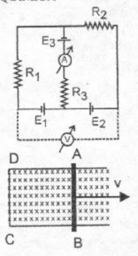

# Recuperatorio segundo examen parcial Física II — Ingeniería Química

## Problema 1

Dado el circuito de la figura, determinar los valores de los instrumentos de
medida ilustrados

Datos: E1=12V, E2=6V, E3=12 V, R1=30 ohm, R2=50 ohm, R3=40 ohm.

## Problema 2

Un cable coaxial está formado por un conductor cilíndrico macizo de radio R1,
rodeado de un cilindro conductor coaxial de radio interno R2 y radio externo R3.
Por el cilíndrico interno circula una corriente i que regresa por el conductor
externo. Demuestre analíticamente cuanto vale el campo en el exterior.

## Problema 3

La barra conductora AB de la figura de longitud L=40 cm, hace contacto con las
guías metálicas AD y BC. a) El sistema se encuentra en un campo magnético
uniforme entrante de densidad de flujo 450 mWb/m², perpendicular al plano de la
figura. Calcular a) la magnitud de la fem inducida en la barra, cuando se mueve
hacia la derecha con una velocidad de 5 m/seg. b) El trabajo necesario para
mantener la corriente circulando.

## Procedencia y observaciones de transcripción

- Original:
  `2015/480938-Modelos de parcial FISICA II actualizado 060813(0).pdf`, página
  19, examen superior, identificado INGENIERIA QUIMICA. Sin fecha propia
  visible.
- SHA-256: `1555e295ed06e6a3872614be84854c0e0af3e8455048ca7e5bcbc4383490653e`.
- Compilación: Sampallo Guillermo, Rodríguez Ulises y Cleva Mario; versión 1.1,
  04/08/2010 en carátula.
- Herramientas: OCRmyPDF español sobre copia con `--force-ocr`, PyMuPDF4LLM,
  Poppler y cotejo visual de todos los enunciados, valores y diagramas. Figuras
  originales por render PyMuPDF. No se completan campos ni se resuelven
  ejercicios.
- Se conserva «Por el cilíndrico interno» y la repetición del inciso a) del
  problema3, sin reinterpretar la consigna de trabajo.
