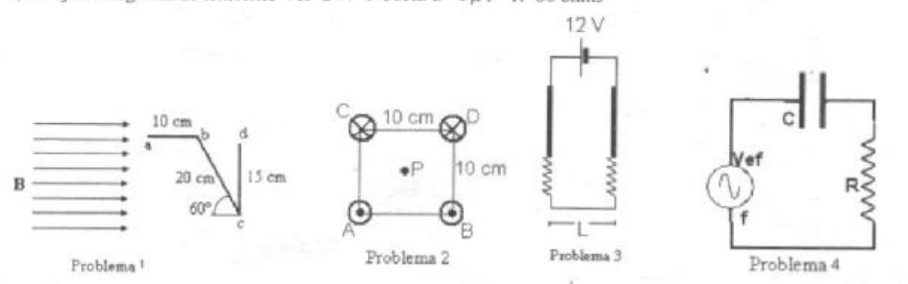

# Física II — ISI: 1º parcial recuperatorio, alambres, resortes y RC

NOMBRE Y APELLIDO: \_\_\_\_\_\_\_\_\_\_\_\_\_\_\_\_\_\_\_\_

## Problema Nº 1

En el esquema de la figura hallar el módulo y sentido de la fuerza en cada tramo
de alambre por el cual circula una corriente de 1 A desde a hacia d. Siendo B=5
T

## Problema Nº 2

En la figura vemos cuatro conductores muy largos y paralelos que transportan
cada uno, una corriente de 5 Amp. En A y B las corrientes son salientes en C y D
son entrantes. Calcular el campo de inducción magnética en el punto P.

## Problema Nº 3

Un alambre recto de 10 g y 5 cm se suspende con dos resortes idénticos de tal
manera que forman un circuito mostrado en la figura. La resistencia del mismo es
de 15 Ω. Los resortes están alargados debidos al peso en 0.5 cm. ¿Cuál es la
magnitud y sentido del campo magnético que se requiere para eliminar el
alargamiento de los resortes?

## Problema Nº 4

Para el circuito de la figura determinar a) la impedancia b) la diferencia de
potencial sobre R y sobre C c) dibuje el diagrama de tensiones Vef=24V f=50Hz
C=5μF R=80 ohms

## Procedencia y observaciones de transcripción

- Original:
  `2015/480938-Modelos de parcial FISICA II actualizado 060813(0).pdf`, página
  17, examen superior. Se conserva el encabezado «1º PARCIAL-RECUPERATORIO»,
  aunque el contenido trata magnetismo y alterna.
- SHA-256: `1555e295ed06e6a3872614be84854c0e0af3e8455048ca7e5bcbc4383490653e`.
- Compilación: Sampallo Guillermo, Rodríguez Ulises y Cleva Mario; versión 1.1,
  04/08/2010 en carátula.
- Herramientas: OCRmyPDF español sobre copia con `--force-ocr`, PyMuPDF4LLM,
  Poppler y cotejo visual de los cuatro enunciados, datos y diagramas. Figuras
  originales por render PyMuPDF. No se completan campos ni se resuelven
  ejercicios.
