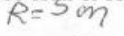
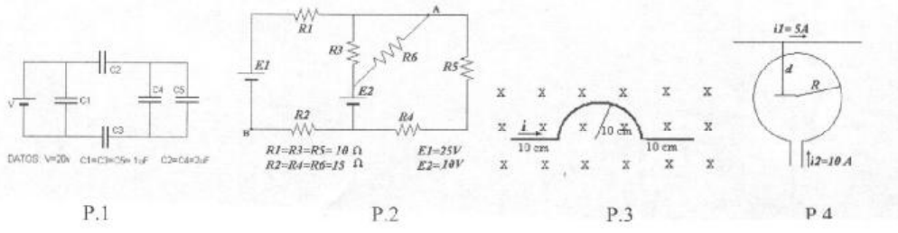

# Física II — ISI: 2º parcial recuperatorio, tema A

NOMBRE Y APELLIDO: \_\_\_\_\_\_\_\_\_\_\_\_\_\_\_\_\_\_\_\_

## Problema 1

Dado el circuito de la figura calcular: la carga y la diferencia de potencial en
cada capacitor y el valor que deberá tener la fuente para que en el capacitor C4
se acumule una carga de $`Q=1{,}7\times10^{-6}\ \mathrm{c}`$

## Problema 2

Hallar las corrientes que atraviesan cada una de las resistencias y la
diferencia de potencial A - B.-

## Problema 3

Encontrar el módulo, la dirección y sentido de la fuerza que aparece sobre los
diferentes tramos del alambre de la figura. Datos: B=300 Gauss, y la corriente
en el alambre es de 16 amp

## Problema 4

Hallar la distancia d a la que debe estar el conductor recto de la figura para
que el campo magnético en el centro de la espira sea cero.-

Dato manuscrito: $`R=5\ \mathrm{m}`$ \*.

## Procedencia y observaciones de transcripción

- Original:
  `2015/480938-Modelos de parcial FISICA II actualizado 060813(0).pdf`, página
  14, examen superior ISI tema A. El tema B inferior se conserva por separado.
- SHA-256: `1555e295ed06e6a3872614be84854c0e0af3e8455048ca7e5bcbc4383490653e`.
- Compilación: Sampallo Guillermo, Rodríguez Ulises y Cleva Mario; versión 1.1,
  04/08/2010 en carátula. El examen no imprime fecha propia.
- Herramientas: OCRmyPDF español sobre copia con `--force-ocr`, PyMuPDF4LLM,
  Poppler y cotejo visual de enunciados, datos y diagramas, con ampliación del
  exponente−6 de la carga. Figuras y anotación manuscrita conservadas por render
  PyMuPDF.
- La anotación manuscrita del problema 4 se conserva como imagen del original.
  El 25/10/2026 el usuario indicó transcribir el radio en metros, manteniendo
  explícita la posible lectura en centímetros. No se resuelve el ejercicio.

\* La unidad manuscrita no se distingue con certeza: se transcribe el radio como
5 metros, pero el original podría indicar 5 centímetros (cm).
