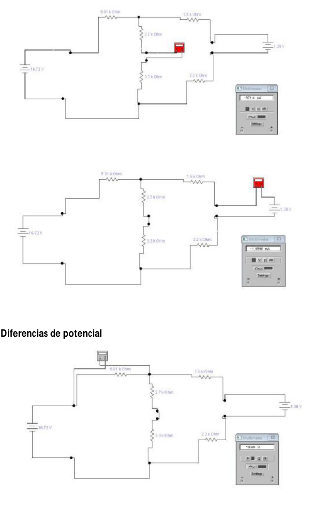
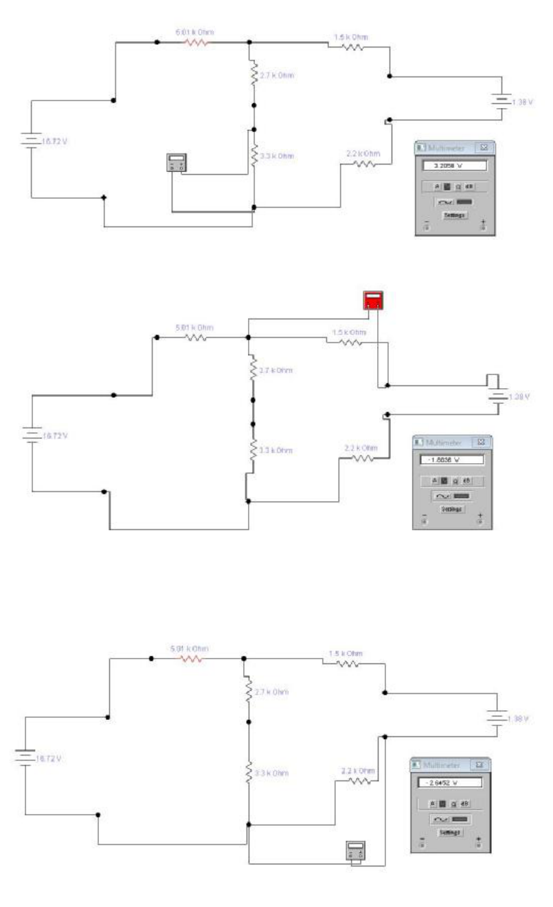
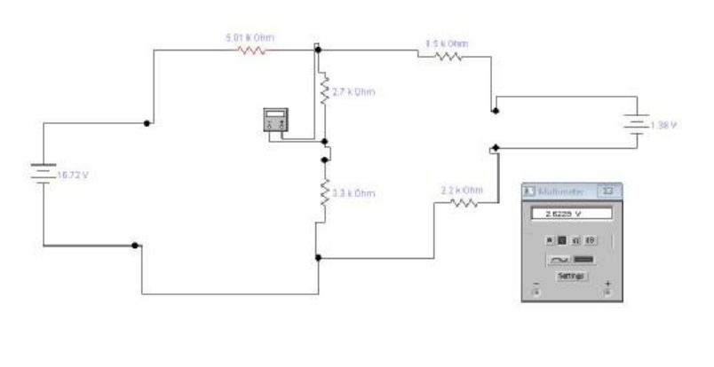

# Leyes de Kirchoff — informe del grupo 6: simulación del circuito II

## Corrientes y Diferencias de potencial

## Procedencia y alcance

- Original: `2015/L6 Kirchoff G6 Aprobado.pdf`, páginas 13–14 completas y figura
  inicial de la 15, antes de «CIRCUITO III». SHA-256:
  `534403fde9ec3209246d64553b98096c417d8f500a5a5cc4424914482ac9ac79`.
- Siete capturas cotejadas visualmente, conservadas en tres recortes de sus
  páginas originales: dos de corrientes y cinco de tensiones. La primera
  corriente está en página 12 y se conserva en el apunte de cálculos.
- Se mantienen las conexiones, signos, valores de resistencias y lecturas de las
  pantallas, sin redibujar ni uniformar sus cifras con las ecuaciones. Algunas
  capturas muestran 6.01 kOhm y otras 5.01 kOhm en la rama izquierda; se
  conserva la variante tal como está en cada imagen.
- No se ejecutó el simulador ni se infieren dígitos que no permita leer la
  resolución de las capturas. Los recortes no sustituyen ecuaciones por imagen:
  el circuito III de la página 15 se transcribe por separado.
- El año corresponde a la carpeta; las páginas no tienen fecha impresa.

[Cálculos del circuito II](kirchhoff-informe-grupo-6-circuito-dos.md).
