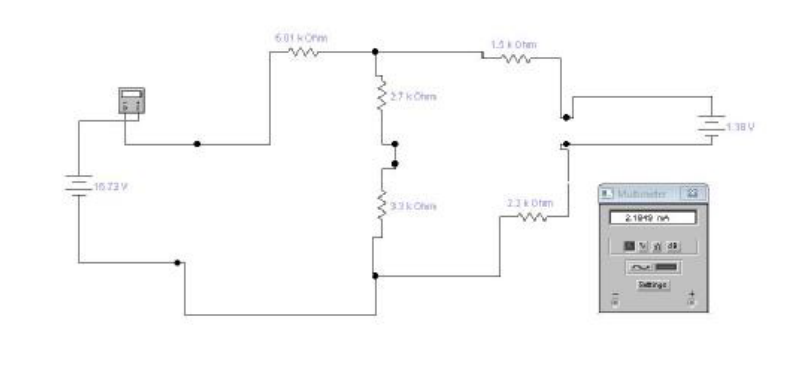

# Leyes de Kirchoff — informe del grupo 6: circuito II

## CIRCUITO II

### Ecuación de Nodos

```math
I_1-I_2-I_3=0
```

### Ecuación de Mallas

III)

```math
(R)I_1+(R_1+R_2)I_2=E_1
```

```math
(5{,}01\,\mathrm{k}\Omega)I_1+(6\,\mathrm{k}\Omega)I_2=16{,}72\mathrm V
```

IV)

```math
(-R_1-R_2)I_2+(R_3+R_4)I_3=-E_2
```

```math
(-6\,\mathrm{k}\Omega)I_2+(3{,}7\,\mathrm{k}\Omega)I_3=-1{,}38\mathrm V
```

### Sistema de Ecuaciones INTENSIDADES

```math
\begin{cases}
I_1-I_2-I_3=0\\
(3{,}02\,\mathrm{k}\Omega)I_1+(6\,\mathrm{k}\Omega)I_3=16{,}72\mathrm V\\
(-6\,\mathrm{k}\Omega)I_1+(3{,}7\,\mathrm{k}\Omega)I_3=-1{,}38\mathrm V
\end{cases}
```

```math
\begin{aligned}
I_1&=2{,}17\,\mathrm{mA}\\
I_2&=0{,}97\,\mathrm{mA}\\
I_3&=1{,}20\,\mathrm{mA}
\end{aligned}
```

### Ecuaciones para VΔ

Ecuación para Vac

```math
\begin{aligned}
V_a+R.I_1&=V_c\\
V_c-V_a&=R.I_1\\
V_c-V_a&=5{,}01\mathrm{k}\Omega.2{,}17\,\mathrm{mA}\\
V_c-V_a&=10{,}87\mathrm V
\end{aligned}
```

Ecuación para Vcd

```math
\begin{aligned}
V_c+R_1.I_2&=V_d\\
V_d-V_c&=R_1.I_2\\
V_d-V_c&=2{,}7\mathrm{k}\Omega.0{,}97\,\mathrm{mA}\\
V_d-V_c&=2{,}62\mathrm V
\end{aligned}
```

Ecuación para Veb

```math
\begin{aligned}
V_e+R_2.I_2&=V_b\\
V_b-V_e&=R_2.I_2\\
V_b-V_e&=3{,}3\mathrm{k}\Omega.0{,}97\,\mathrm{mA}\\
V_b-V_e&=3{,}20\mathrm V
\end{aligned}
```

Ecuación para Vgb

```math
\begin{aligned}
V_g-R_4.I_3&=V_b\\
V_b-V_g&=-R_4.I_3\\
V_b-V_g&=-2{,}2\mathrm{k}\Omega.1{,}20\,\mathrm{mA}\\
V_g-V_b&=-2{,}64\mathrm V
\end{aligned}
```

Ecuación para Vcf

```math
\begin{aligned}
V_c-R_3.I_3&=V_f\\
V_f-V_c&=-R_3.I_3\\
V_f-V_c&=-1{,}5\mathrm{k}\Omega.1{,}20\,\mathrm{mA}\\
V_f-V_c&=-1{,}80\mathrm V
\end{aligned}
```

## Corrientes



## Procedencia y observaciones

- Original: `2015/L6 Kirchoff G6 Aprobado.pdf`, páginas 11–12 de 20. SHA-256:
  `534403fde9ec3209246d64553b98096c417d8f500a5a5cc4424914482ac9ac79`.
- Ambas páginas cotejadas visualmente contra Poppler/PyMuPDF4LLM; todas las
  expresiones se conservaron sin recalcular. La página 12 inicia las capturas de
  corrientes: aquí se conserva su primera figura completa.
- Se mantiene la numeración III/IV de las mallas y las discrepancias del
  sistema: usa 3,02 kΩ frente a 5,01 kΩ de la sustitución de malla; I3 en el
  segundo término de la segunda fila e I1 en el primer término de la tercera
  fila.
- Se mantiene la inversión Vb−Vg a Vg−Vb en la última línea de Vgb.
- La captura muestra 6.01 kOhm en la resistencia superior izquierda, mientras
  los cálculos de este bloque usan 5,01 kΩ. Se conserva la figura original sin
  modificar sus etiquetas para hacerlas coincidir con las ecuaciones.
- La fecha no consta en estas páginas; 2015 corresponde a la carpeta. Las
  capturas restantes de páginas 13–15 no se incluyen en este lote.

[Circuito I](kirchhoff-informe-grupo-6-circuito-uno.md).
