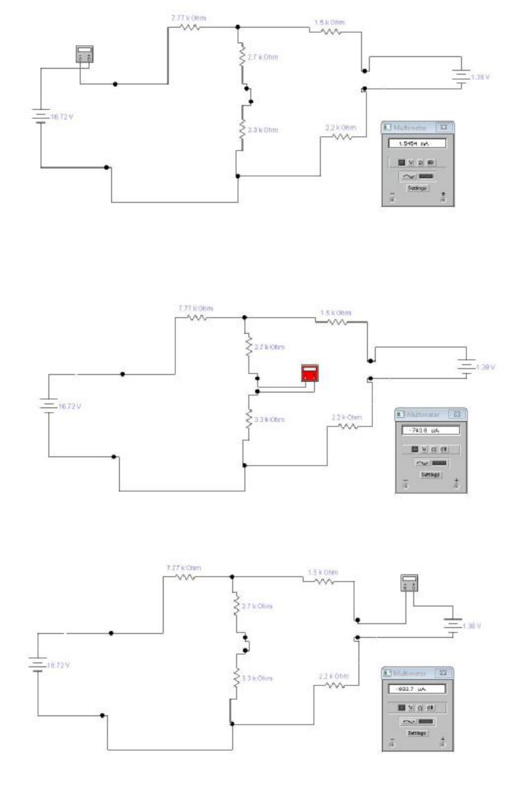
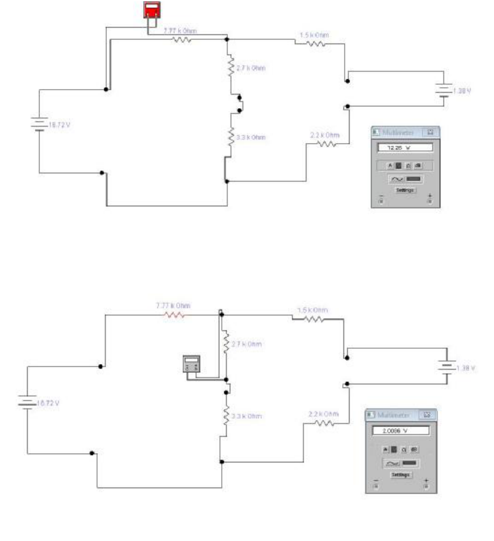
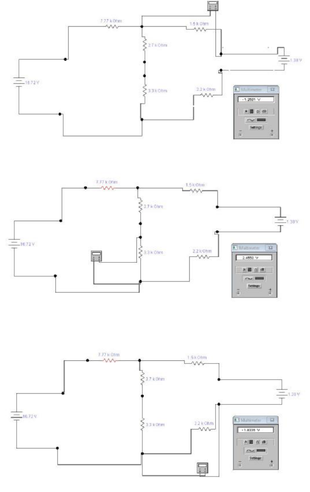

# Leyes de Kirchoff — informe del grupo 6: simulación del circuito III

## Corrientes

## Diferencias de potencial

## Procedencia y alcance

- Original: `2015/L6 Kirchoff G6 Aprobado.pdf`, páginas 17–19 de 20. SHA-256:
  `534403fde9ec3209246d64553b98096c417d8f500a5a5cc4424914482ac9ac79`.
- Ocho capturas cotejadas visualmente, conservadas completas en tres recortes:
  tres de corrientes y cinco de tensiones. Se mantienen componentes, conexiones,
  polaridades, signos y lecturas de los multímetros, sin redibujar ni
  recalcular.
- Se compararon las páginas renderizadas y los límites de los objetos de imagen
  del PDF. La página 19 continúa las diferencias de potencial sin repetir
  título.
- La resolución original limita los últimos dígitos de algunas pantallas; no se
  infieren ni se reemplazan por las cifras de los cálculos. No se ejecutó el
  simulador ni se verificó el funcionamiento del circuito fuera del documento.
- El año corresponde a la carpeta; estas páginas no tienen fecha impresa.

[Cálculos del circuito III](kirchhoff-informe-grupo-6-circuito-tres.md).
