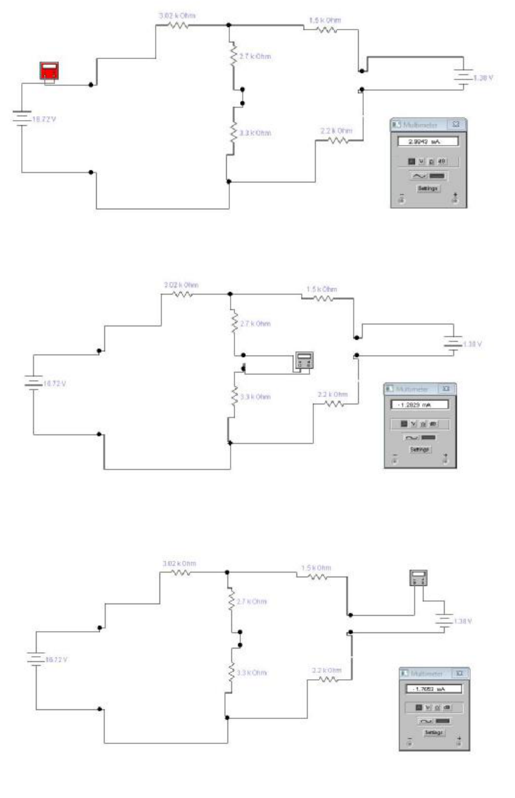
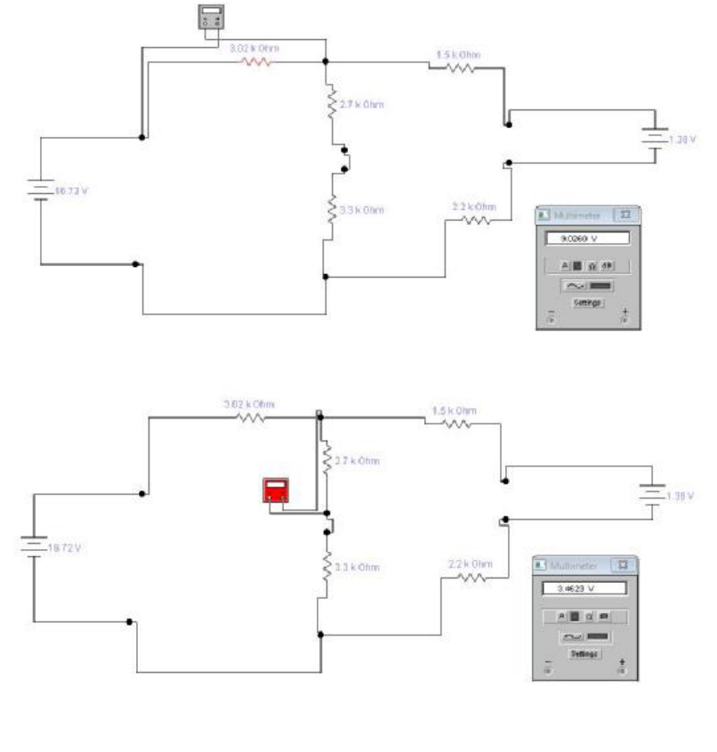
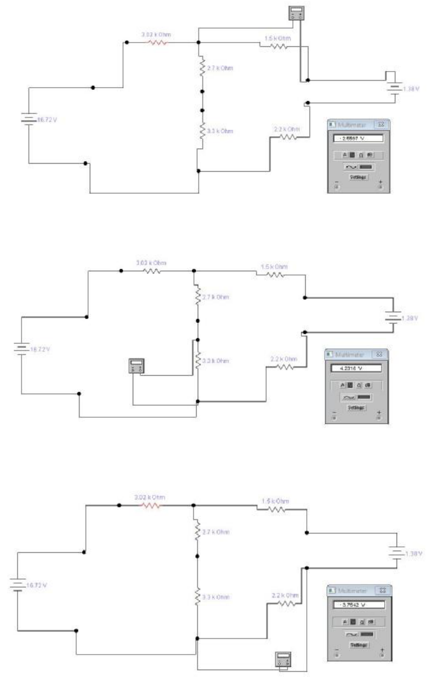

# Leyes de Kirchoff — informe del grupo 6: simulación del circuito I

## Corrientes

## DIFERENCIAS DE POTENCIAL

## Procedencia y alcance

- Original: `2015/L6 Kirchoff G6 Aprobado.pdf`, páginas 8–10 de 20. SHA-256:
  `534403fde9ec3209246d64553b98096c417d8f500a5a5cc4424914482ac9ac79`.
- Las tres páginas contienen ocho capturas del simulador: tres de corrientes y
  cinco de tensiones. Se conservan completas, con conexiones, valores de
  componentes, polaridad y pantallas; no se redibujan ni se ejecuta el software.
- La página 10 continúa las diferencias de potencial sin repetir el título. Se
  cotejaron las tres páginas renderizadas y los límites de sus imágenes; los
  recortes reúnen bandas originales sin incluir márgenes vacíos.
- Las pantallas y etiquetas pertenecen a las capturas. Su resolución original
  limita la lectura de los últimos dígitos; no se sustituyen por resultados
  calculados ni por los valores redondeados del apunte anterior.
- El año corresponde a la carpeta, no a una fecha impresa en estas páginas.

[Cálculos y mediciones del circuito I](kirchhoff-informe-grupo-6-circuito-uno.md).
