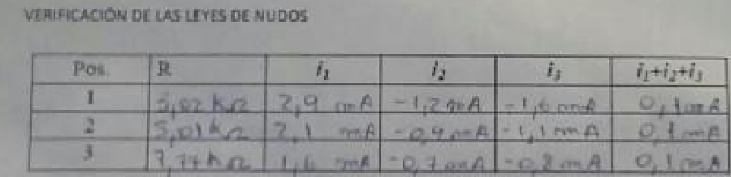
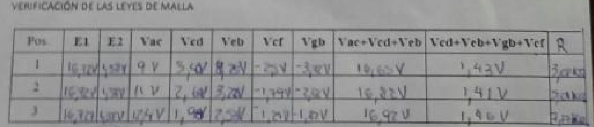

# Leyes de Kirchoff — informe del grupo 6: hoja manuscrita de datos

Hoja de datos:

UNIVERSIDAD TECNOLOGICA NACIONAL

FACULTAD REGIONAL RESISTENCIA

CÁTEDRA: FÍSICA II

TRABAJO DE LABORATORIO Nº 6

TEMA: Comprobación experimental de las Leyes de Kirchoff.-

HOJA DE DATOS

CURSO: ISI “A”

GRUPO Nº: 6

FECHA: 02/06/16

## VERIFICACIÓN DE LAS LEYES DE NUDOS

| Pos. | R | i1 | i2 | i3 | i1+i2+i3 |
| -- | -- | -- | -- | -- | -- |
| 1 | 3,02 kΩ | 2,9 mA | -1,2 mA | -1,6 mA | 0,1 mA |
| 2 | 5,01 kΩ | 2,1 mA | -0,9 mA | -1,1 mA | 0,1 mA |
| 3 | 7,77 kΩ | 1,6 mA | -0,7 mA | -0,8 mA | 0,1 mA |

## VERIFICACIÓN DE LAS LEYES DE MALLA

| Pos | E1 | E2 | Vac | Vcd | Veb | Vcf | Vgb | Vac+Vcd+Veb | Vcd+Veb+Vgb+Vcf | R |
| -- | -- | -- | -- | -- | -- | -- | -- | -- | -- | -- |
| 1 | 16,72 V | 1,38 V | 9 V | [ilegible] | [ilegible] | -2,5 V | [ilegible] | 16,65 V | 1,43 V | 3,02 kΩ |
| 2 | 16,72 V | 1,38 V | 11 V | 2,6 V | 3,22 V | -1,79 V | -2,62 V | 16,82 V | 1,41 V | 5,01 kΩ |
| 3 | 16,72 V | 1,38 V | 12,4 V | [ilegible] | 2,53 V | -1,24 V | -1,82 V | 16,92 V | 1,46 V | 7,77 kΩ |

[Descargar tabla de mallas con sus píxeles nativos, sin pérdida ni reescalado](../../../resources/2015/kirchhoff-informe-grupo-6/hoja-datos-mallas-nativa.png).

## Procedencia y límites de lectura

- Original: `2015/L6 Kirchoff G6 Aprobado.pdf`, página 5 de 20. SHA-256:
  `534403fde9ec3209246d64553b98096c417d8f500a5a5cc4424914482ac9ac79`.
- OCRmyPDF en español sobre una copia de esta página, con OCR forzado porque el
  título «Hoja de datos» ya tiene texto y la fotografía no; el original no se
  modifica. El OCR no recupera fielmente la escritura. Se cotejaron todas las
  celdas visualmente, con ampliaciones de fecha, nudos y mallas.
- Se conservan las unidades manuscritas en las celdas y la columna R añadida a
  la derecha de la segunda tabla. No se copia la tabla mecanografiada de página
  6 para completar la fotografía: no acredita cada trazo de esta hoja.
- El 25/10/2026 el usuario decidió conservar la hoja original y las cuatro
  celdas como `[ilegible]`: Vcd, Veb y Vgb de posición 1, y Vcd de posición 3.
  No se adoptan las aproximaciones del agente principal ni del subagente.
- La tabla nativa descargable tiene 497 × 85 píxeles. Es un recorte de la foto
  JPEG incrustada (xref 34), de 533 × 350 píxeles: origen (25, 100), sin
  reescalado, filtros ni nueva compresión JPEG. Se guardó como PNG sin pérdida y
  se comprobó fila a fila que conserva los mismos píxeles decodificados. SHA-256
  del PNG: `b4cb93c70933e3276d357209a44c07668d7f6cb774b05fed53f01ab1d941cb5a`.
- Las dos fotos JPEG incrustadas, xrefs 33 y 34, se conservan también sin
  modificar sus bytes en la caché local `20261025-kirchhoff-originales`, junto
  con sus SHA-256 y dimensiones en `procedencia.json`. El PDF original sigue
  intacto en OneDrive. Los recortes ampliados facilitan la lectura, pero no
  agregan detalle al original; para futuros OCR se conserva la copia nativa.
- La fecha del campo es 02/06/16. Se omiten explícitamente nombres y firmas
  manuscritos de los campos nominales, firma docente y anotación junto a ella.
  Los autores declarados en portada están en el apunte de fundamentos. Los
  recortes publicados solo contienen las tablas; el original completo se
  conserva en la caché y en OneDrive.
- Todas las páginas del informe están revisadas; estas cuatro celdas impiden
  declarar completa la lectura manuscrita. La carpeta 2015 no es el año de la
  fecha manuscrita de esta hoja.

[Resultados mecanografiados y circuito I](kirchhoff-informe-grupo-6-circuito-uno.md).
