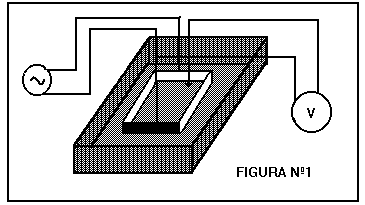
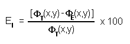

<!-- markdownlint-disable MD060 -->

# Trabajo de laboratorio Nº 2: Potencial eléctrico. Ecuación de Laplace (compilado)

Universidad Tecnologica Nacional. Facultad Regional Resistencia. Cátedra: Física
II.

## Tema: potencial eléctrico. ecuación de laplace

**OBJETO DE LA EXPERIENCIA:** Verificar experimentalmente la ecuación de Laplace
en dos dimensiones.

**RESUMEN:** Se calcula teóricamente la distribución de potencial de una región
cuadrada con condiciones de contorno conocida, empleando la ecuación de Laplace
expresada mediante la aproximación en diferencia finita. La región a estudiar se
divide en un reticulado ortogonal con un número finito de intersecciones. El
método de cálculo es iterativo permitiendo el empleo de un utilitario tipo
planilla de cálculo, obteniéndose la distribución del potencial eléctrico, que
puede ser representado en un gráfico.

La verificación experimental, se monta la misma experiencia que se realiza para
el tradicional práctico de mapeo de campo eléctrico, pero en este caso, se
delimita una región cuadrada, por ejemplo 8 cm X 8 cm mediante dos electrodos
conectados a una fuente. En la región bajo estudio se hace un reticulado
rectangular con paso constante, por ejemplo de 1 cm, y en cada intersección, se
mide el potencial eléctrico respecto de uno de los electrodos con un voltímetro,
representándose gráficamente los datos experimentales.

Se comparan los datos y las gráficas comprobándose la semejanza de los
resultados y por lo tanto la verificación de la validez de la ecuación de
Laplace.

## Equipamiento necesario

Para una estación de trabajo:

1 transformador 220/12 voltios

1 recipiente de vidrio con fondo plano (si es rectangular mínimo12 cmX14cm si es
circular, diámetro mínimo 12 cm).

2 electrodos uno en forma de "U" y otro en forma de "I" de longitud 10 cm

1 hoja de papel milimetrado

Conectores

1 Voltímetro CA (preferentemente digital p/alta impedancia)

Para el cálculo numérico:

PC 286 con monitor VGA

Utilitario Planilla de cálculo con posibilidad de graficar en 3D

**FUNDAMENTOS TEORICOS:** En una región en dos dimensiones desprovista de cargas
cuyo contorno tiene un potencial eléctrico determinado, la teoría predice que el
potencial eléctrico en el interior es solución de la ecuación de Laplace
(problema de Dirichlet).

Vamos a obtener la ecuación en diferencia finita equivalente a la de Laplace en
dos dimensiones. Para ello suponemos que la función potencial eléctrico puede
ser desarrollada en serie de Taylor alrededor de un punto (x,y) entonces

```math
\Phi(x+h,y)\cong\Phi(x,y)+h\frac{\partial\Phi(x,y)}{\partial x}+\frac{h^2}{2}\frac{\partial^2\Phi(x,y)}{\partial x^2}
```

(1)

```math
\Phi(x-h,y)\cong\Phi(x,y)-h\frac{\partial\Phi(x,y)}{\partial x}+\frac{h^2}{2}\frac{\partial^2\Phi(x,y)}{\partial x^2}
```

(2)

sumando (1) y (2) y agrupando, obtenemos

```math
\frac{\partial^2\Phi(x,y)}{\partial x^2}=\frac{\Phi(x+h,y)-2\Phi(x,y)+\Phi(x-h,y)}{h^2}
```

(3)

de igual manera se obtiene la derivada segunda para y

```math
\frac{\partial^2\Phi(x,y)}{\partial y^2}=\frac{\Phi(x,y+h)-2\Phi(x,y)+\Phi(x,y-h)}{h^2}
```

(4)

sumando ahora la (3) y la (4) resulta

```math
\frac{\partial^2\Phi(x,y)}{\partial x^2}+\frac{\partial^2\Phi(x,y)}{\partial y^2}=\frac{\Phi(x+h,y)-4\Phi(x,y)+\Phi(x-h,y)+\Phi(x,y+h)+\Phi(x,y-h)}{h^2}=0
```

de donde se despeja la función potencial Φ(x,y) resultando

```math
\Phi(x,y)\cong\frac{\Phi(x+h,y)+\Phi(x-h,y)+\Phi(x,y+h)+\Phi(x,y-h)}{4}
```

(5)

El potencial en un punto es el promedio de los potenciales en los puntos
circundantes.

La región donde se aplicará la (5), la supondremos de forma cuadrada, se
retícula empleando una malla lo suficientemente fina formada con líneas
ortogonales entre sí. Se asigna inicialmente a los puntos de intersección
interiores el valor cero y los puntos de la malla que están en el contorno toman
el valor del potencial correspondiente. Se inicia el cálculo, en forma
sistemática desde un vértice de la región, concluida la evaluación de todos los
puntos, se reinicia el proceso. Puede observarse, que después de varios pasos,
los potenciales convergen hacia determinados valores. Esto puede continuarse
hasta que la diferencia del valor del potencial en un punto entre dos pasos
sucesivos sea menor que un valor previamente definido.

**DESCRIPCIÓN DEL DISPOSITIVO:** En un recipiente de vidrio transparente apoyado
sobre un papel milimetrado, se coloca convenientemente dos electrodos del mismo
metal, uno con forma de " U " y otro con forma de " I " , representando un
contorno cuadrado( 10 cm X 10 cm), sin tocarse. Se agrega agua potable. Se
conectan a una fuente de CA de 12 voltios. Un voltímetro se conecta de modo que
un borne haga contacto con un de los electrodos y el otro a través de una punta
de prueba medirá los potenciales en el recinto limitados por los electrodos
siguiendo la retícula del papel milimetrado.

Es posible también delimitar regiones de otra forma, cambiando los electrodos,
por ejemplo, " $`\lfloor`$ " y " $`\rceil`$ " ( ángulo recto hacia abajo).

**MARCHA DE LA EXPERIENCIA:** Montado el dispositivo de la figura Nº1, con la
punta de prueba se irá registrando los valores de los potenciales según su
posición determinada por el reticulado del papel milimetrado, es aconsejable,
hacerlo con paso de 5mm. Cuidando en cada registro que la punta de prueba se
encuentre siempre perpendicular a la superficie.

Se puede completar el siguiente cuadro, con los datos experimentales, de modo
que estén posicionados de acuerdo a sus coordenadas espaciales.

DATOS EXPERIMENTALES

Φ(x,y) en voltios y longitudes en cm

|  | x=0 | x=1 | x=2 | x=3 | x=4 | x=5 | x=6 | x=7 | x=8 |
| :- | -- | -- | -- | -- | -- | -- | -- | -- | -- |
| y=0 | 12 | 0,00 | 0,00 | 0,00 | 0,00 | 0,00 | 0,00 | 0,00 | 0,00 |
| y=1 | 12 |  |  |  |  |  |  |  | 0,00 |
| y=2 | 12 |  |  |  |  |  |  |  | 0,00 |
| y=3 | 12 |  |  |  |  |  |  |  | 0,00 |
| y=4 | 12 |  |  |  |  |  |  |  | 0,00 |
| y=5 | 12 |  |  |  |  |  |  |  | 0,00 |
| y=6 | 12 |  |  |  |  |  |  |  | 0,00 |
| y=7 | 12 |  |  |  |  |  |  |  | 0,00 |
| y=8 | 12 | 0,00 | 0,00 | 0,00 | 0,00 | 0,00 | 0,00 | 0,00 | 0,00 |

Una vez completo el cuadro se puede cargar los valores en un utilitario como una
planilla de cálculo y representarlos en un gráfico de 3-D.

En la misma planilla de cálculo, en una hoja de trabajo se define el contorno de
una región de celdas compatible con el cuadro anterior. En las celdas externas
de la región van los valores de los potenciales de los electrodos y en las
celdas interiores la fórmula (5). Eligiendo la opción de cálculo iterativo se
determina el valor del potencial en las celdas interiores.



Con estos datos se hace la representación gráfica correspondiente

**CALCULO DE ERRORES**: Se efectúa haciendo el cálculo del error porcentual
punto a punto.

```math
E_I=\frac{[\Phi_T(x,y)-\Phi_E(x,y)]}{\Phi_T(x,y)}\times100
```

DATOS TEÓRICOS

Φ(x,y) en voltios y longitudes en cm

|  | x=0 | x=1 | x=2 | x=3 | x=4 | x=5 | x=6 | x=7 | x=8 |
| :- | -- | -- | -- | -- | -- | -- | -- | -- | -- |
| y=0 | 0.00 | 0,00 | 0,00 | 0,00 | 0,00 | 0,00 | 0,00 | 0,00 | 0,00 |
| y=1 | 10.0 |  |  |  |  |  |  |  | 0,00 |
| y=2 | 10.0 |  |  |  |  |  |  |  | 0,00 |
| y=3 | 10.0 |  |  |  |  |  |  |  | 0,00 |
| y=4 | 10.0 |  |  |  |  |  |  |  | 0,00 |
| y=5 | 10.0 |  |  |  |  |  |  |  | 0,00 |
| y=6 | 10.0 |  |  |  |  |  |  |  | 0,00 |
| y=7 | 10.0 |  |  |  |  |  |  |  | 0,00 |
| y=8 | 0.00 | 0,00 | 0,00 | 0,00 | 0,00 | 0,00 | 0,00 | 0,00 | 0,00 |

**CONCLUSIONES:** En el informe haga una comparación entre la gráfica que se
obtuvo a partir de datos experimentales y la que surge de la representación de
los valores de potencial calculados a partir de la ecuación de Laplace en
diferencia finita y obtenga conclusiones.

## Bibliografía

Física - Fundamentos y aplicaciones -Eisberg Lerner - Mcgraw-Hill (1988)

Campos y Ondas - Ramo-Whinnery-Van Duzer - John Wiley& Son (1965)

## Trabajo de laboratorio Nº 2: Hoja de datos

TEMA: POTENCIAL ELÉCTRICO. ECUACION DE LAPLACE

<table>
<tr><th rowspan="4">CURSO:</th><th rowspan="8">GRUPO Nº:</th><th colspan="2">INTEGRANTES</th></tr>
<tr><th>NOMBRE Y APELLIDO</th><th>FIRMA</th></tr>
<tr><td></td><td></td></tr>
<tr><td></td><td></td></tr>
<tr><th rowspan="4">FECHA:</th><td></td><td></td></tr>
<tr><td></td><td></td></tr>
<tr><td></td><td></td></tr>
<tr><td></td><td></td></tr>
</table>

DATOS EXPERIMENTALES

Ø(x,y) en voltios y longitudes en cm

|  | X=0 | X=1 | X=2 | X=3 | X=4 | X=5 | X=6 | X=7 | X=8 | X=9 | X=10 |
| -- | -- | -- | -- | -- | -- | -- | -- | -- | -- | -- | -- |
| Y=0 |  |  |  |  |  |  |  |  |  |  |  |
| Y=1 |  |  |  |  |  |  |  |  |  |  |  |
| Y=2 |  |  |  |  |  |  |  |  |  |  |  |
| Y=3 |  |  |  |  |  |  |  |  |  |  |  |
| Y=4 |  |  |  |  |  |  |  |  |  |  |  |
| Y=5 |  |  |  |  |  |  |  |  |  |  |  |
| Y=6 |  |  |  |  |  |  |  |  |  |  |  |
| Y=7 |  |  |  |  |  |  |  |  |  |  |  |
| Y=8 |  |  |  |  |  |  |  |  |  |  |  |
| Y=9 |  |  |  |  |  |  |  |  |  |  |  |
| Y=10 |  |  |  |  |  |  |  |  |  |  |  |

FIRMA DEL PROFESOR:

## Procedencia y diferencias de versión

Fuente: `2015/FISICA II - EXPERIENCIAS DE LABORATORIOS.pdf`, páginas9–14,
cotejadas completas. Se conservan las series de Taylor, diferencias finitas y
cálculo de errores, montaje, tablas experimentales y teóricas9×9 y hoja
vacía11×11. Véase
[el inventario de fuentes](../../../resources/2015/fuentes.md).

Se mantienen contornos experimentales de12 y teóricos de10.0,
notaciones0.00/0,00, tamaños8/10cm y paso5mm frente al ejemplo de1cm. La hoja
tiene Ø(x,y), X/Y mayúsculas, campos de grupo, seis integrantes y firmas; el
cuerpo usa Φ y x/y minúsculas. No se unifican ni se calculan celdas. La
referencia a figura1 y las esquinas de electrodos se conservan como están en el
original.

El índice del error se transcribe I, sin punto, como se observa en el bitmap
original. La misma imagen220×75 está en el DOCX y en el PDF, con idénticos
píxeles decodificados (SHA-256
`e5e621076712eae487e411a955699c73a6e76ee4238ef8c9fd3391740291f7c6`). Se corrige
aquí la lectura i de la transcripción anterior:


