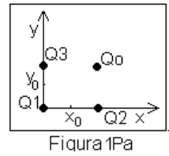
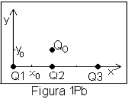
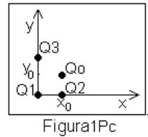
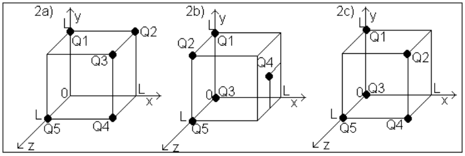
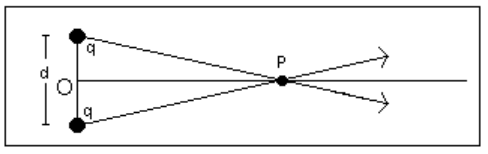

# Ley de Coulomb: guía identificada como 2011

Fuente: `2015/guia de problemas 2011.pdf`, páginas 3–4 de 31. SHA-256:
`5a5ae8ac33a7a3d14d854623015ef14bc0af3dae1651c013aed06567e28a8bca`.

Extracción pdftotext y cotejo visual de ambas páginas. Nueve preguntas y nueve
problemas; tres figuras lógicas, con cinco archivos de imagen y siete paneles.
El año 2011 pertenece al nombre del archivo; se conserva la carpeta canónica
2015\.

## Cuestionario

**1.** ¿Cuál es la carga eléctrica total en un sistema aislado?

**2.** Puede destruirse o crearse una carga eléctrica? Justifique.

**3.** ¿Qué diferencia existe entre un conductor y no conductor?

**4.** Empleando la ley de Coulomb haga una representación gráfica: a)
$`F/q=F(r)`$ con q constante. b) $`F/q=F(q)`$ con r constante

**5.** ¿Cuáles son los valores numéricos y unidades de la constante de
proporcionalidad en la ley de Coulomb en los distintos sistemas de unidades?

**6.** La fuerza electrostática ejercida entre dos cargas puntuales de igual
(distinto) signo es una magnitud vectorial. Hacer un diagrama vectorial en cada
caso.

**7.** Plantear el caso de la fuerza sobre una carga (positiva o negativa)
producida por un conjunto de carga puntuales.

**8.** ¿Que significa que la fuerza de interacción entre cargas sea de "acción a
distancia" ?

**9.** Una varilla cargada atrae pedacitos de polvo de corcho seco los cuales
después de tocar la varilla, a menudo saltan disparados violentamente fuera de
ella. Explique lo que ocurre.

## Problemas

### Problema 1

Calcule la intensidad de la fuerza electrostática que ejerce una carga de Q
=$`10^{-9}`$ C sobre otra carga de igual valor numérico y signo, cuando están
distanciadas: a) r = 1 m, b) r = 0,5 m, c) r = 0,25 m, d) r = 0,125 m. Haga una
representación gráfica de la fuerza en función de la distancia entre las cargas.

### Problema 2

Calcule la intensidad de la fuerza electrostática que ejerce una carga $`Q_1`$ =
1 C sobre otra que está a r = 0,125 m, siendo su carga: a) $`Q_2`$ = $`Q_1`$ / 2
, b) $`Q_2`$ = $`Q_1`$, c) $`Q_2`$ = 2 $`Q_1`$, d) $`Q_2`$ = 4 $`Q_1`$. Haga una
representación gráfica de la fuerza en función de la carga.

### Problema 3

Calcule la fuerza electrostática sobre la carga $`Q_0`$ debido a la presencia de
las cargas $`Q_1`$, $`Q_2`$ y $`Q_3`$ como muestran las figuras 1Pa), 1Pb),
1Pc). Datos: $`Q_o`$ = 1 C, $`Q_1`$ = -2 C, $`Q_2`$ = 2 C, $`Q_3`$ = 1 C,
$`x_o`$ = 1 m, $`y_o`$ = 1 m

Figura 1Pa.

Figura 1Pb.

Figura 1Pc.

### Problema 4

Calcule la fuerza electrostática sobre la carga $`Q_1`$, según se indica en las
figuras 2P a), b) y c). Datos: $`Q_1`$= $`Q_2`$= $`Q_3`$ = 1 C, $`Q_4`$ =
$`Q_5`$ = 2 C, L = 0.2 m.

Figura 2P.

### Problema 5

Un átomo de hidrógeno está constituido por un núcleo (un protón) y un electrón
girando en forma estable en una órbita. Se desea conocer la velocidad del
electrón si el radio de la órbita es $`0{,}528\cdot10^{-8}`$ cm. DATOS: $`m_e`$=
$`9{,}11\cdot10^{-31}`$ Kg. y $`q_p=-q_e`$ = $`1{,}610^{-19}`$ C.

### Problema 6

Una cierta carga Q se divide en dos partes +q y Q - q. ¿Cuál es la relación de Q
a q si las dos partes separadas una cierta distancia deben producir una máxima
repulsión coulombiana entre sí?

### Problema 7

Tres cargas puntuales iguales de Q = 1.$`10^{-4}`$ C están colocadas en los
vértices de un triángulo equilátero de 20 cm de lado. Calcular la fuerza que
actúa sobre cada carga.

### Problema 8

Dos esferas cargadas iguales de dimensiones pequeñas y masa = 1 g, se hallan
colgadas de un soporte mediante hilos de seda de 30 cm de longitud y penden de
un punto en común. Cada hilo forma un ángulo de 5º con la vertical. Calcúlese el
valor de las cargas.

### Problema 9

Dos cargas puntuales idénticas de +q C están separadas por una distancia d (ver
fig. 3P). Calcular el trabajo por unidad de carga necesaria para traer a otra
carga desde un punto muy alejado (infinito) y sobre el plano bisector de la
línea que une las cargas, hasta el punto medio de dicha distancia.

Figura 3P.

## Observaciones de fidelidad

- Esta versión incluye configuraciones tridimensionales y un problema de átomo
  de hidrógeno; no se sustituye por la guía de 2015 o 2019.
- El problema 5 imprime «1,610⁻¹⁹» sin signo de producto antes de 10; se
  conserva la notación, sin corregirla ni resolver el ejercicio.
- La carátula de página 1 dice «PROBLEMAS PROPUESTOS» y página 2 no contiene
  ejercicios; ambas se revisaron visualmente.
