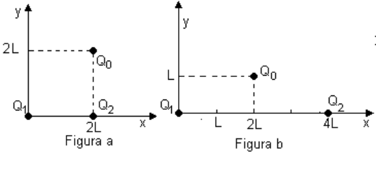
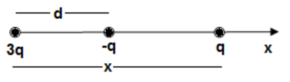
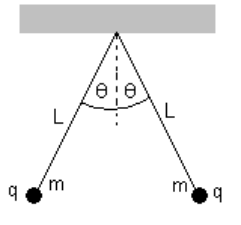
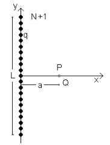
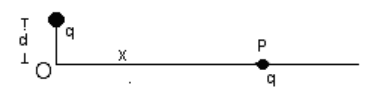

# Guía 1: Ley de Coulomb

Fuente: `2015/GUIA DE PROBLEMAS PROPUESTOS 1ra parte.pdf`, páginas 5–6 de 24.
SHA-256: `efac01b619f48d06286a725a5a7ccc8de7b6baffb2a931515c9dba28ae7e5e5b`.

Extracción pdftotext y recuperación visual de la fórmula; cotejo de ambas
páginas renderizadas. Nueve preguntas, once problemas y cinco figuras
originales.

## Cuestionario

**1.** ¿Cuál es la carga eléctrica total en un sistema aislado?

**2.** Puede destruirse o crearse una carga eléctrica? Justifique.

**3.** ¿Qué diferencia existe entre un conductor y no conductor?

**4.** Empleando la ley de Coulomb haga una representación gráfica: a)
$`F/q=F(r)`$ con q constante. b) $`F/q=F(q)`$ con r constante

**5.** ¿Cuáles son los valores numéricos y unidades de la constante de
proporcionalidad en la ley de Coulomb en los distintos sistemas de unidades?

**6.** La fuerza electrostática ejercida entre dos cargas puntuales de igual
(distinto) signo es una magnitud vectorial. Hacer un diagrama vectorial en cada
caso.

**7.** Plantear el caso de la fuerza sobre una carga (positiva o negativa)
producida por un conjunto de carga puntuales.

**8.** ¿Que significa que la fuerza de interacción entre cargas sea de "acción a
distancia" ?

**9.** Una varilla cargada atrae pedacitos de polvo de corcho seco los cuales
después de tocar la varilla, a menudo saltan disparados violentamente fuera de
ella. Explique lo que ocurre.

## Serie de problemas Nº1

### Problema 1

La expresión de la ley de Coulomb para interacción entre cargas puntuales es

```math
\vec F=k\frac{q_1q_2}{r^2}\vec r_o
```

Determine las unidades de k si las cargas se miden en Coulomb (C), la distancia
r en metros (m) y la fuerza en Newton (N)

### Problema 2

Calcule el módulo de la fuerza electrostática que ejerce un cuerpo puntual
cargado con Q = $`10^{-6}`$C sobre otro igual, cuando están distanciados: a) r1
= 1 m, b) r2 = 0,5m, c) r3 = 0,25 m, d) r4 = 0,125 m. Haga una representación
gráfica de la fuerza en función de la distancia entre los cuerpos.

### Problema 3

Dos cargas puntuales Q1 y Q2 respectivamente, como muestran las figuras 1a), 1b)
ejercen una fuerza electrostática sobre la carga puntual Q0. a) Haga un esquema
del diagrama de fuerzas que ejercen las cargas puntuales Q1 y Q2 sobre Q0 y
encuentre geométricamente su resultante. b) Calcule la fuerza electrostática
sobre el cuerpo puntual con carga Q0 Datos: Q0= 1x$`10^{-5}`$ C, Q1 =
-2x$`10^{-5}`$ C, Q2 = 2x$`10^{-5}`$ C, L = 0.4m.



### Problema 4

Dadas dos pequeñas esferas, una tiene carga positiva 3q y la otra carga negativa
-q están ubicadas como muestra la figura. Una tercera esfera con carga q es
libre para deslizarse solo sobre la horizontal. ¿En qué posición la tercera
esfera está en equilibrio? ¿Puede ser en equilibrio estable?



### Problema 5

Una cierta carga Q se divide en dos partes +q y Q - q. ¿Cuál es la relación de Q
a q si las dos partes separadas una cierta distancia deben producir una máxima
repulsión coulombiana entre si?

### Problema 6

Tres cargas puntuales iguales de Q = 1.$`10^{-4}`$ C. están colocadas en los
vértices de un triángulo equilátero de 20 cm de lado. Calcular la fuerza que
actúa sobre cada carga.

### Problema 7

Si la suma de dos cargas puntuales es 5.$`10^{-5}`$C. Y la fuerza eléctrica
entre ellas cuando están separadas 2 m. es 1 N. ¿Cuál es el valor de cada carga?

### Problema 8

Dos esferas cargadas iguales de dimensiones pequeñas y masa 1g se hallan
colgadas de un soporte mediante hilos de seda de 30 cm de longitud y penden de
un punto en común. Cada hilo forma un ángulo de 5º con la vertical calcúlese el
valor de las cargas



### Problema 9

Dos cuerpos cargados Q1 y Q2 con cargas iguales a $`10^{-3}`$ C están separados
por una distancia d = 0.01 m. ¿Qué valor de masa debería tener el cuerpo de
carga Q2 para que su peso sea igual en magnitud a la fuerza eléctrica que existe
entre ambos cuerpos?

### Problema 10

A lo largo de la longitud L del eje y se colocan N cargas puntuales
equiespaciadas simétricas respecto del eje horizontal. a) Calcular la fuerza
sobre una carga puntual Q ubicada en el eje horizontal como muestra la figura.
b) Si L =10 cm, N = 101 (para incluir la que coincide con el centro de
coordenadas) a =10 cm y el valor de las cargas es $`10^{-11}`$C, determinar la
magnitud de la fuerza. c) Calcule la fuerza sin incluir la carga del centro de
coordenadas.



### Problema 11

Una carga puntual de +q C está a una distancia d (ver figura) del origen O.
Calcular el trabajo por unidad de carga necesario para traer a otra carga +q
desde un punto muy alejado (infinito) y a lo largo del eje x hasta el punto O.



## Nota de transcripción

La versión 2015 incluye un problema 8 sobre dos esferas de masa 1 g suspendidas
por hilos de 30 cm; la guía 2019 posee diez problemas. Se conserva cada versión
por separado. Los diagramas pertenecen a sus enunciados originales; no se
resuelven ejercicios.
