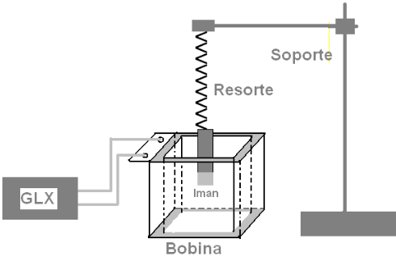

# Trabajo de laboratorio Nº 9 bis: Ley de Faraday

Universidad Tecnologica Nacional. Facultad Regional Resistencia. Cátedra: Física
II.

**OBJETIVOS:** Verificar la ley de Faraday y relación con el flujo magnético

## Resumen

Se presenta una experiencia que permite verificar la ley de Faraday y calcular
el flujo magnético. A partir de la ley de Faraday, se hace la fundamentación
teórica que justifica la relación entre fem inducida con el flujo magnético de
un imán.

La verificación experimental se logra haciendo oscilar un imán en el interior de
una bobina y se registra la fem inducida en la misma.

## Equipamiento necesario

Para una estación de trabajo

- 1 Soporte universal
- 1 Resorte
- 1 Imán
- 1 GLX Pasco configurado como voltímetro
- 1 Pendriver ( traer)

Para hacer el tratamiento de datos

- 1 PC más con utilitario tipo planilla de cálculo.

## Fundamentos teoricos

La ley de Faraday establece que las variación del flujo magnético en el tiempo,
a través de una espira es igual a la fuerza electromotriz generada en ella con
signo contrario, es decir

```math
e(t)=-\frac{d\varphi}{dt} \tag{1}
```

Entonces se puede

```math
d\varphi=-e(t)dt \tag{2}
```

Integrando se obtiene el flujo magnético

```math
\int d\varphi=-\int e(t)dt \tag{3}
```

Entonces

```math
\varphi(t)=-\int e(t)dt \tag{4}
```

Si el registro de $`e(t)`$ es discreto y no continuo entonces $`e(t_k)`$ para
$`t_k`$ con $`k=0,1,2\ldots`$ Entonces se puede reescribir la integral

```math
\varphi(t_k)=-e(t_k)\Delta t_k \tag{5}
```

## Esquema del montaje



## Marcha de la experiencia

Luego del montaje de acuerdo al esquema, la fuerza electromotriz inducida
$`e_k`$ es registrada en forma automática en cada instante $`t_k`$ con el GLX y
se tiene una tabla:

<!-- markdownlint-disable MD060 -->

| Nº | $`t_k`$ | $`e_k`$ | $`\varphi_k=-e_k(t_k-t_{k-1})`$ |
| -- | -- | -- | -- |
| 1 |  |  |  |
| 2 |  |  |  |
| . |  |  |  |
| . |  |  |  |
| . |  |  |  |

<!-- markdownlint-enable MD060 -->

La última columna se calcula.

## Procesamiento de datos

a) Haga una representación gráfica con los datos $`e(t)`$ y $`\varphi(t)`$. b)
Determine gráficamente el período.

## Analisis de los resultados

a) Justifique por que la señal es periódica y de quien depende. b) Interprete
los picos positivos y negativos c) A que le atribuye que la señal no sea
perfectamente sinusoidal d) El área de $`e(t)`$ con qué está relacionado y cómo.

## Nota de transcripción

Se conserva la ecuación (5) tal como aparece en el original, sin agregar una
sumatoria. Fuente PDF de dos páginas; el DOCX es una versión diferente. Véase
[procedencia y comprobaciones](../../../resources/2015/fuentes.md).

## Presentación en el compilado de laboratorios

La página 57 de `2015/FISICA II - EXPERIENCIAS DE LABORATORIOS.pdf` presenta el
trabajo Nº 9BIS, TEMA: LEY DE FARADAY. Bajo «OBJETO DE LA EXPERIENCIA» reproduce
el objetivo de esta nota, y bajo «RESUMEN» reproduce sus dos párrafos iniciales.
A continuación dice:

> GUÍA COMPLETA EN ARCHIVO ADICIONAL : TRABAJO DE LABORATORIO Nº 9bis

Esa página no incluye equipamiento, fundamentos, montaje ni tablas. Se registra
aquí como presentación compartida; la guía completa anterior procede del PDF
adicional de dos páginas.
