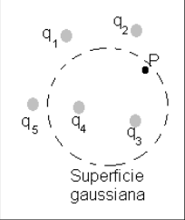
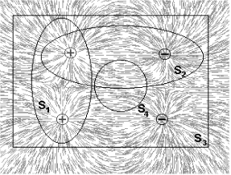
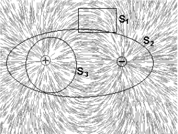
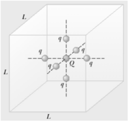
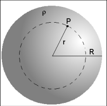
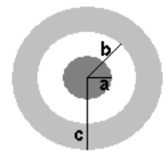

# Guía de problemas: ley de Gauss. Aplicaciones

Fuente: `2015/GUIA DE PROBLEMAS PROPUESTOS 1ra parte.pdf`, sección Gauss de
páginas 9–11 de 24, desde su título hasta antes de potencial eléctrico. SHA-256:
`efac01b619f48d06286a725a5a7ccc8de7b6baffb2a931515c9dba28ae7e5e5b`.

Extracción pdftotext y cotejo visual de las tres páginas; cinco preguntas, doce
problemas y seis figuras.

## Cuestionario

**1.** Calcule el flujo del campo eléctrico a través de una superficie cerrada,
si la carga contenida dentro de ella es: a. Q = 0. b. Una carga puntual Qo c. Un
conjunto de cargas puntuales Qi con i =1,2,... n d. Un cuerpo conductor cargado
con una densidad de carga σ e. Una región donde existe una densidad volumétrica
de carga ρ

**2.** A partir de los casos anteriores establezca una conclusión que contenga a
todos los casos anteriores

**3.** Empleando la ley de Gauss demuestre que las líneas del campo eléctrico
tienen fuente y sumidero. Ayuda: emplee un dipolo y elija superficies cada vez
más grande, partiendo de una que solo contenga a una de las cargas.

**4.** ¿Cómo se puede demostrar que el flujo del campo eléctrico no depende de
la forma y del tamaño de la superficie cerrada que contiene la carga?

**5.** Es posible usar la ley de Gauss para calcular el campo de un dipolo
eléctrico? Porque?

## Problemas

### Problema 1

Un campo eléctrico de 3,50 kN/C se aplica a lo largo del eje +x. Calcular el
flujo eléctrico a través de un plano rectangular de ancho 0,350 m y 0,700 m de
largo suponiendo que (a) el plano es paralelo al plano yz, (b) el plano es
paralelo al plano xy, (c) el plano contiene el eje y , y su normal forma un
ángulo de 40,0 ° con el eje x.

### Problema 2

Los siguientes cargas se encuentran dentro de un tanque: 5,00 μC, μC -9,00, μC
27,0 y -84,0 μC. (a) Calcular el flujo eléctrico neto a través del tanque. (b)
es el número de líneas de campo eléctrico que salen del tanque es mayor que,
igual a, o menor que el número entrar en el?

### Problema 3

Considere la superficie gaussiana que rodea parte de la distribución de carga
mostrada en la figura. a) ¿Cuál de las cargas contribuye al campo eléctrico en
el punto P? b) Calcule el flujo del campo eléctrico a través de la superficie
punteada de la figura

### Problema 4

Para los espectros de campo eléctricos de las figuras, determine el flujo de
acuerdo con las superficies indicadas

### Problema 5

En un cono con distribución volumétrica de carga uniforme es posible aplicar la
ley de Gauss para calcular a) El flujo sobre una superficie que contenga al
cono. b) El campo eléctrico creado por el cono sobre la misma superficie

### Problema 6

Una carga puntual Q = 5,00 μC está situado en el centro de un cubo de lado L =
0,100 m. Además, seis cargas con q = -1.00 μC están situadas simétricamente en
torno a Q como se muestra en la figura. Determinar el flujo eléctrico a través
del cubo

### Problema 7

Una medida del campo eléctrico cerca de la superficie terrestre es 100N/C,
apuntando radialmente hacia adentro, asumiendo que ese valor es constante en
cualquier punto de la superficie, determine la carga total que debería estar
almacenada en la Tierra.

### Problema 8

Calcular el campo eléctrico creado por una esfera conductora con carga Q y de
radio a, en el interior y exterior de la misma.

### Problema 9

Cálculo del campo eléctrico creado por una distribución de cargas con simetría
esférica de radio R y densidad volumétrica constante ρ. Carga total Q

### Problema 10

Calcular el campo eléctrico creado por una distribución de cargas con simetría
esférica de radio R y densidad volumétrica $`\rho(r)=A.r`$, con $`0\le r\le R`$
y A es una constante.

### Problema 11

En los problemas 8, 9 y 10 se calculó el campo eléctrico creado por
distribuciones de cargas con simetrías esférica para los casos: a) Una esfera
conductora cargada. b) Una distribución esférica con densidad de carga
constante. c) Una distribución esférica con densidad de carga variable constante
$`\rho(r)=A.r`$, con $`0\le r\le R`$. Compare las expresiones de estos campos y
saque conclusiones.

### Problema 12

Una esfera sólida de radio a tiene una densidad de carga ρ y una carga total Q.
Concéntrica con esta esfera hay una esfera hueca conductora, no cargada, de
radio interno b y radio externo c, como muestra la figura. a) Determine la carga
inducida en las superficies interna y externa de la esfera hueca. b) Determine
la intensidad del campo eléctrico en las regiones $`r\le a`$, $`a\le r\le b`$,
$`b\le r\le c`$ y $`r\ge c`$.

## Nota de transcripción

Se conserva el orden de unidades del problema 2 («μC -9,00, μC 27,0»), y
«densidad de carga variable constante» del problema 11. No se armonizan las
erratas ni se resuelven ejercicios. Las páginas 9 y 11 contienen además otras
secciones que no forman parte de esta nota.
