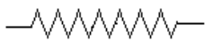
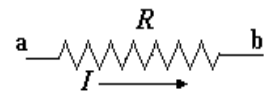
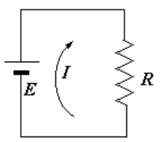
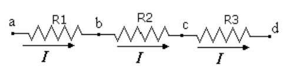
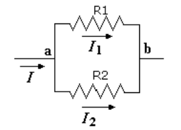
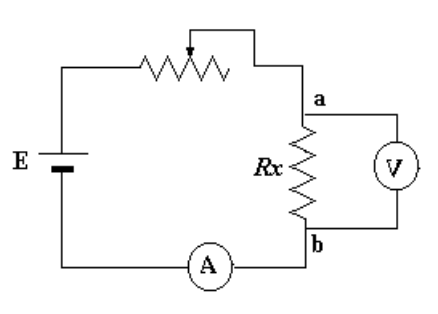
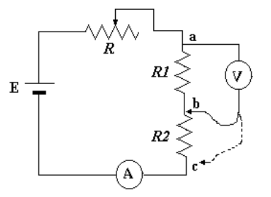
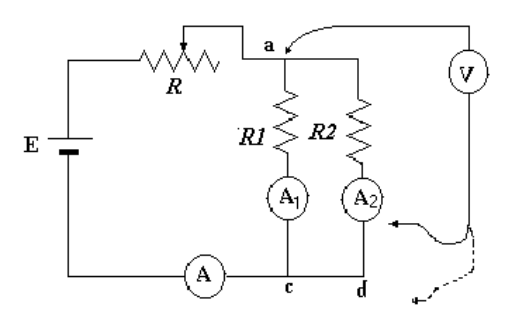

<!-- markdownlint-disable MD060 -->

# Trabajo de laboratorio Nº 4: Ley de Ohm. Asociación de resistencias

Universidad Tecnologica Nacional. Facultad Regional Resistencia. Cátedra: Física
II.

## Objeto de la experiencia

Comprobar la ley de ohm y verificar las fórmulas para determinar asociaciones de
resistencias en serie y paralelo.-

## Fundamentos teóricos

La Ley de ohm establece que la diferencia de potencial $`\Delta V`$ existente
entre los extremos de un conductor es directamente proporcional a la corriente I
que circula por él, esto es:

```math
\Delta V=R\cdot I \tag{1}
```

Donde R es la constante de proporcionalidad en la ecuación (1) y representa la
Resistencia que el conductor ofrece al flujo de cargas eléctricas a través de
él. En un circuito se representa a la resistencia de un material con el símbolo:



Las unidades serán:

```math
(R)=\frac{(\Delta V)}{(I)}=ohm=\frac{Voltios}{amperee}
```

Si los extremos de la resistencia A y B están a los potenciales Va y Vb
respectivamente, si el valor dela resistencia es R y la intensidad de corriente
es I entonces:



```math
Vb-Va=R\cdot I \tag{2}
```

naturalmente esto debe estar integrado a algo mas para par formar un circuito
cerrado y mantener el flujo de cargas, los extremos de la resistencia a y b se
conectan a una fuente de energía (pila, acumulador,ect.) llamadas fuentes de
fuerza electromotriz (fem) entonces:



```math
E=Vb-Va \tag{3}
```

de modo que reemplazando en (2) la (3) tenemos: $`E=R\cdot I`$

## Asociación de resistencias

### A) En serie

Se dice que se han asociado resistencias en serie cuando atravez de cada una de
ellas circula la misma corriente y las diferencias de potencial existente en
cada una de ellas serán distintas. En símbolo:



I es la misma para cada una de las resistencias

Mientras que las diferencia de potenciales son distintas: $`Vab\ne Vbc\ne Vcd`$

Como $`Vab=I\cdot R1`$ ; $`Vbc=I\cdot R2`$ ; $`Vcd=I\cdot R3`$

Pero

```math
Vad=Vab+Vbc+Vcd\quad\Rightarrow\quad I\cdot R1+I\cdot R2+I\cdot R3=I\cdot(R1+R2+R3)
```

Haciendo pasaje de términos:

```math
\frac{Vad}{I}=R1+R2+R3
```

Esta asociación de resistencias en serie puede ser reemplazada por una
resistencia equivalente tal que en sus extremos se mantenga la diferencia de
potencial Vad y circule por ella una corriente I, y además valga:

```math
Re=R1+R2+R3
```

en general en una asociación de resistencias en serie, la resistencia
equivalente a la de todas las resistencias parciales:

```math
R=R1+R2+R3+\ldots+Rn
```

### B) En paralelo

SE dice que se han asociado resistencias en paralelo, si la diferencia de
potencial en los extremos de cada una de ellas es la misma y la corriente que
circula por cada una de ellas es distinta.-



Vab es la misma para cada una de las resistencias, $`I1\ne I2`$

Además $`I1=\frac{Vab}{R1}`$ e $`I2=\frac{Vab}{R2}`$ pero $`I=I1+I2`$

Entonces:

```math
I=\frac{Vab}{R1}+\frac{Vab}{R2}=Vab\left(\frac{1}{R1}+\frac{1}{R2}\right)
```

```math
\frac{I}{Vab}=\frac{1}{R1}+\frac{1}{R2}
```

Una asociación de resistencias en paralelo puede ser reemplazado por una
resistencia equivalente tal que sus extremos estén a la diferencia de potencial
Vab y circule por ella una corriente I y tenga el valor:

```math
\frac{1}{Re}=\frac{1}{R1}+\frac{1}{R2}
```

En general, en una asociación de resistencias en paralelo la reciproca de la
resistencia equivalente será la suma de todas las recíprocas de las resistencias
parciales:

```math
\frac{1}{Re}=\frac{1}{R1}+\frac{1}{R2}+\frac{1}{R3}+\ldots+\frac{1}{Rn}
```

## Técnica operativa

### 1) Comprobación de la ley de Ohm

A) Se armará el siguiente circuito: antes de conectar la fuente de alimentación
se solicitará al ayudante de cátedra controlar el circuito.



B) Una vez conectada la fuente al circuito, se variará el cursor de la
resistencia R en cinco posiciones distintas, cuidando que los fieles del
amperímetro y voltímetro no salgan de escala, y se completará el siguiente
cuadro:

| Posición de R | I (ampere) | Vab (voltios) | $`Rx=\frac{Vab}{I}`$ (ohm) |
| -- | -- | -- | -- |
| 1 |  |  |  |
| 2 |  |  |  |
| 3 |  |  |  |
| 4 |  |  |  |
| 5 |  |  |  |

_C)_ hágase un gráfico colocando en abscisas las intensidades de corrientes _I_
y en ordenadas las diferencias de potencial Vab.-

### 2) Asociación de resistencias en serie

- A) Se armará el siguiente circuito: antes de conectar la fuente de
  alimentación se solicitará al ayudante de cátedra controlar el circuito.



- B) Una vez conectada la fuente de alimentación se variará para el valor de la
  resistencia R cambiando la posición del cursor de la misma en cinco
  oportunidades y se completará el siguiente cuadro:

| Posic. | I | Vab | $`R=\frac{Vab}{I}`$ | Vbc | $`R2=\frac{Vbc}{I}`$ | $`R=R1+R2`$ | $`Vac=Vab+Vbc`$ | Vac | $`\frac{Vac}{I}=R`$ |
| -- | -- | -- | -- | -- | -- | -- | -- | -- | -- |
| 1 |  |  |  |  |  |  |  |  |  |
| 2 |  |  |  |  |  |  |  |  |  |
| 3 |  |  |  |  |  |  |  |  |  |
| 4 |  |  |  |  |  |  |  |  |  |
| 5 |  |  |  |  |  |  |  |  |  |

Donde _I_ es el valor medido por el amperímetro

_Vab_ es el valor medido por el voltímetro cuando sus bornes estan conectados
entre _a_ y b Vbc , idem entre b y c

Vac , idem entre a y c

- C) compare la columna 7 con la 10 ¿Qué observa? ¿Por qué?

- D) compare la columna 8 con la 9 ¿Qué observa? ¿Por qué?

- E) Calcule teóricamente el valor de la resistencia equivalente. Compare con el
  valor obtenido y determine el error absoluto, relativo y porcentual obtenido.-

### 3) Asociación de resistencia en paralelo

- A) Se armará el siguiente circuito: antes de conectar la fuente de
  alimentación se solicitará al ayudante de cátedra controlar el circuito:



B) Una vez conectada la fuente al circuito se variará el valor de la resistencia
R cambiando la posición del cursor de la misma en cinco oportunidades y se
completará el siguiente cuadro:

| Pos. | I | Vab | Vcd | Vac | Vad | I1 | I2 | I1+I2 | $`\frac{Vac}{R1}`$ | $`\frac{Vac}{R2}`$ | $`\frac{Vac}{R1}+\frac{Vac}{R2}`$ | $`Re=\frac{Vac}{I}`$ |
| -- | -- | -- | -- | -- | -- | -- | -- | -- | -- | -- | -- | -- |
| 1 |  |  |  |  |  |  |  |  |  |  |  |  |
| 2 |  |  |  |  |  |  |  |  |  |  |  |  |
| 3 |  |  |  |  |  |  |  |  |  |  |  |  |
| 4 |  |  |  |  |  |  |  |  |  |  |  |  |
| 5 |  |  |  |  |  |  |  |  |  |  |  |  |

Donde: I = Intensidad de corriente medida por el amperímetro A

- I1 = Intensidad de corriente medida por el amperímetro A1

- I2 = Intensidad de corriente medida por el amperímetro A2

Vab = Diferencia de potencial medida por el voltímetro conectado a los puntos a
y b Vcd = Diferencia de potencial medida por el voltímetro conectado a los
puntos c y d Vac = Diferencia de potencial medida por el voltímetro conectado a
los puntos a y c Vbd = Diferencia de potencial medida por el voltímetro
conectado a los puntos b y d

- C) ¿Qué conclusión saca de las tablas Vab y Vcd?

- D) ¿Qué conclusión saca de las tablas Vad y Vbd?

E) ¿Qué conclusión saca de las tablas I1+I2 y de
$`\frac{Vac}{R1}+\frac{Vac}{R2}`$?

- F) Calcule teóricamente el valor de la resistencia equivalente. Compare con el
  resultado experimental y determine los errores.-

### 4) Errores

Haga una lista de los posibles errores

## Nota de transcripción

Se conservan la polaridad y signos escritos en (2)/(3), amperee y otras erratas.
No se corrigen las referencias distintas a Vad y Vbd ni los nombres de columnas.
Las tres tablas se reconstruyen con cuatro, diez y trece columnas, cinco filas
vacías cada una, comparadas con las páginas 4–6.

[Procedencia y comprobaciones](../../../resources/2015/fuentes.md).
