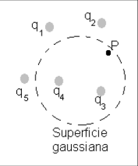
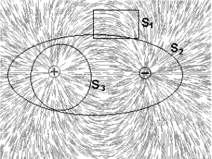
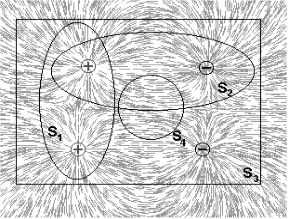
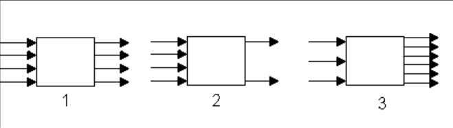
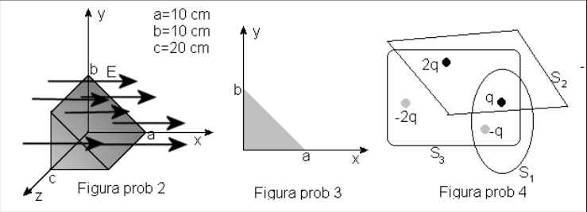
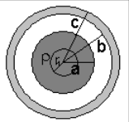
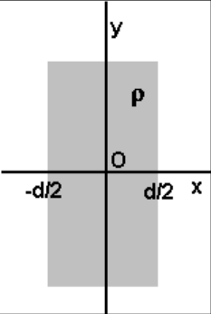

# Ley de Gauss: guía identificada como 2011

Fuente: `2015/guia de problemas 2011.pdf`, páginas 7–9 de 31. SHA-256:
`5a5ae8ac33a7a3d14d854623015ef14bc0af3dae1651c013aed06567e28a8bca`.

Extracción pdftotext, recuperación visual de símbolos/ecuaciones y cotejo de las
tres páginas. Once preguntas y once problemas, con siete archivos de figuras y
diagramas compuestos. El año 2011 pertenece al nombre del archivo.

## Cuestionario

**1.** Considere la superficie gaussiana que rodea parte de la distribución de
carga mostrada en la figura 1 a. ¿Cuál de las cargas contribuye al campo
eléctrico en el punto P? b. Calcule el flujo del campo eléctrico a través de la
superficie punteada de la figura 1



**2.** Calcule el flujo del campo eléctrico a través de una superficie cerrada,
si la carga contenida dentro de ella es: a. Q = 0. b. Una carga puntual $`Q_o`$
c. Un conjunto de cargas puntuales $`Q_i`$ con i =1,2,... n d. Un cuerpo
conductor cargado con una densidad de carga $`\sigma`$ e. Una región donde
existe una densidad volumétrica de carga $`\rho`$

**3.** A partir de los casos anteriores establezca una conclusión que contenga a
todos los casos anteriores

**4.** Empleando la ley de Gauss demuestre que las líneas del campo eléctrico
tienen fuente y sumidero. Ayuda: emplee un dipolo y elija superficies cada vez
más grande, partiendo de una que solo contenga a una de las cargas.

**5.** ¿Cómo se puede demostrar que el flujo del campo eléctrico no depende de
la forma y del tamaño de la superficie cerrada que contiene la carga?

**6.** Es posible usar la ley de Gauss para calcular el campo de un dipolo
eléctrico? Porque?

**7.** Para los espectros de campo eléctricos de las figuras, determine el flujo
de acuerdo con las superficies indicadas





**8.** ¿Qué conclusiones saca de los esquemas de la figura 2 de flujos
eléctricos netos a través de una superficie cerrada?



**9.** Si la carga está en la superficie gaussiana ¿qué conclusiones se pueden
obtener con el empleo de la ley de Gauss?

**10.** Si se encierra el dipolo en una superficie gaussiana, la carga neta
encerrada es cero y según la ley de Gauss el campo eléctrico sería también cero.
¿Es correcto este razonamiento? si no lo es, ¿dónde está es error?

**11.** Sea un conductor hueco, aislado, grande y sin carga. A través de una
pequeña abertura en la parte superior del conductor se introduce una pequeña
esferita de metal que tiene una carga negativa, de manera que toque la
superficie interior, y luego se retira. ¿Cuál es, entonces, la carga en el
conductor y en la esferita?

## Problemas

### Problema 1

En una región donde existe un campo eléctrico constante E = $`2\cdot10^6`$ N/C
Calcule el flujo eléctrico a través de una superficie plana de área 2
$`\mathrm{m^2}`$ si se coloca a) el plano de la superficie perpendicular a la
dirección de campo. b) el plano de la superficie paralelo a la dirección de
campo. c) el plano de la superficie formando un ángulo de 50º a la dirección de
campo.



### Problema 2

En la figura se presenta una caja triangular en una región donde existe un campo
eléctrico de intensidad $`2\cdot10^5`$ N/C. Calcule el flujo eléctrico a través
cada cara de la caja y de la superficie completa.

### Problema 3

Un campo eléctrico está dado por $`\vec E=pz\vec i+qx\vec j`$ donde p y q son
constantes. Determine el flujo eléctrico a través de la superficie mostrada en
la figura

### Problema 4

En la figura se muestran tres superficies cerradas $`S_1`$, $`S_2`$ y $`S_3`$, y
las cargas puntuales q, -q, 2q y –2q, Encuentre el flujo a través de cada
superficie.

### Problema 5

Una medida del campo eléctrico cerca de la superficie terrestre es 100N/C,
apuntando radialmente hacia adentro, asumiendo que ese valor es constante en
cualquier punto de la superficie, determine la carga total que debería estar
almacenada en la Tierra.

### Problema 6

Una distribución de carga esférica de radio a tiene una densidad de carga
$`\rho`$ y carga total Q. Concéntrica con esta distribución hay una esfera hueca
conductora, no cargada, de radio interno b y radio externo c, como muestra la
figura. 5 a) Determine la intensidad del campo eléctrico en las regiones
$`r\lt a`$, $`a\lt r\lt b`$, $`b\lt r\lt c`$ y $`r\gt c`$. b) Determine la carga
inducida en las superficies interna y externa de la esfera hueca.



### Problema 7

Una distribución de cargas con simetría rectángular de espesor d y densidad
volumétrica constante $`\rho`$, como muestra la figura 5 a) Demuestre que el
campo eléctrico a una distancia x de su centro y dentro de la placa es
$`E=\rho x/\varepsilon_o`$. b) Suponga que un electrón de carga -e y masa m se
coloca sin velocidad dentro de la placa a una distancia x del centro, demuestre
que el electrón tendrá un movimiento armónico simple con frecuencia dada por

```math
f=\frac{1}{2\pi}\cdot\sqrt{\frac{\rho\cdot e}{m\cdot\varepsilon_o}}
```

### Problema 8

Una distribución de cargas positivas con simetría rectángular de espesor d y
densidad volumétrica no uniforme dada por $`\rho(x)=Cx^2`$ donde x se mide desde
el centro de la placa como muestra la figura 6 y C es una constante. La placa es
infinita en las direcciones y y z. Deduzca la expresión del campo eléctrico
dentro y fuera de la distribución.

### Problema 9

Considere un cascarón metálico esférico con carga Q, de radio interior $`R_1`$ y
radio exterior $`R_2`$, empleando la ley de Gauss establezca cómo se distribuye
la carga y determine el campo eléctrico E(r) en todos los puntos.

### Problema 10

Determine el campo eléctrico E(r) creado por una distribución contenida en un
cascarón cilíndrico de radio $`R_1`$ y $`R_2`$ ($`R_1\lt R_2`$) muy largo, con
densidad de carga constante, para $`r\le R_1`$, $`R_1\lt r\lt R_2`$ y
$`r\ge R_2`$.

### Problema 11

En el interior de una región esférica de radio R existe distribuida una densidad
de carga $`\rho(r)=A/r`$ donde A es una constante y $`0\le r\le R`$, determine
el valor de A si la carga total es Q y el campo eléctrico E(r) para $`r\le R`$ y
para $`r\ge R`$.



Figura 6.

## Observaciones de fidelidad

- El problema 7 remite a «figura 5» para la placa; se conserva esa referencia,
  aunque el esquema rectangular aparece rotulado Figura 6.
- Se conservan los rangos estrictos del problema 6 y los rangos con igualdad del
  10 y 11, sin completar los casos de frontera omitidos.
- El intervalo impreso del problema 11 incluye r=0 con densidad A/r; no se
  modifica el enunciado ni se resuelve.
