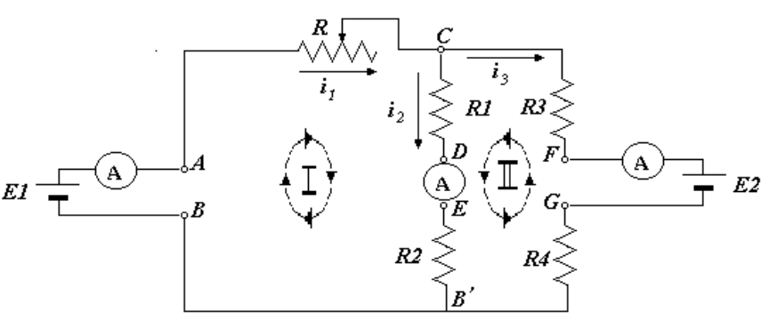

<!-- markdownlint-disable MD060 -->

# Trabajo de laboratorio Nº 6: Leyes de Kirchoff

Universidad Tecnologica Nacional. Facultad Regional Resistencia. Cátedra: Física
II.

## Tema: leyes de kirchoff

## Objeto de la experiencia

Comprobación experimental de las Leyes de Kirchhoff.

## Fundamentos teoricos

Para averiguar cómo se distribuyen las corrientes en una red de conductores se
recurre a las leyes de Kirchoff. Antes de enunciarlas recordemos lo que se
entiende por nudo, rama y malla en una red.

NUDO: Todo punto donde convergen tres o más conductores.

RAMA: Todos los elementos (resistencias, generadores,....) comprendidos entre
dos nudos adyacentes.

MALLA: Todo circuito cerrado que puede ser recorrido volviendo al mismo punto de
partida sin pasar dos veces por el mismo elemento.

Evidentemente la intensidad de corriente será la misma en cada uno de los
elementos de una rama.

Para los nudos y las mallas tenemos las siguientes leyes:

### Primera ley de kirchoff (ley de nudos)

“La suma algebraica de las corrientes que concurren a un nudo es nula”

```math
\sum I = 0
```

Considerando positivas las intensidades que se dirigen al nudo y negativas las
que parten del mismo.

### Segunda ley de kirchoff (ley de mallas)

“La suma algebraica de las f.e.m. en una malla cualquiera menos la caída de
tensión en los elementos de la misma malla es igual a cero”

```math
\sum E - \sum R.I = 0
```

Para aplicar esta segunda ley, será preciso asignar un sentido convencional de
circulación positiva para cada malla, y considerar positivas las intensidades y
F.e.m. que concuerdan con dicho sentido convencional y negativas las que no
concuerdan.

## Circuito a emplear



## Técnica operativa

### Verificación de las leyes de nudos

1.- Se selecciona un valor de R1 con el multímetro en la escala conveniente
ajustando el cero del óhmetro para la escala elegida.-

Con el circuito abierto y las puntas del óhmetro en AC se calibra el valor de
R.-

2.- Para las lecturas de las tres corrientes se coloca el multímetro en la
escala apropiada como amperímetro intercalándolo en cada rama como se observa en
la figura.-

3.- Luego se repite el proceso para otros valores de R y se completa la tabla
siguiente:

| Pos. | R | ***i1*** | ***i2*** | ***i3*** | ***i1+i2+i3*** |
| :- | -- | -- | -- | -- | -- |
| 1 |  |  |  |  |  |
| 2 |  |  |  |  |  |
| 3 |  |  |  |  |  |

### Verificación de las leyes de malla

1.- Para los mismos valores de R medir con el voltímetro la tensión en cada uno
de los elementos del circuito (resistencias y fem) .-

Con el multímetro en Vdc seleccionando la escala conveniente y las puntas en C y
D se lee la tensión en la resistencia R2, de igual manera se procede con las
demás resistencias:

R1= en A y C , R3= en E y B , R4= en C y F , R5= en G y B

2.- Teniendo en cuenta el sentido de circulación de las corrientes, completar la
siguiente tabla asignandoun sentido de recorrido a las dos mallas tal cual se
muestra en la figura:

| Pos | E1 | E2 | Vac | Vcd | Veb | Vbg | Vfc | Vac+Vcd+Veb | Vcd+Veb+Vbg+Vfc |
| :- | -- | -- | -- | -- | -- | -- | -- | -- | -- |
| 1 |  |  |  |  |  |  |  |  |  |
| 2 |  |  |  |  |  |  |  |  |  |
| 3 |  |  |  |  |  |  |  |  |  |

3.- Realice los cálculos teóricos para los tres casos planteados y compare con
los obtenidos en forma práctica.

## Datos

E1= medir

E2= medir

R = medir

- **R1 = 2,7 kΩ**

- **R2 = 3,3 kΩ**

- **R3 = 1,5 kΩ**

- **R4 = 2,2 kΩ**

4.- Utilizando el programa Workbench **o similar** arme el mismo circuito.

Justifique las diferencias, si las hubiere.

## Nota de transcripción

Se conservan los nombres Kirchoff/Kirchhoff, las discrepancias entre las
etiquetas de resistencias del circuito y el procedimiento, y la falta de valor
para R5. La cifra 38 aparece como paginación en el cuerpo del original. No se
completa ni corrige el experimento.

[Procedencia y comprobaciones](../../../resources/2015/fuentes.md).
