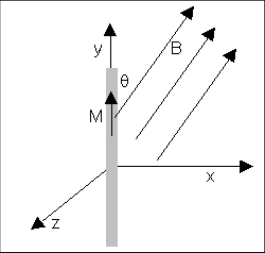

# Guía de problemas: magnetismo en medios materiales

Fuente: `2015/GUIA DE PROBLEMAS PROPUESTOS 2da parte.pdf`, sección de páginas
8–10 de 13, hasta antes de corriente alterna. SHA-256:
`e2452f4b287c4401d9902c425f82a9caaab0bb7dd7c877c724934eb2bed5a9fa`.

Extracción pdftotext y cotejo visual de las tres páginas. Once preguntas, siete
problemas, una figura y dos tablas de datos.

## Cuestionario

**1.** ¿Qué es el momento dipolar magnético?

**2.** Halle una expresión para el momento dipolar magnético orbital del átomo
de H, desde el punto de vista clásico.

**3.** ¿Qué relación existe entre momento magnético y momento cinético?

**4.** Exprese los momentos dipolares magnéticos de: a) orbital de un electrón.
b) de spín de un electrón. c) de un núcleo de hidrógeno. Compare órdenes de
magnitud.

**5.** ¿El aluminio es paramagnético? ¿Por qué?

**6.** Defina el vector de magnetización.

**7.** Relacione el vector de magnetización con la temperatura en un medio
paramagnético y diamagnético.

**8.** Compare en una tabla de libros de textos la permeabilidad magnética
$`\mu`$ entre materiales paramagnéticos y diamagnéticos (indique sus
características).

**9.** Defina susceptibilidad magnética. Qué significa que $`\psi_m`$ sea
negativa?

**10.** ¿El paramagnetismo y el diamagnetismo provienen del mismo fenómeno?.
Justifique brevemente.

**11.** Grafique una curva para un material ferromagnético, indicando los puntos
más característicos. ¿Un ciclo de histéresis es cerrado?.

## Problemas

### Problema 1

Sobre una muestra toroidal de un material cuya susceptibilidad magnética es de
$`4\cdot10^{-2}`$, se han devanado 4000 espiras por la que circula una corriente
de 3 A. El toroide tiene 15 cm de longitud. a) calcular la densidad de corriente
solenoidal. b) determinar el campo H producido por la corriente. c) calcular la
permeabilidad magnética del material. d) calcular la magnetización M producida
en el material. e) calcular el campo B resultante tanto de la corriente como de
la magnetización del material

### Problema 2

Un anillo de Rowland, hecho de hierro, cuya longitud de la circunferencia media
es de 30 cm y cuya sección es de 1 $`\mathrm{cm^2}`$ está enrollado
uniformemente con 300 espiras de hilo conductor. Las medidas efectuadas
demuestran que cuando la corriente en el enrollamiento es de 32 mA el flujo en
el anillo es de $`2\cdot10^{-6}`$ wb. Calcúlese a) B en el anillo. b) el vector
H. c) la magnetización. d) la permeabilidad del hierro. e) la susceptibilidad.

### Problema 3

Una partícula de masa m y carga q realiza un movimiento circular uniforme.
Demuestre que el momento magnético $`\vec m`$ es proporcional al momento
cinético.

### Problema 4

Una varilla imanada de longitud 2 cm, sección 1 $`\mathrm{mm^2}`$ y
magnetización M = 1 $`\mathrm{A/m^2}`$ se coloca en una región donde existe un
campo B = 1 T con el que forma un ángulo de 30º como muestra la figura 1P,
calcule el par sobre la varilla.

### Problema 5

La tabla da medidas experimentales de la susceptibilidad magnética del alumbre
de amonio de hierro. Hacer un gráfico de $`1/\psi_m`$ en función de la
temperatura absoluta y determinar si vale la ley de Curie. En caso afirmativo
¿cuál es la constante de Curie?.

<!-- markdownlint-disable MD060 -->

| t (ºC) | $`\chi_m`$ ($`10^{-4}`$) |
| -- | -- |
| -250 | 75.4 |
| -173 | 11.3 |
| -73 | 5.65 |
| 27 | 3.77 |

### Problema 6

Las tablas relacionan los valores de B y H para una muestra de acero al silicio
laminado en caliente, material que se emplea con frecuencia en los núcleos de
los transformadores. a) Constrúyase la gráfica de B y $`\mu`$ en función de H
para un intervalo de H = 0 a 1000 A.vueltas/m. b)¿Cuál es la permeabilidad
máxima?. c)¿Cuál es la permeabilidad inicial (H = 0)?. d)¿Cuál es la
permeabilidad cuando H = 800.000 A.vueltas/m?.

Los dos vectores de datos del original utilizan la asignación `:=`. Se conservan
sus catorce pares, en el mismo orden:

| H | B |
| -- | -- |
| 0 | 0 |
| 10 | 0.05 |
| 20 | 0.15 |
| 40 | 0.43 |
| 50 | 0.54 |
| 60 | 0.62 |
| 80 | 0.74 |
| 100 | 0.83 |
| 150 | 0.98 |
| 200 | 1.07 |
| 500 | 1.27 |
| 1000 | 1.34 |
| 10000 | 1.65 |
| 100000 | 2.02 |

### Problema 7

Calcular el cambio de momento dipolar magnético que sufre un electrón circulante
si obra un campo magnético de inducción B = 2 $`\mathrm{wb/m^2}`$ perpendicular
al plano de la órbita. Radio de la orbita $`r=5{,}1\cdot10^{-11}`$ m

## Observaciones de fidelidad

- El texto utiliza ψ y la cabecera de la tabla χ; se conserva cada símbolo en su
  lugar.
- Se conserva la unidad A/m² para M del problema 4 y H=800.000 del problema 6,
  aunque ese valor excede el último dato de la tabla.
- Los dos vectores de catorce datos de H/B se presentan como tabla de pares para
  conservar su correspondencia. No se calculan valores adicionales ni se
  resuelven ejercicios.

## Versión incluida en la guía identificada como 2011

La sección de `2015/guia de problemas 2011.pdf`, páginas 26–27, contiene las
mismas once preguntas, siete problemas y dos tablas. Se cotejaron ambas páginas,
incluidos los cuatro registros de susceptibilidad y los catorce pares H/B. La
figura de la varilla utiliza exactamente los mismos píxeles decodificados en
ambos PDF. Cambia la paginación, por lo que se comparte esta nota sin duplicar
las expresiones matemáticas.

SHA-256 de esa fuente:
`5a5ae8ac33a7a3d14d854623015ef14bc0af3dae1651c013aed06567e28a8bca`. El año 2011
consta en el nombre del archivo; se conserva su ubicación canónica 2015.
