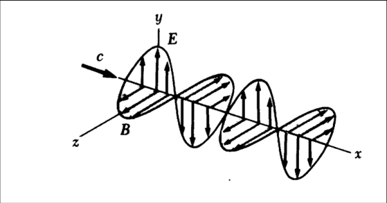
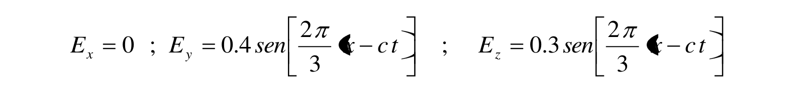

# Ecuaciones de Maxwell y ondas electromagnéticas

Fuente: `2015/GUIA DE PROBLEMAS PROPUESTOS 2da parte.pdf`, páginas 12–13 de 13.
SHA-256: `e2452f4b287c4401d9902c425f82a9caaab0bb7dd7c877c724934eb2bed5a9fa`.

Extracción pdftotext, recuperación visual de ecuaciones y cotejo de ambas
páginas. Nueve preguntas, ocho problemas y una figura original.

## Cuestionario

**1.** ¿Qué modificación introduce Maxwell a la ley de Ampere?

**2.** ¿Qué diferencia existe ente la corriente de conducción y la corriente de
desplazamiento?

**3.** ¿En qué se basa para decir que las ondas electromagnéticas son
transversales?

**4.** Bajo qué condiciones un conductor que transporta una corriente puede
emitir ondas electromagnéticas?

**5.** ¿Cómo se caracteriza una onda electromagnética?

**6.** ¿Cuál es el significado físico del vector de Poynting?

**7.** En una región del espacio donde existe E(r,t) puede o debe existir
B(r,t)? Porqué?

**8.** ¿Qué significa que la onda electromagnética sea plana?

**9.** Haga un esquema vectorial de la disposición de los campos eléctrico y
magnético, el vector de Poynting y el vector de onda para el caso de una onda
electromagnética plana.

## Problemas

### Problema 1

Un condensador de placas planas, con placas en forma de disco con un dieléctrico
de permitividad $`\varepsilon`$ está conectado a una fuente
$`V(t)=V_o\mathop{\mathrm{sen}}\nolimits(\omega t)`$ a) Calcule la corriente de
desplazamiento. b) Encuentre las expresiones de los campos eléctricos y
magnéticos. c) Determine el vector de Poynting

### Problema 2

Una onda electromagnética senoidal de frecuencia 20 Mhz viaja en el vacío en la
dirección x, como se muestra en la figura 1P. En un punto y en un instante, el
campo eléctrico E tiene su valor máximo de 750 N/c y está dirigido a lo largo
del eje y a) determine la longitud y el período de la onda. b) Calcúlese la
magnitud y dirección del campo magnético B. c) Escríbanse las expresiones para
las componentes del campo eléctrico y magnético de la onda plana en términos de
las variaciones del tiempo y del espacio.



### Problema 3

Verifique que las siguientes expresiones para E y B son solución de las
ecuaciones de ondas

a)

```math
E=\frac{A}{\sqrt{\varepsilon_o\mu_o}}e^{a(x-ct)}
```

```math
B=Ae^{a(x-ct)}
```

b)

```math
E=E_m\cos(Kx-\omega t)
```

```math
B=B_m\cos(Kx-\omega t).
```

### Problema 4

Una onda electromagnética plana tiene una frecuencia de $`6{,}4\cdot10^{14}`$ Hz
y una amplitud de campo eléctrico de 320 N/c. Escriba las ecuaciones que
describen los campos eléctricos y magnéticos de estas ondas en su forma

$`E(x,t)=E_m\cos(Kx-\omega t)`$ y $`B(x,t)=B_m\cos(Kx-\omega t)`$.

Dé los valores numéricos de $`E_m`$, $`B_m`$, K y $`\omega`$.

### Problema 5

La figura 1 muestra una onda electromagnética plana senoidal que se propaga en
la dirección del eje x. La longitud de onda es de 25 m , el campo eléctrico
vibra en el plano xy con una amplitud de 20V/m. Calcule a) la frecuencia
senoidal b) la amplitud y dirección de B cuando el campo eléctrico tiene su
valor máximo en la dirección negativa de y. c) Escriba una expresión para B en
la forma $`B(x,t)=B_m\cos(Kx-\omega t)`$. Con lo valores numéricos de $`B_m`$, K
y $`\omega`$.

### Problema 6

El campo eléctrico de una onda electromagnética plana es

```math
E_x=0;\quad E_y=0.4\mathop{\mathrm{sen}}\nolimits\left[\frac{2\pi}{3}(x-ct)\right];\quad E_z=0.3\mathop{\mathrm{sen}}\nolimits\left[\frac{2\pi}{3}(x-ct)\right]
```

medido N/C. a) Determinar la amplitud del campo eléctrico y del campo magnético
de la onda electromagnética. b) Dibujar un esquema en el que se especifique la
dirección de vibración del campo eléctrico, del campo magnético y la dirección y
sentido de la propagación de la onda electromagnética. c)Hallar la frecuencia,
longitud de onda e intensidad de la onda electromagnética. d) Calcular el vector
de Poynting

### Problema 7

El Sol entrega aproximadamente 1000 $`\mathrm{W/m^2}`$ de flujo electromagnético
a la superficie terrestre a) calcúlese la potencia total que incide sobre una
azotea cuya dimensiones son 8 m x 20 m. b) Determínese la presión de radiación y
la fuerza de la radiación sobre la azotea, suponiendo que su recubrimiento es un
absorbente perfecto. c) ¿Cuánta energía solar llega a la azotea en una hora?.

### Problema 8

Un alambre conductor recto de resistividad $`\rho`$ y de área A conduce una
corriente uniforme de intensidad I. Determínese el sentido, la dirección y
magnitud del vector de Poynting en la superficie del alambre. Calcule el flujo
del vector de Poynting a través de la superficie del alambre y compare este
resultado con el calor de Joule producido en este segmento del conductor.

## Observaciones de fidelidad

Se conservan K mayúscula, los operadores sen/cos y las unidades N/c impresas en
los problemas 2 y 4, diferenciadas de N/C en el 6. Las amplitudes, ecuaciones y
ejercicios se transcriben sin resolverlos.

## Versión incluida en la guía identificada como 2011

La sección de `2015/guia de problemas 2011.pdf`, páginas 30–31, contiene las
mismas nueve preguntas y ocho problemas. Se cotejaron enunciados, valores y
ecuaciones con ambas páginas. La figura de la onda tiene los mismos píxeles
decodificados en los dos PDF. Se comparte esta nota sin duplicar matemática.

En la ecuación del problema 6, el PDF 2011 superpone delimitadores sobre x. La
variable x figura en la capa textual de ambos componentes; los coeficientes,
fracciones, signo menos y ct también se contrastaron con la página. Se conserva
este recorte original para mostrar el defecto gráfico, además de las ecuaciones
transcritas arriba:



SHA-256 de esa fuente:
`5a5ae8ac33a7a3d14d854623015ef14bc0af3dae1651c013aed06567e28a8bca`. El año 2011
consta en el nombre; se conserva su carpeta canónica 2015.
