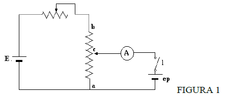
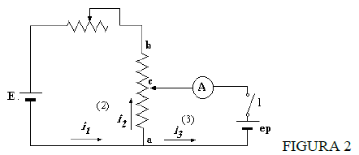
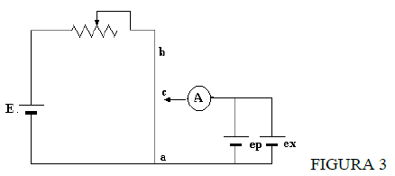
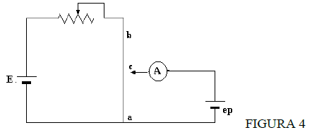

# Trabajo de laboratorio Nº 5: Medicion de una fem desconocida

Universidad Tecnologica Nacional. Facultad Regional Resistencia. Cátedra: Física
II.

## Tema: medicion de una fem desconocida

## Objetivo de la experiencia

Determinar la fuerza electromotriz (f.e.m.) de un generador por el método del
potenciómetro.

## Fundamentos teóricos

El potenciómetro es un instrumento base para la medición de diferencia de
potencial por oposición y consiste en oponer a la ddp a medir, una fem o fem
equivalente de igual valor, en éstas condiciones en el circuito entre dicha fem
y la ddp a medir, conectadas en oposición, no circula la corriente. Por lo tanto
el valor conocido de la fem equivalente es también la ddp desconocida.

En el circuito de la figura, cuando la llave l está abierta, circula corriente
exclusivamente en el circuito de la izquierda.



la corriente valdrá:

```math
i=\frac{E}{R}
```

la ddp entre c y a será:

```math
Vc-Va=Rca\times\frac{E}{R}
```

Es decir que dependerá de la posición de c con respecto a a; pudiéndose variar
desde 0 cuando coincide con a hasta E cuando c está en b y se puede despreciar
la resistencia interna de la fem E.

Al cerrar l, para una posición cualquiera de c; en general circulará corriente
por ep con lo que la distribución de corrientes en el circuito se habrá
modificado totalmente.

Supongamos que $`E\gt ep`$ , como se indica en la figura siguiente:



en este caso la ddp calculada en las ramas (2) y (3) serán:

```math
Vc-Va=Rca\times i_2\qquad Vc-Va=ep-r\times i_3
```

```math
i_3=\frac{ep-(Vc-Va)}{r}
```

esta corriente es nula cuando $`ep=Vc-Va`$

Si modificamos la posición del cursor c para variar la ddp *Vc Va* hasta
conseguir anular la corriente i3 en la rama (3) se obtiene de las ecuaciones
anteriores que:

```math
Rca\times i=ep
```

Ya que i2 = i1 = i , al ser nula i3

En el equilibrio todo sucederá como si l estuviera abierto y entonces es válida
la primera ecuación obteniendo:

```math
Rca\times i=e
```

Permitiendo calcular la fem cuando se conoce la resistencia *Rca* necesaria para
anular la corriente i3 y además la corriente que circula en E.

Observar que para poder medir la fem e , su valor debe ser menor que E, ya que
la ddp Vca debe oponérsele.

## Potenciómetro de hilo

En este aparato se reemplaza la resistencia *Rca* por un hilo metálico de
sección uniforme y de un único material.

En este caso como la resistencia es proporcional a la longitud del hilo y a su
resistividad es inversamente proporcional a su sección, la ecuación de
equilibrio nos quedará:

```math
e=i\cdot\delta\cdot\frac{lac}{S}=k\cdot lac\qquad\text{donde }k=\frac{\delta\cdot i}{S}
```



## Calibración del potenciómetro

Como en general no conocemos el valor de la corriente i que circula por la
fuente E calibramos el circuito utilizando una fem patrón de valor conocido,
conectando como en la figura siguiente. Conectando la fem patrón (ep) y
eligiendo un valor para c1 se busca el equilibrio con un valor apropiado de R.

En esa condición podemos decir que:



```math
ep=k\cdot lac_1
```

Y decimos que el potenciómetro se encuentra calibrado ya que:

```math
k=\frac{ep}{lac_1}
```

## Medición de una fem desconocida

En éstas condiciones se reemplaza la *ep* por la *ex* y se busca el equilibrio
nuevamente variando ahora *lac*, cuidando de no variar la resistencia R , pues
esto alteraría la calibración anteriormente hecha. Al encontrar el equilibrio
obtendremos *lac2* y por lo tanto el valor de la fem desconocida será:

```math
ex=k\cdot lac_2\qquad ex=\left(\frac{ep}{lac_1}\right)lac_2
```

Si en ésta ecuación el valor de k está dado por un número sencillo, el cálculo
de *ex* resulta inmediato y el potenciómetro se dice que es de lectura directa.

## Mediciones a realizar

Con el circuito de la figura 2 una vez armado se medirá una fem desconocida,
previa calibración del potenciómetro con una pila patrón. Así mismo se medirá la
misma fem desconocida mediante la utilización de un voltímetro. La precisión de
la medición depende de la sensibilidad del potenciómetro. Cuando éste está
calibrado al provocar una variación de R en Rac, disminuyendo en igual valor la
resistencia Rac se producirá una desviación de la aguja del galvanómetro. La
sensibilidad del potenciómetro es:

```math
S=\frac{\Delta a}{Rac}\qquad\frac{(div)}{(\Omega)}
```

En nuestro caso la sensibilidad estará dada por:

```math
S=\frac{\Delta a}{\Delta lac}
```

Calcular la sensibilidad del potenciómetro para la medición de ex que realice.

## Bibiliografia

Fundamentos de Física. Tomo II. Sears

Fundamentos de electricidad y magnetismo. N. Kip

Escuela del Técnico Electricista T II. Dr. Stockl

## Nota de transcripción

Las cuatro figuras se extraen de las capturas incrustadas respetando el
contenido visible del DOCX; se excluyen barras de la aplicación y texto oculto
por el recorte de Word. Las fórmulas visibles en las capturas se recuperan a
LaTeX, incluido el recorte reutilizado para Rca × i = ep. Se conservan δ para la
resistividad, Rac/Rca, Vc Va sin signo en el párrafo y BIBILIOGRAFIA del
original. La fecha de la barra de Windows no se atribuye al documento.

[Procedencia y comprobaciones](../../../resources/2015/fuentes.md).
