# Partes y funciones de un multímetro digital

> Fuente: `2015/PARTES Y FUNCIONES DE UN MULTÍMETRO DIGITAL.ppsx`. SHA-256:
> `4375b5ba3260f92e29876aa7d402634bbe935cc55e776dba1f40c7bcad431c3d`. PPSX de 19
> diapositivas, normalizado con LibreOffice a PPTX y PDF. MarkItDown no acepta
> directamente el tipo slideshow; se utilizó el PPTX normalizado. Se cotejaron
> todas las diapositivas con el PDF, pdftotext -layout y XML original,
> conservando las 17 imágenes originales y sus etiquetas. No hay fecha o autor
> personal explícitos; 2015 es la carpeta de origen. La única nota XML contiene
> un campo de número de diapositiva, sin texto adicional. Se conservan las
> instrucciones, grafías y afirmaciones del material fuente.

## Diapositiva 1

MULTIMETRO

DIGITAL Laboratorio Física II

## Diapositiva 2

PARTES Y FUNCIONES DE UN MULTÍMETRO DIGITAL A continuación describiremos las
partes y funciones de un multímetro , recuerde que generalmente los multímetros
son semejantes, aunque dependiendo de los modelos, pueden cambiar la posición de
sus partes y la cantidad de funciones, es por eso que cada parte tiene un
símbolo estándar que identifica su función. Laboratorio Física II

## Diapositiva 3

Partes de un Multimetro Digital

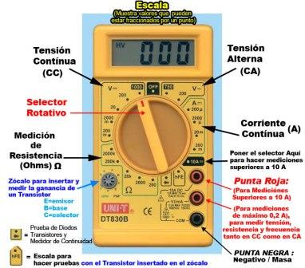
Laboratorio Física II

## Diapositiva 4

Partes del Multimetro Digital Display: Pantalla de cristal líquido en donde se
muestran los resultados de las mediciones.

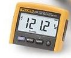 Laboratorio
Física II

## Diapositiva 5

Llave selectora (Selector Rotativo) del tipo y rango de medición: Esta llave nos
sirve para seleccionar el tipo de magnitud a medir y el rango de la medición.

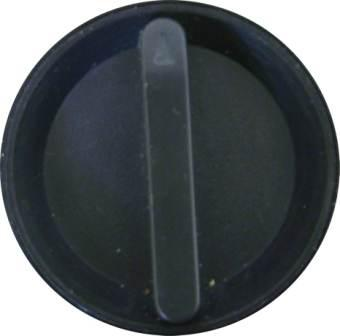
Laboratorio Física II

## Diapositiva 6

Rangos y tipos de medición: Los números y símbolos que rodean la llave selectora
indican el tipo y rango que se puede escoger. En la imagen podemos apreciar los
diferentes tipos de posibles mediciones de magnitudes como el voltaje continuo y
alterno, la corriente continua y alterna, la resistencia, etc.

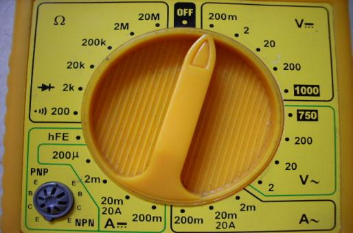
Laboratorio Física II

## Diapositiva 7

Cables rojo y negro con punta: El cable negro siempre se conecta al borne o jack
negro, mientras que el cable rojo se conecta al jack adecuado según la magnitud
que se quiera medir.

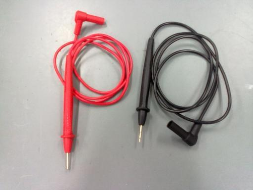
Laboratorio Física II

## Diapositiva 8

Borne de conexión o jack negativo: Aquí siempre se conecta el cable negro con
punta. Su símbolo es el siguiente.

Borne de conexión o jack para el cable rojo con punta: Aquí se conecta para
mediciones de voltaje (V), resistencia (Ω) y frecuencia (Hz). Su símbolo es el
siguiente.

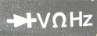
Laboratorio Física II

## Diapositiva 9

Borne de conexión o jack para el cable rojo con punta para medición de mili
amperes (mA). Su símbolo es el siguiente.

Borne de conexión o jack para el cable rojo con punta para medición de amperes
(A). Su símbolo es el siguiente.

Laboratorio Física II

## Diapositiva 10

A continuación vemos la forma en que se conectan los cables al multímetro.
Medición de Tensión (V), Resistencia (Ω) y Frecuencia (f)

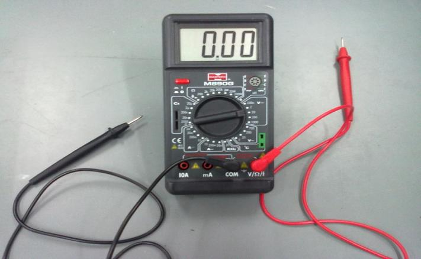
Laboratorio Física II

## Diapositiva 11

Conexión para medir corriente en la unidad de mili Amper (mA)

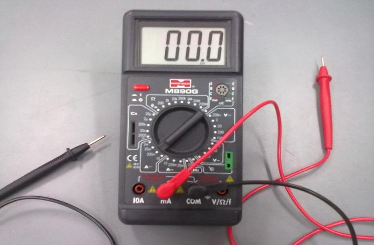
Laboratorio Física II

## Diapositiva 12

Funcionamiento del Multimetro Digital. A continuación mediremos algunas
magnitudes utilizando el multímetro digital.

a) Midiendo resistencia: Básicamente una resistencia es la dificultad que ofrece
un componente al pasaje de la corriente eléctrica, siendo su unidad de medida el
ohm, pudiendo apreciar en el dial de selección del tester las diferentes escalas
(de 0 a 200, 200 a 2000, etc.), salvo que se trate de un multímetro con auto
rango, los cuales permiten la selección automática del rango según la
resistencia medida.

**Tengamos en cuenta que para utilizar el multímetro en esta escala, el
componente a medir no debe recibir corriente del circuito al cual pertenece y
debe encontrarse desconectado.** Laboratorio Física II

## Diapositiva 13

Medir una resistencia es un procedimiento sencillo, lo primero que hacemos es
conectar los cables en los jacks correctos, luego movemos la llave selectora al
símbolo Ω y escogemos el rango adecuado de acuerdo a la resistencia
proporcionada por el resistor, si no lo sabemos, escogemos el rango más alto y
lo disminuimos poco a poco hasta llegar a un cantidad diferente de uno (el uno
indica que el rango es muy pequeño para medir esa resistencia) , tocamos los
extremos del resistor con las puntas roja y negra y finalmente multiplicamos la
cantidad por el valor del rango. Laboratorio Física II

## Diapositiva 14

Medición de una resistencia

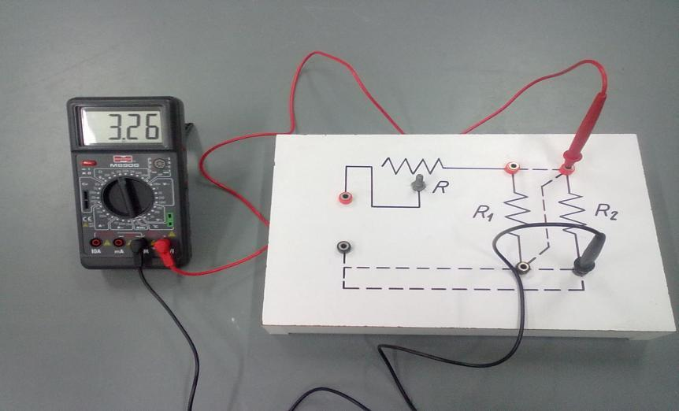
Laboratorio Física II

## Diapositiva 15

b) Midiendo voltaje (voltaje continuo o alterno): **Sabemos que como voltímetro
se conecta en paralelo con el componente a medir**, de tal manera que indique la
diferencia de potencial entre las puntas. Donde indica 200m el máximo es 200
mili volts (0,2 V), el resto se comprende tal cual están expresados por sus
cifras. Por lo tanto, por ejemplo, para medir tensiones de batería del automóvil
debemos elegir la de 20V. Si se está buscando caídas de tensión en terminales o
conductores, podemos elegir una escala con un máximo más pequeño, luego de
arrancar con un rango más elevado y así tener una lectura aproximada. Siempre
hay que empezar por un rango alto, para ir bajando y así obtener mayor
precisión. Cuando el valor a medir supere el máximo elegido, indicará “1”en el
lado izquierdo del Display. Laboratorio Física II

## Diapositiva 16

Medición de tensión de una fuente de alimentación

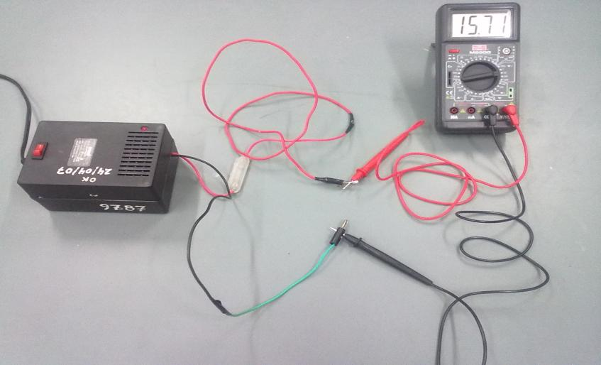
Laboratorio Física II

## Diapositiva 17

c) Midiendo corriente: **Para medir esta magnitud, hay que tener mucha
precaución porque como amperímetro el multímetro se conecta en serie. Por lo
tanto toda la corriente a medir se conducirá por su interior, con el riesgo de
quemarlo.**

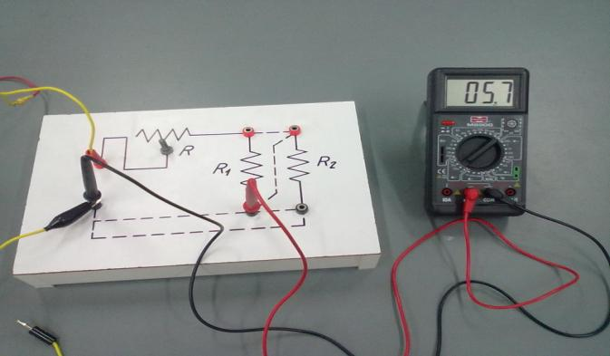
Laboratorio Física II

## Diapositiva 18

OTRAS MAGNITUDES

Hay multímetros genéricos que además miden frecuencia en KiloHertz (KHz) y
mediante un zócalo adicional (parecido al de capacitores) y una termocupla o
conector especial, pueden medir temperatura en grados centigrados. La frecuencia
en KHz generalmente tiene un rango único de 20KHz (20000 Hz). La temperatura en
grados centigrados puede ser captada tocando con la termocupla el objeto a
controlar y la rapidez con la cual registre el valor a igual que su precisión
dependerá de la calidad de cada multímetro y termocupla en cuestión. Algunos
multímetros también agregan otro zócalo para la prueba de transistores, indicado
como hFE. Esto determina el estado de la base y el emisor de dicho
semiconductor. Laboratorio Física II

## Diapositiva 19

Multímetros utilizados en el Laboratorio de Física II

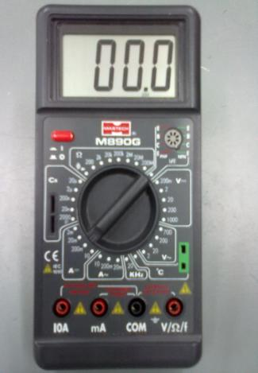

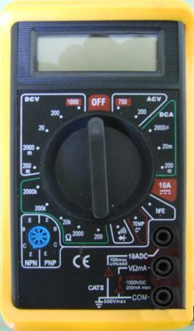

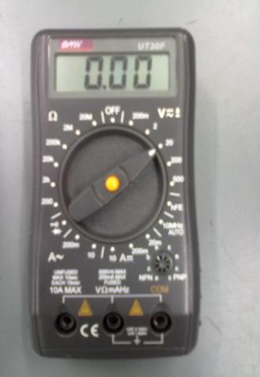
Laboratorio Física II
