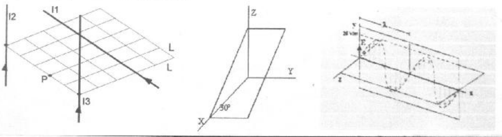

# Parcial: corrientes, circuito variable y onda electromagnética

## Problema 1

Dada la distribución de conductores de corrientes de la figura, a) Graficar el
campo magnético que cada conductor genera en el punto P. b) Calcular el campo
magnético total (módulo, dirección y sentido). Datos: I1=1 amp, I2=2 amp, I3=3
amp. L=1 cm

## Problema 2

Se coloca un circuito de N vueltas, cada una de área S, en un campo magnético
uniforme, paralelo al eje Z, que varía con el tiempo de la forma
$`Bz=Bo\cos(\omega t)`$. a) Calcular la f.e.m. inducida. b) Representar el campo
magnético y la fem en función del tiempo. c) Representar en el circuito el
sentido del campo y de la corriente inducida en cada cuarto de periodo,
explicando el resultado

## Problema 3

Una onda EM se propaga en el vacío con su vector E según la gráfica (amplitud de
E=25 V/m). Si el período es de $`10^7`$ segundos, determine: a) La frecuencia
angular ω, el número de ondas k y la amplitud máxima del campo magnético b) Las
expresiones de los campos eléctricos y magnéticos con sus respectivas
direcciones de oscilación. c) En el gráfico dibuje el primer ciclo del campo
magnético B

## Laboratorio: Mapeo de campo Magnético

a) ¿En qué consistió la práctica de “visualización de líneas de campo”? b) ¿Cuál
es la técnica operatoria? c) Indique cuántas observaciones se hicieron en el
laboratorio, de las características de cada una de ellas y qué conclusiones se
obtuvieron.

## Procedencia y observaciones de transcripción

- Original:
  `2015/480938-Modelos de parcial FISICA II actualizado 060813(0).pdf`, página
  21, examen superior sin encabezado legible (recortado sobre la línea
  superior). No se inventan tema, fecha ni carrera.
- SHA-256: `1555e295ed06e6a3872614be84854c0e0af3e8455048ca7e5bcbc4383490653e`.
- Compilación: Sampallo Guillermo, Rodríguez Ulises y Cleva Mario; versión 1.1,
  04/08/2010 en carátula.
- Herramientas: OCRmyPDF español sobre copia con `--force-ocr`, PyMuPDF4LLM,
  Poppler y cotejo visual de los enunciados y diagramas; ampliación del período
  para comprobar el exponente. Figuras originales por render PyMuPDF.
- El período impreso es **10⁷ segundos**, sin signo menos; se conserva. El
  ángulo 30° del circuito y los rótulos de la onda quedan en las figuras. No se
  resuelven problemas ni se agregan conclusiones de laboratorio.
