<!-- markdownlint-disable MD060 -->

# Trabajo práctico Nº 15: Estudio del fenómeno de la polarización de la luz

Universidad Tecnologica Nacional. Facultad Regional Resistencia. Cátedra: Física
II.

TEMA: ESTUDIO DEL FENÓMENO DE LA POLARIZACIÓN DE LA LUZ

## Objeto de la experiencia

Estudiar y verificar experimentalmente la ley de Malus.

Estudiar y verificar experimentalmente la ley de Brewster

Estudiar el comportamiento de materiales fotoelásticos

## Introducción

La luz es una onda electromagnética transversal, esto significa que el campo
eléctrico (campo magnético) vibra en dirección perpendicular a la dirección de
propagación, definida por el vector de onda $`\vec K`$.

Se dice que la *luz está linealmente polarizada o polarizada en un plano* cuando
la orientación del campo eléctrico ( campo magnético) es constante, aunque su
magnitud y signo pueden variar.

El plano formado por el campo eléctrico y el vector de onda se conoce como
*plano de vibración* (ver figura 1)

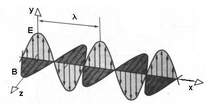

Si consideramos dos ondas de luz, con sus campos eléctricos colineales se
combinarán para producir una onda resultante linealmente polarizada, ahora si
las dos ondas tienen sus campos eléctricos con orientaciones diferentes la onda
resultante deja de ser linealmente polarizada.

## Polarización lineal

Consideremos dos ondas de luz caracterizadas por los campos eléctricos

```math
\vec E_x(z,t)=\vec i\,E_{ox}\cos(kz-\omega t)\qquad\vec E_y(z,t)=\vec j\,E_{oy}\cos(kz-\omega t)
```

Estos campos están en fase, entonces al superponerlos resulta

```math
\vec E(z,t)=\vec E_x(z,t)+\vec E_y(z,t)=(\vec i\,E_{ox}+\vec j\,E_{oy})\cos(kz-\omega t)
```

La onda resultante tiene un campo eléctrico con orientación fija y por lo tanto
también es linealmente polarizada.

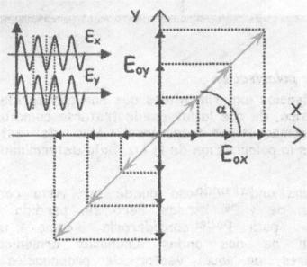

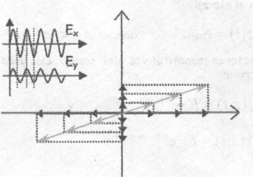

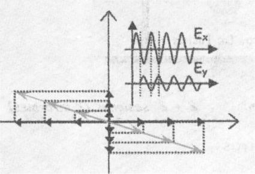

Polarización lineal a) Ex = Ey b) Ex ≠ Ey c) En oposición de fase con Ex ≠ Ey

## Polarización circular

Consideremos dos ondas de luz caracterizadas por los campos eléctricos

```math
\vec E_x(z,t)=\vec i\,E_o\cos(kz-\omega t)\qquad\vec E_y(z,t)=\vec j\,E_o\cos(kz-\omega t+\delta)
```

Estos campos tienen la misma amplitud y presenta una diferencia de fase
$`\delta=-\pi/2+2m\pi`$ donde $`m=0,\pm1,\pm2,\ldots`$ Por lo tanto pueden
escribirse

```math
\vec E_x(z,t)=\vec i\,E_o\cos(kz-\omega t)\qquad\vec E_y(z,t)=\vec j\,E_o\mathop{\mathrm{sen}}\nolimits(kz-\omega t)
```

La onda resultante será

```math
\vec E(z,t)=\vec E_x(z,t)+\vec E_y(z,t)=E_o(\vec i\cos(kz-\omega t)+\vec j\mathop{\mathrm{sen}}\nolimits(kz-\omega t))
```

La amplitud de la onda resultante es igual Eo constante, pero la dirección del
campo eléctrico varia con el tiempo y no está limitada a un solo plano. El campo
eléctrico esta rotando en la dirección de las agujas del reloj para un
observador que mira hacia la fuente, en este caso se dice que la luz tiene
polarización circular derecha. Cuando el campo completa una rotación completa
habrá avanzado una longitud de onda.

Si la diferencia de fase $`\delta=\pi/2+2m\pi`$ donde $`m=0,\pm1,\pm2,\ldots`$
El campo eléctrico ahora, está rotando en la dirección contraria a las agujas
del reloj para un observador que mira hacia la fuente, en este caso se dice que
la luz tiene polarización circular izquierda.

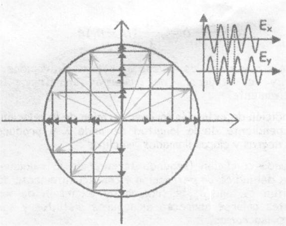

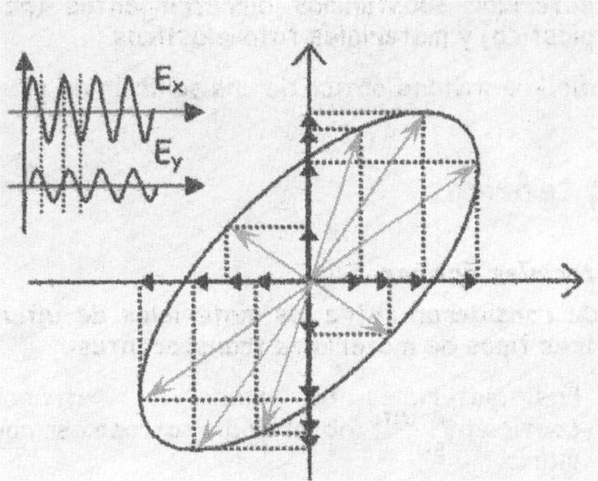

## Polarización eliptica

Consideremos dos ondas de luz caracterizadas por los campos eléctricos

```math
\vec E_x(z,t)=\vec i\,E_{ox}\cos(kz-\omega t)\qquad\vec E_y(z,t)=\vec j\,E_{oy}\cos(kz-\omega t+\delta)
```

Acá la diferencia de fase es arbitraria

Se determinará la curva que describe la punta del campo eléctrico resultante,
para ello consideramos

```math
E_x(z,t)=E_{ox}\cos(kz-\omega t)\qquad E_y(z,t)=E_{oy}\cos(kz-\omega t+\delta)
```

desarrollamos la expresión de $`E_y`$

```math
\frac{E_y}{E_{oy}}=\cos(kz-\omega t)\cos\delta-\mathop{\mathrm{sen}}\nolimits(kz-\omega t)\mathop{\mathrm{sen}}\nolimits\delta
```

mientras

```math
\frac{E_x}{E_{ox}}=\cos(kz-\omega t)\qquad\sqrt{1-\left(\frac{E_x}{E_{ox}}\right)^2}=\mathop{\mathrm{sen}}\nolimits(kz-\omega t)
```

reemplazando

```math
\frac{E_y}{E_{oy}}-\frac{E_x}{E_{ox}}\cos\delta=-\sqrt{1-\left(\frac{E_x}{E_{ox}}\right)^2}\mathop{\mathrm{sen}}\nolimits\delta
```

elevando al cuadrado ambos miembros

```math
\left(\frac{E_y}{E_{oy}}-\frac{E_x}{E_{ox}}\cos\delta\right)^2=\left[1-\left(\frac{E_x}{E_{ox}}\right)^2\right]\mathop{\mathrm{sen}}\nolimits^2\delta
```

operando algebraicamente se tiene

```math
\left(\frac{E_y}{E_{oy}}\right)^2+\left(\frac{E_x}{E_{ox}}\right)^2-2\frac{E_y}{E_{oy}}\frac{E_x}{E_{ox}}\cos\delta=\mathop{\mathrm{sen}}\nolimits^2\delta
```

Esta ecuación corresponde a una elipse cuyos ejes principales forma un ángulo
$`\alpha`$ con el sistemas coordenado (Ex, Ey) con

```math
\tan2\alpha=\frac{2E_{ox}E_{oy}\cos\delta}{E_{ox}^2-E_{oy}^2}
```

cuando α = 0 significa que $`\delta=\pm\pi/2,\pm5\pi/2,\pm7\pi/2`$ tenemos la
forma familiar

```math
\left(\frac{E_y}{E_{oy}}\right)^2+\left(\frac{E_x}{E_{ox}}\right)^2=1
```

Si $`E_{ox}=E_{oy}=E_o`$ entonces

```math
E_x^2+E_y^2=E_o^2
```

Y si $`\delta=n\pi`$ con n entero par

```math
E_y=\frac{E_{oy}}{E_{ox}}E_x
```

Y si $`\delta=n\pi`$ con n entero impar

```math
E_y=-\frac{E_{oy}}{E_{ox}}E_x
```

Por lo tanto, bajo condiciones determinadas la polarización elíptica contiene a
las anteriores.

## Luz natural

La luz natural es luz no polarizada.

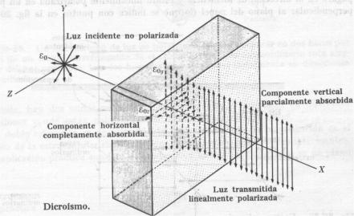

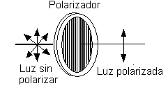

Para obtener luz polarizada a partir de luz natural existen algunos métodos:

- Absorción selectiva
- Reflexión
- Doble refracción

## Polarización por absorción selectiva: dicroismo

Una lámina polarizadora transforma a la luz no polarizada en luz linealmente
polarizada. La lámina permite únicamente el paso de aquellas componentes de la
onda cuyos campos eléctricos vibren paralelamente a una dirección. La situación
se llama dicroismo

Este procedimiento de absorción selectiva en esta dirección se produce
sumergiendo ciertas moléculas de cadena larga en una lámina flexible de plástico
y estirando después la lámina para que las moléculas queden alineadas
paralelamente entre sí.

## Polarización por reflexión

La figura muestra un haz de luz no polarizada que incide sobre un cristal. El
campo eléctrico de cada tren de onda del haz de luz natural se puede descomponer
en dos componentes:

- Componente paralelo al plano de incidencia
- Componente perpendicular al plano de incidencia

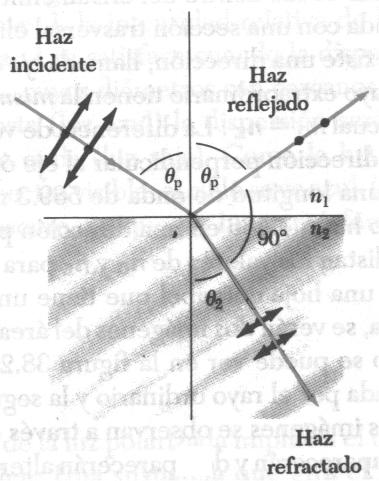

Para el cristal y ciertos materiales dieléctricos, existe un determinado ángulo
de incidencia llamado ángulo de polarización $`\alpha_P`$ para el cual no se
refleja luz alguna con el campo eléctrico paralelo al plano de incidencia. El
ángulo de polarización $`\alpha_P`$ se encuentra experimentalmente cuando los
rayos reflejado y refractado son perpendiculares entre sí, esto es

```math
\theta_P+\theta_R=90^\circ
```

De la ley de Snell

```math
n_1\mathop{\mathrm{sen}}\nolimits\theta_P=n_2\mathop{\mathrm{sen}}\nolimits\theta_R
```

reemplazando resulta

```math
n_1\mathop{\mathrm{sen}}\nolimits\theta_P=n_2\mathop{\mathrm{sen}}\nolimits90^\circ-\theta_P=n_2\cos\theta_P
```

entonces

```math
\tan\theta_P=\frac{n_1}{n_2}
```

Que se conoce como la Ley de Brewster.

## Los materiales ópticos

Se puede considerar entre los materiales de interés en óptica, tres tipos de
materiales transparentes:

Los materiales de índice de refracción y coeficiente de absorción isotrópicos
como el vidrio.

Los materiales que tienen índices de refracción anisotrópicos. La velocidad con
que se propaga la luz en estos materiales depende de la orientación del campo
electro-magnético relativa a las direcciones preferenciales del material. Se
nota una dirección de polarización **rápida** y una dirección de polarización
**lenta** del material. Estos son los materiales **birrefringentes**. Para
algunos de ellos, el índice de refracción depende de la tensión mecánica. Estos
materiales llegan a ser birrefringentes cuando se les aplica esfuerzo mecánico.
Los materiales que presentan esta característica son llamados **fotoelásticos**.

Los materiales que presentan coeficiente de absorción anisotrópico. Estos
materiales absorben selectivamente la componente de la onda electromagnética en
una orientación específica. A estos materiales se les llaman **polarizadores**.

## Ley de Malus

Si la luz natural incide sobre un polarizador lineal ideal, se transmitirá solo
la componente del campo eléctrico paralela a la dirección de transmisión del
polarizador. Si el polarizador se gira alrededor del eje z la intensidad
registrada por el detector permanecerá sin cambio.

La luz transmitida está polarizada en un plano. Si esta luz polarizada incide
sobre un segundo polarizador, y la dirección de transmisión de este está
orientado perpendicular al plano de polarización de la luz incidente, nada de
luz atravesará el segundo polarizador (vea el dibujo).

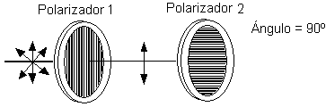

Si el segundo polarizador está orientado a un ángulo $`\theta`$ respecto al
primer polarizador, quedarán restos de algún componente del campo eléctrico de
la luz polarizada que permanece en la misma dirección que el eje del segundo
polarizador, así que algo de luz atravesará el segundo polarizador (vea el
dibujo ).

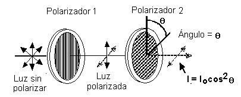

El componente, E, del campo eléctrico polarizado, Eo, está determinado por:

```math
E=E_o\cos\theta
```

Dado que la intensidad de la luz cambia como el cuadrado del campo eléctrico, la
intensidad de la luz que atraviesa el segundo polarizador es determinada por:

```math
I=I_o\cos^2\theta
```

donde Io es la intensidad de la luz que atraviesa el primer filtro y $`\theta`$
es el ángulo existente entre las direcciones de transmisión de los
polarizadores.

Consideremos los dos casos extremos para esta ecuación:

Si $`\theta`$ es cero, el segundo polarizador está alineado con el primero, y el
valor del $`\cos^2(\theta)`$ es uno. Dado que la intensidad transmitida por el
segundo filtro es igual a la intensidad de la luz que atraviesa el primer
filtro. En este caso se permitirá que una intensidad máxima atraviese los
polarizadores.

Si $`\theta`$ es 90º, el segundo polarizador está orientado de manera
perpendicular a la dirección de transmisión del primer polarizador, y el
$`\cos^2(90^\circ)`$ es igual a cero. De modo que nada de luz atraviesa el
segundo polarizador. Este caso permitirá que una cantidad mínima atraviese.

Estos resultados asumen que la absorción de la luz se debe únicamente a los
efectos de los polarizadores. De hecho la mayoría de las películas polarizadoras
no son claras y, en consecuencia, hay algo de absorción debida a la coloración
de los polarizadores.

Si representamos con $`I_{\mathrm{max}}`$ e $`I_{\mathrm{min}}`$ los valores
máximo y mínimo de la cantidad de luz que incide sobre el detector, se define el
*porcentaje de polarización* como

```math
P\%=\frac{I_{\mathrm{max}}-I_{\mathrm{min}}}{I_{\mathrm{max}}+I_{\mathrm{min}}}100
```

## Elementos empleados

Lámpara de luz blanca incandescente, dos polarizadores montados en escala
graduada en grados angulares, fotómetro y datalogger(o PC) con software para
registrar datos.

## Trabajo a realizar

1.-Verifique la ley experimental de Malus en la forma $`I=I(\theta)`$, donde I
es la irradiancia de la luz emergente del polarizador (analizador) y θ es el
ángulo entre las direcciones de transmisión de los dos polarizadores en el
montaje que se muestra a continuación.

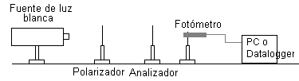

2.- Determinar el porcentaje de polarización.

<!-- markdownlint-disable MD029 -->

3. Con el montaje que a continuación se presenta, observe y mida el ángulo de
   Brewster y analice la luz reflejada por una superficie dieléctrica (vidrio).
   La placa de vidrio se apoya sobre una escala graduada en grados angulares.
   Determinar la curva de polarización intensidad de la luz polarizada (paralela
   y perpendicular) en función del ángulo de incidencia.

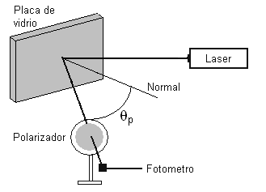

4. Observar la polarización en materiales fotoelásticos. Colocar entre los dos
   polarizadores una placa de acrílico lentes de acrílico y observar los
   esfuerzos mecánicos que existen en ellos.

<!-- markdownlint-enable MD029 -->

## Trabajo práctico Nº 15: Hoja de datos

TEMA: ESTUDIO DEL FENÓMENO DE LA POLARIZACIÓN DE LA LUZ

OBJETO DE LA EXPERIENCIA:

Estudiar y verificar experimentalmente la ley de Malus.

Estudiar y verificar experimentalmente la ley de Brewster

Estudiar el comportamiento de materiales fotoelásticos

<table>
<tr><th rowspan="5">CURSO</th><th rowspan="5">FECHA</th><th>INTEGRANTES</th></tr>
<tr><td>1.-</td></tr>
<tr><td>2.-</td></tr>
<tr><td>3.-</td></tr>
<tr><td>4.-</td></tr>
</table>

### Estudiar y verificar experimentalmente la ley de Malus

Dibujar el montaje que emplea para la verificación de la ley de Malus

Complete la siguiente tabla

| Angulo | Intensidad | Angulo | Intensidad | Angulo | Intensidad |
| -- | -- | -- | -- | -- | -- |
| 0 |  | 120 |  | 240 |  |
| 10 |  | 130 |  | 250 |  |
| 20 |  | 140 |  | 260 |  |
| 30 |  | 150 |  | 270 |  |
| 40 |  | 160 |  | 280 |  |
| 50 |  | 170 |  | 290 |  |
| 60 |  | 180 |  | 300 |  |
| 70 |  | 190 |  | 310 |  |
| 80 |  | 200 |  | 320 |  |
| 90 |  | 210 |  | 330 |  |
| 100 |  | 220 |  | 340 |  |
| 110 |  | 230 |  | 350 |  |

Represente gráficamente los valores de la tabla

Calcule el porcentaje de polarización

```math
P\%=\frac{I_{\mathrm{max}}-I_{\mathrm{min}}}{I_{\mathrm{max}}+I_{\mathrm{min}}}100=
```

### Estudiar y verificar experimentalmente la ley de Brewster

Dibujar el montaje que emplea para la verificación de la ley de Brewster

Haga rotar la placa de vidrio y para cada ángulo de incidencia determine la
intensidad de haz linealmente polarizado (emplee la tabla anterior de 0º hasta
90º). Determine el ángulo de polarización

### Estudiar el comportamiento de materiales fotoelásticos

Coloque entre las dos láminas de polarizadoras

Una placa de acrílico

Una lente de acrílico

En cada caso haga rotar el analizador y observe con detenimiento y registre una
imagen color.

## Procedencia y transcripción

Fuente: `2015/FISICA II - EXPERIENCIAS DE LABORATORIOS.pdf`, páginas 81–89,
cotejadas completas. Se conservan los casos lineal, circular y elíptico, la
derivación algebraica, métodos de polarización, leyes de Brewster y Malus,
cuatro trabajos y la hoja con36 ángulos y mediciones vacías. Véase
[el inventario de fuentes](../../../resources/2015/fuentes.md).

Se preservan la convención de giro mirando hacia la fuente, los signos de fase y
raíces, los valores ±π/2, ±5π/2, ±7π/2 impresos, αP en el texto frente a θP en
las fórmulas, la escritura sin paréntesis en sen90°−θP, y el cociente n1/n2
final de Brewster tal como aparece. Tampoco se modifica «presenta», «forma», «el
sistemas» ni «láminas de polarizadoras». No se corrigen afirmaciones ni se
completan resultados experimentales.
