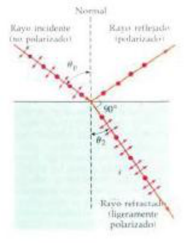
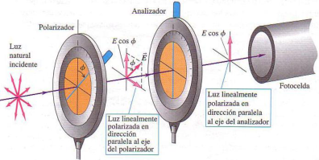

# Guía de problemas: Polarizacion

**1)** Consideremos dos ondas de luz caracterizadas por los campos eléctricos

```math
\vec E_x(z,t)=\vec i\,E_o\cos kz-\omega t
```

```math
\vec E_y(z,t)=\vec j\,E_o\cos kz-\omega t+\delta
```

Analice el tipo de polarización que posee el campo resultante si

a) Los campos tienen la misma amplitud y presenta una diferencia de fase
$`\delta=0,\pm2\pi,\pm4\pi,\ldots2m\pi`$ donde $`m=0,\pm1,\pm2,\ldots`$

b) Los campos tienen la misma amplitud y presenta una diferencia de fase
$`\delta=-\pi/2+2m\pi`$ donde $`m=0,\pm1,\pm2,\ldots`$

c) Los campos tienen distinta amplitud y diferencia de fase arbitraria



**2)** Un haz paralelo de luz no polarizada en aire incide a un ángulo de 54.5°
(respecte a la normal) sobre una superficie plana de vidrio. El haz reflejado
está linealmente polarizado en su totalidad.

a) ¿Cuál es el índice de refracción del vidrio? b) ¿Cuál es el ángulo de
refracción del haz transmitido?

**3)** La luz que viaja en agua incide en una placa de .vidrio a un ángulo de
incidencia de 53.0°; una parte del haz se refleja y otra se refracta . Si las
porciones reflejada y refractada forman un ángulo de 90.0° una con la otra.
¿cuál es el índice de refracción del vidrio?

**4)** La luz no polarizada que se propaga en un líquido con un índice de
refracción _n_ incide en la superficie del líquido, arriba de la cual hay aire.
Si la luz incide sobre la superficie a un ángulo de 31.2° respecto a la normal,
la luz que se refleja de regreso en el líquido está totalmente polarizada.

a) ¿Cuál es el índice de refracción _n_ del líquido?

b) ¿Qué ángulo forma con la nornal a la superficie la luz refractada que se
propaga en el aire?

**5)** El índice de refracción de cierto vidrio es de 1.66. ¿A qué ángulo de
incidencia estará totalmente polarizada la luz que se refleja en la superficie
de este vidrio si el vidrio está inmerso en: a) aire, b ) agua?



La luz no polarizada de intensidad lo incide en un filtro polarizador, La luz
que emerge incide en un segundo filtro polarizador cuyo eje está a 41.0°
respecto al del primero. Halle la intensidad del haz después de pasar a través
del segundo polarizador

**6)** Un polarizador y un analizador están orientados de modo que se transmite
la máxima cantidad de luz. ¿A qué

fracción de su valor máximo se reduce la intensidad de la luz transmitida cuando
se hace girar el analizador. al 22.5 °. b ) 45.0°. e) 67.5º?

**7)** La luz no polarizada con una intensidad de 20.0 _Wlm_<sup>_2_</sup>
incide en dos filtros polarizadores. El eje del primer filtro está a un ángulo
de 25.0º de la vertical en sentido contrario a las manecillas del reloj (visto
en la dirección de propagación de la luz) y el eje del segundo está a un ángulo
de 62.0º de la vertical en ese mismo sentido. ¿Cuál es la intensidad de la luz
después que ha pasado a través del segundo polarizador?

**8)** Se tienen tres filtros polarizadores apilados, con el eje de polarización
de los filtros segundo y tercero a 23.0" y 62.0°, respecto al del primero. Si
incide luz no polarizada en la pila, la luz tiene una intensidad de 75.0 W/cm2
después de atravesar la pila. Si se mantiene constante la intensidad incidente.
¿cuál es la intensidad de la luz después de pasar a través de la pila si se
quita el segundo polarizador?

## Nota de transcripción

Se conservan la escritura de las dos expresiones sin paréntesis de argumento, la
unidad «Wlm²», la comilla en 23.0" y las erratas del original. No se resuelven
los ocho problemas ni se añade numeración al párrafo del segundo polarizador.

[Procedencia y comprobaciones](../../../resources/2015/fuentes.md).
