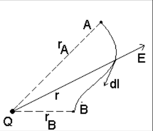
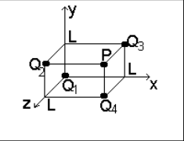
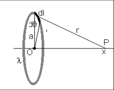
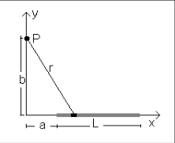
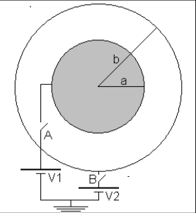
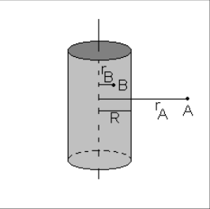
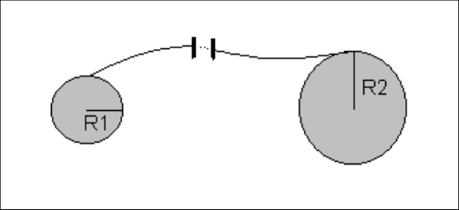

# Potencial eléctrico: guía identificada como 2011

Fuente: `2015/guia de problemas 2011.pdf`, páginas 10–11 de 31. SHA-256:
`5a5ae8ac33a7a3d14d854623015ef14bc0af3dae1651c013aed06567e28a8bca`.

Extracción pdftotext y cotejo visual de ambas páginas, con recuperación de
símbolos y fórmula del dipolo. Diez preguntas, once problemas y siete figuras.
El año 2011 pertenece al nombre del archivo.

## Cuestionario

**1.** ¿Una carga eléctrica positiva se desplaza de una superficie potencial a
otra de mayor o menor valor de potencial?

**2.** ¿Qué consideraciones puede hacer sobre un conductor esférico aislado
cargado positivamente?

**3.** ¿Dos superficies equipotenciales diferentes pueden interceptarse?

**4.** Si en una región del espacio el potencial eléctrico es constante ¿qué
puede decirse sobre el campo eléctrico en esa región?

**5.** Si se conoce el valor del campo eléctrico en un punto ¿es posible
calcular el potencial eléctrico en ese punto? Si no se puede ¿qué información
falta?

**6.** Si el campo eléctrico es cero en una región, puede decir que también el
potencial eléctrico es cero.

**7.** Explique la diferencia entre energía potencial eléctrica y potencial
eléctrico.

**8.** ¿Cómo puede protegerse un dispositivo electrónico de campos eléctricos
externos?

**9.** En condiciones estáticas, ¿porqué todos los puntos de un conductor están
al mismo potencial?

**10.** ¿Qué relación se cumple entre las líneas de fuerzas del campo eléctrico
y las superficies equipotenciales?

## Problemas

### Problema 1

a)Calcule la diferencia de potencial entre A y B de una región donde existe un
campo eléctrico creado por una carga puntual (ver figura 1).b)Suponiendo que el
punto A está infinitamente lejos de la carga Q, ¿cuál sería la diferencia de
potencial entre ese punto y el punto B? c) Analizando este resultado represente
gráficamente los puntos del espacio que tengan igual diferencia de potencial.



Figura 1.

### Problema 2

La separación más probable entre el electrón y el núcleo de H (un protón) es
igual a $`r_o`$ = $`5{,}29\cdot10^{-11}`$ m. Considerando el protón como núcleo
del H, calcule el potencial eléctrico V creado por él, a una distancia $`r_o`$
del mismo. Calcule la energía potencial eléctrica U del átomo

### Problema 3

Determine el potencial eléctrico de la distribución de cargas puntuales
mostradas en la figura 2, en el punto P. El valor de las cargas son $`Q_1`$
=$`10^{-6}`$ C, $`Q_2`$ = -2.$`10^{-6}`$ C, $`Q_3`$ = 3.$`10^{-6}`$ C y $`Q_4`$
= - 2.$`10^{-6}`$ C. La distancia L = 0.1 m.



Figura 2.

### Problema 4

Considere un anillo de radio a que posee una carga Q distribuida uniformemente.
Determine el potencial eléctrico en un punto P sobre el eje del disco, a una
distancia x de su centro. Analice los casos $`x\gt\gt a`$; $`x\lt\lt a`$ y
$`x=0`$. Figura 3.



Figura 3.

### Problema 5

Considere una barra delgada de longitud L que posee una carga Q distribuida
uniformemente. Determine el potencial eléctrico en un punto P a una distancia b
a lo largo del eje y positivo, como muestra la figura.4



Figura 4.

### Problema 6

Una esfera conductora de radio a está conectada a una batería de potencial
eléctrico V1; rodeando a ésta se encuentra otra esfera conductora de radio b que
puede o no estar conectada a la batería V2. (Ver figura 5) a) Si el interruptor
A está cerrado y el B abierto, calcular E(r) para $`r\lt a`$; $`a\lt r\lt b`$;
$`r\gt b`$. b) si el interruptor A está abierto y el B cerrado calcular E(r)
para los mismos puntos que en el caso anterior. c) Suponga que V2 = 0, repita el
cálculo si los interruptores A y B están cerrados. d) Suponga que los dos
interruptores están cerrados, repita el cálculo.



Figura 5.

### Problema 7

Dada una esfera conductora de radio R con carga Q, calcular V(r) para $`r\gt R`$
y $`r\lt R`$. Considerar V(r) = 0 si se toma r infinitamente lejos de la esfera.

### Problema 8

Calcule la diferencia de potencial $`V_{AB}`$ debido a una distribución
cilíndrica de carga de radio R y densidad de carga $`\rho`$. Los puntos A y B
está indicados en la figura 6



Figura 6.

### Problema 9

¿Cuántos electrones se deben quitar a un conductor esférico inicialmente
descargado de radio 0.3 m para producir un potencial de 10kV en la superficie?

### Problema 10

Dos esferas conductoras de radio 0.1m y 0.4m respectivamente, están muy
separadas pero conectadas con un hilo conductor, como se muestra en la figura 7.
Se deposita una carga total de 20 $`\mu\mathrm C`$ en esta combinación de
esferas. a) ¿Cómo se distribuye la carga?. b) ¿cuál es el potencial eléctrico de
cada esfera?. c) ¿cuál es el campo eléctrico de cada esfera?



Figura 7.

### Problema 11

Se puede demostrar que el potencial eléctrico de un dipolo con momento dipolar p
= q.a está dado por

```math
V(r,\theta)=\frac{1}{4\pi\varepsilon_o}\frac{p\cos(\theta)}{r}
```

a) Determine las componentes del campo eléctrico

b) En el plano, trace algunas líneas equipotenciales.

## Observaciones de fidelidad

- La fórmula del problema 11 imprime r en el denominador, sin cuadrado; se
  conserva, diferenciada de la fórmula de otra versión.
- El problema 4 comienza con un anillo y luego menciona «eje del disco». El
  problema 6 pide E(r) y repite la condición de ambos interruptores cerrados en
  c) y d). No se corrigen.
- La figura 7 incluye una batería en el conductor entre esferas; se conserva el
  dibujo original, sin armonizarlo con el texto. No se resuelven ejercicios.
