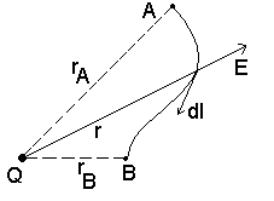
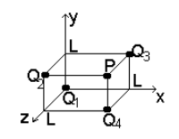
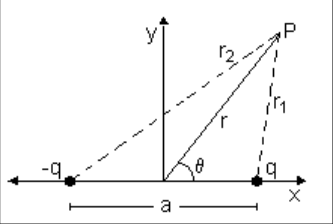
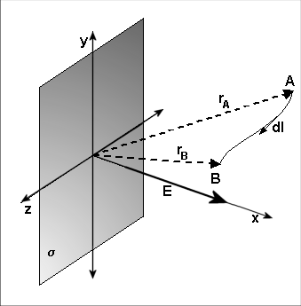
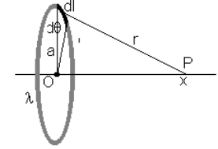
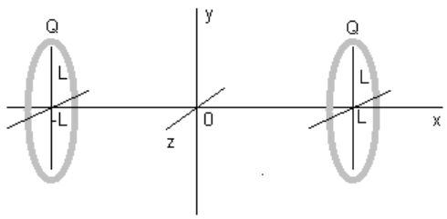
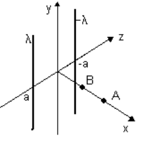
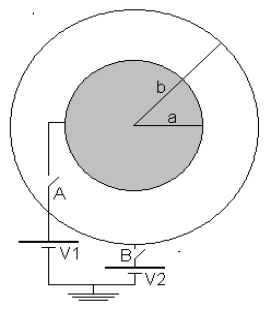

# Guía de problemas: potencial eléctrico

Fuente: `2015/GUIA DE PROBLEMAS PROPUESTOS 1ra parte.pdf`, sección potencial de
páginas 11–13 de 24. SHA-256:
`efac01b619f48d06286a725a5a7ccc8de7b6baffb2a931515c9dba28ae7e5e5b`.

Extracción pdftotext y cotejo visual de las tres páginas. Diez preguntas, once
problemas numerados 1–7 y 9–12, ocho figuras.

## Cuestionario

**1.** ¿Una carga eléctrica positiva se desplaza de una superficie potencial a
otra de mayor o menor valor de potencial?

**2.** ¿Qué consideraciones puede hacer sobre un conductor esférico aislado
cargado positivamente?

**3.** ¿Dos superficies equipotenciales diferentes pueden interceptarse?

**4.** Si en una región del espacio el potencial eléctrico es constante ¿qué
puede decirse sobre el campo eléctrico en esa región?

**5.** Si se conoce el valor del campo eléctrico en un punto ¿es posible
calcular el potencial eléctrico en ese punto? Si no se puede ¿qué información
falta?

**6.** Si el campo eléctrico es cero en una región, puede decir que también el
potencial eléctrico es cero.

**7.** Explique la diferencia entre energía potencial eléctrica y potencial
eléctrico.

**8.** ¿Cómo puede protegerse un dispositivo electrónico de campos eléctricos
externos?

**9.** En condiciones estáticas, ¿porqué todos los puntos de un conductor están
al mismo potencial?

**10.** ¿Qué relación se cumple entre las líneas de fuerzas del campo eléctrico
y las superficies equipotenciales?

## Problemas

### Problema 1

Calcule la diferencia de potencial entre los puntos A y B pertenecientes a una
región donde existe un campo eléctrico creado por una carga puntual (ver
figura). Suponiendo que el punto A está infinitamente lejos de la carga Q, ¿cuál
sería la diferencia de potencial entre ese punto y el punto B? Analizando este
resultado represente gráficamente los puntos del espacio que tengan igual la
diferencia de potencial.



### Problema 2

Calcular el potencial eléctrico de la distribución de cargas puntuales mostradas
en la figura, en el punto P. El valor de las cargas son
$`Q_{\mathrm{B}1\mathrm{B}}=10^{-6}`$ C,
$`Q_{\mathrm{B}2\mathrm{B}}=-2\cdot10^{-6}`$ C,
$`Q_{\mathrm{B}3\mathrm{B}}=3\cdot10^{-6}`$ C y
$`Q_{\mathrm{B}4\mathrm{B}}=-2\cdot10^{-6}`$ C. La distancia L = 0.1m



### Problema 3

a) Calcule el potencial eléctrico producido por un dipolo en función r y θ, como
indica la figura. b) Obtenga las expresiones de las líneas equipotenciales en el
plano r y θ.



### Problema 4

Calcular la diferencia de potencial eléctrico entre dos puntos A y B ubicados en
una región donde existe una placa plana infinitamente grande con densidad de
carga σ.



### Problema 5

Considere un anillo de radio a que posee una carga Q distribuida uniformemente.
Ver figura. Determine el potencial eléctrico en un punto P sobre el eje del
anillo, a una distancia x de su centro. Analice los casos $`x\gt\gt a`$ y x = 0.



### Problema 6

Dos cargas en forma de anillo de radio L y carga +Q están centradas sobre el eje
x y localizadas en sendos planos perpendiculares al mismo en los puntos x = - L
y en x = L. Considere una carga puntual de masa m y carga q que está restringida
a moverse a lo largo del eje x. Determine el potencial entre los anillos de
carga en función de x para $`-L\le x\le L`$ Demostrar que el potencial pasa por
un mínimo en x = 0. Demostrar que el potencial para $`x\lt\lt L`$ toma la forma
$`V(0)+kx\mathrm{P}^{2\mathrm{P}}`$ Deducir la frecuencia de oscilación de la
masa m si se desplaza ligeramente del origen y se deja libre.



### Problema 7

Dos hilos muy largos con densidades de cargas λ y -λ son paralelos al eje y,
están localizados en z = -a y z = a. Calcule la diferencia de potencial
$`V_{\mathrm{B}A\mathrm{B}}`$ entre los puntos A y B indicados en la figura.



### Problema 9

Dada una esfera conductora de radio R con carga Q aislada. Calcular V(r) para
$`r\ge R`$ y $`r\le R`$.

### Problema 10

Una esfera conductora de radio a está conectada a una batería de potencial
eléctrico V1; rodeando a ésta se encuentra otra esfera conductora de radio b que
puede o no estar conectada a la batería V2. a) Si el interruptor A está cerrado
y el B abierto, calcular E(r) para $`r\lt a`$; $`a\lt r\lt b`$; $`r\gt b`$. b)
si el interruptor A está abierto y el B cerrado calcular E(r) para los mismos
puntos que en el caso anterior. c) Suponga que V2 = 0, repita el cálculo del
item b, si el interruptor A está cerrado.

d) Suponga que los dos interruptores están cerrados, repita el cálculo.



### Problema 11

Dos esferas conductoras de radio 0.1m y 0.4 m respectivamente, están muy
separadas pero conectadas con un hilo conductor. Se deposita una carga total de
$`20\cdot10\mathrm{P}^{-6\mathrm{P}}`$ C en esta combinación de esferas. a)
¿Cómo se distribuye la carga?. b) ¿cuál es el potencial eléctrico de cada
esfera? c) ¿cuál es el campo eléctrico de cada esfera?

### Problema 12

El potencial eléctrico de un dipolo como momento dipolar eléctrico p = qa está
dado por

```math
V_P(r,\theta)=\frac{p}{4\pi\varepsilon_o}\frac{\cos(\theta)}{r^2}
```

Determine las componentes del campo eléctrico.

## Observaciones de fidelidad

- El original salta del problema 7 al 9; no se agrega un problema 8.
- Se conservan las letras B que rodean subíndices y las P que acompañan
  potencias: aparecen impresas en la fuente, no son variables añadidas. Se
  mantiene la distribución tipográfica observada.
- El problema 6 afirma un mínimo del potencial y el problema 10 solicita E(r);
  no se modifican ni se resuelven los enunciados.
- La figura del anillo del problema 5 llega al borde derecho de la página
  original; se conserva ese límite.
