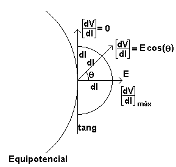
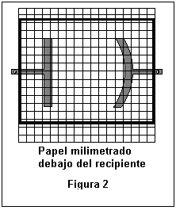
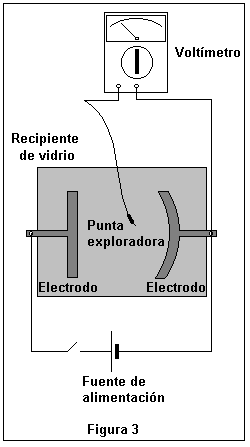
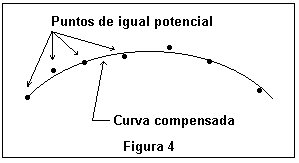
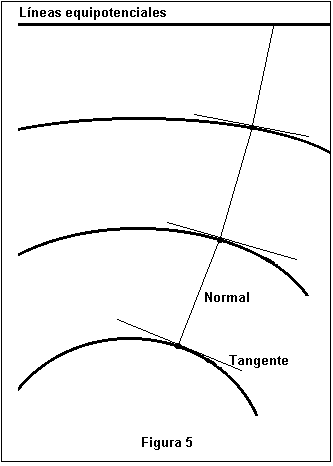

<!-- markdownlint-disable MD060 MD029 -->

# Trabajo de laboratorio Nº 1: Potencial eléctrico. Mapeo del campo eléctrico

Universidad Tecnologica Nacional. Facultad Regional Resistencia. Cátedra: Física
II.

TEMA: POTENCIAL ELÉCTRICO. MAPEO DEL CAMPO ELÉCTRICO

## Objeto de la experiencia

Visualizar el espectro del campo eléctrico en un plano producido por una
distribución de carga obtenido a partir del trazado de líneas equipotenciales.

## Metodologia

Dada una distribución de carga, se determinan las posiciones de los puntos de
igual potencial, trazándose a través de ellos una línea equipotencial,
generándose asi una familia de líneas equipotenciales. A partir de estas es
posible graficar las líneas de campo eléctrico asociadas.

## Fundamentos teóricos

EL CAMPO ELÉCTRICO COMO GRADIENTE DEL POTENCIAL

Hasta ahora se ha determinado la función potencial eléctrico V(x, y, z) en una
región del espacio conociendo el campo electrostático en esa región.

El problema que se plantea a partir de ahora es:

¿es posible determinar el campo si conocemos el potencial ?



Si se aplica la definición de diferencia de potencial a dos puntos separados por
una distancia dl, suponiendo que en esa región, el campo $`\vec E`$ puede ser
considerado constante, entonces

```math
dV=-\vec E\cdot\overrightarrow{dl} \tag{1}
```

considerando el producto escalar se tiene

```math
dV=-E\cos(\theta)\,dl \tag{2}
```

haciendo

```math
\frac{dV}{dl}=-E\cos(\theta) \tag{3}
```

Es posible interpretar mediante la figura 1,

a) si el vector $`\overrightarrow{dl}`$ es tangente a una superficie
equipotencial entonces no hay variación de potencial y el cociente

$`\left|\frac{dV}{dl}\right|=0`$

b) si el vector $`\overrightarrow{dl}`$ es normal a la tangente de una
superficie equipotencial, entonces hay una máxima variación de potencial y el
cociente

$`\left|\frac{dV}{dl}\right|_{Max}=E`$

c) si el vector $`\overrightarrow{dl}`$ forma un ángulo θ con la tangente de una
superficie equipotencial, entonces el cociente toma el valor

$`\left|\frac{dV}{dl}\right|=E\cos(\theta)`$

Haciendo el desarrollo en coordenadas cartesianas de (1) el vector
$`\overrightarrow{dl}`$ tiene como componentes (dx, dy, dz) entonces

```math
dV=-(E_x\,dx+E_y\,dy+E_z\,dz) \tag{5}
```

Puesto que V es una función de la posición, es decir, de x, y y z, el
diferencial total puede expresarse

```math
dV=\frac{\partial V}{\partial x}\,dx+\frac{\partial V}{\partial y}\,dy+\frac{\partial V}{\partial z}\,dz \tag{6}
```

Comparando la (5) y la (6) surge que

```math
E_x=-\frac{\partial V}{\partial x}\qquad E_y=-\frac{\partial V}{\partial y}\qquad E_z=-\frac{\partial V}{\partial z} \tag{7}
```

Entonces el campo eléctrico puede indicarse como

```math
\vec E=-\frac{\partial V}{\partial x}\vec i-\frac{\partial V}{\partial y}\vec j-\frac{\partial V}{\partial z}\vec k \tag{8}
```

o bien

```math
\vec E=-\nabla V(x,y,z) \tag{9}
```

donde ∇ representa el gradiente de V(x, y, z). El campo eléctrico está indicando
la dirección y magnitud de la variación espacial máxima de la función escalar
V(x, y, z), el signo negativo indica el sentido contrario de la variación.

El gradiente de una función escalar gráficamente indica la dirección y sentido
de máxima variación de la función.

Propiedades del gradiente

El gradiente ∇V es un operador vectorial sobre V (función de la posición) que da
información de V en un entorno del punto en el cual se calcula.

a) El sentido de ∇V es aquel en el cual la función escalar V varía más
rápidamente.

b) ∇V es perpendicular en cada punto a las superficies equipotenciales.

c) El $`\lvert\nabla V\rvert`$ es igual al máximo de las derivadas direccionales
de V

## Superficies equipotenciales

Si una línea L es equipotencial, entonces satisface V(x, y) = C, si se calcula
el diferencial resulta

```math
dV=\frac{\partial V}{\partial x}\,dx+\frac{\partial V}{\partial y}\,dy=0 \tag{10}
```

y considerando la relación con las componentes del campo

```math
dV=-E_x\,dx-E_y\,dy=0 \tag{11}
```

entonces, es posible encontrar la expresión de la familia de líneas
equipotenciales a partir de las componentes del campo eléctrico haciendo

```math
\frac{dy}{dx}=-\frac{E_x}{E_y} \tag{12}
```

Como las líneas de fuerzas del campo eléctrico son tangentes a este, entonces
siempre atraviesan las superficies equipotenciales en forma perpendicular y
corren en la dirección en la cual el potencial decrece más rápidamente. Las
líneas de fuerza y las superficies equipotenciales son **familias ortogonales**,
es decir, en un punto de intersección sus tangentes son perpendiculares[^1].
Entonces a partir de esta condición es posible obtener la familia de líneas de
fuerzas del campo eléctrico. Haciendo

```math
-\frac{1}{\frac{dy}{dx}}=-\frac{E_x}{E_y} \tag{13}
```

Esto se desarrolló en coordenadas cartesianas, pero puede extenderse a otras
coordenadas.

La experiencia de laboratorio se basará en este hecho.

## Material a utilizar

- Fuente de alimentación de CC.

<!-- -->

- Equipo para la práctica de campo eléctrico (recipiente de vidrio, agua
  potable, electrodos y papel milimetrado tamaño oficio)

<!-- -->

- Multímetro.

<!-- -->

- Cables de Conexión.

## Técnica operatoria

**1.** Lave varias veces el recipiente de vidrio con agua potable y luego
llénelo con agua hasta una altura de unos 5 mm.

**2.**


Coloque debajo del recipiente un papel milimetrado tamaño oficio que servirá de
referencia.

**3.** Antes de colocar los electrodos verifique que están limpios, póngalos en
forma firme y ajústelos en el borde del recipiente, establezca la posición de
los mismo tomando usando como referencia el papel milimetrado. Figura 2

**4.** Arme el circuito presentado en la Figura 3. Compruebe que la escala del
voltímetro es la adecuada.

**Solicite la autorización al auxiliar docente para hacer la conexión a la
fuente de alimentación.**

**5.**


Cuando se conecta el circuito, entre los electrodos se establece una diferencia
de potencial Vo, igual a la de la fuente, que puede ser medida con el
voltímetro, si se elije el electrodo conectado al borne ( - ) del voltímetro
como punto de referencia (V=0) y se conecta el otro borde a una punta
exploradora.

**6.** Divida la diferencia de potencial Vo en ocho partes.

**7.** Con esta punta exploradora determine las coordenadas (x,y) de al menos 8
de los puntos que están al potencial $`V_1=\frac{V_o}{8}`$ mediante la lectura
del voltímetro y complete con estos datos la tabla 1 . Luego busque co la punta
exploradora los puntos que están al potencial $`V_2=2\frac{V_o}{8}`$ mediante la
lectura del voltímetro y complete con estos la tabla 1.

**8.** Haga lo mismo para $`V_3=3\frac{V_o}{8}`$ ...... y finalmente para
$`V_9=7\frac{V_o}{8}`$

<table style="width:78%;">
<colgroup>
<col style="width: 21%" />
<col style="width: 5%" />
<col style="width: 6%" />
<col style="width: 4%" />
<col style="width: 4%" />
<col style="width: 24%" />
<col style="width: 5%" />
<col style="width: 5%" />
</colgroup>
<tbody>
<tr>
<td colspan="8" style="text-align: left;"><strong>Tabla 1</strong> Valor de la fuente Vo =</td>
</tr>
<tr>
<td style="text-align: left;"></td>
<td colspan="2" style="text-align: center;">V<sub>1</sub></td>
<td colspan="2" style="text-align: center;">V<sub>2</sub></td>
<td style="text-align: left;"></td>
<td colspan="2" style="text-align: center;">V<sub>8</sub></td>
</tr>
<tr>
<td style="text-align: center;">Lecturas</td>
<td style="text-align: left;">X</td>
<td style="text-align: left;">Y</td>
<td style="text-align: left;">X</td>
<td style="text-align: left;">Y</td>
<td style="text-align: left;"></td>
<td style="text-align: left;">X</td>
<td style="text-align: left;">Y</td>
</tr>
<tr>
<td style="text-align: center;">1</td>
<td style="text-align: left;"></td>
<td style="text-align: left;"></td>
<td style="text-align: left;"></td>
<td style="text-align: left;"></td>
<td style="text-align: left;"></td>
<td style="text-align: left;"></td>
<td style="text-align: left;"></td>
</tr>
<tr>
<td style="text-align: center;">2</td>
<td style="text-align: left;"></td>
<td style="text-align: left;"></td>
<td style="text-align: left;"></td>
<td style="text-align: left;"></td>
<td style="text-align: left;"></td>
<td style="text-align: left;"></td>
<td style="text-align: left;"></td>
</tr>
<tr>
<td style="text-align: center;">3</td>
<td style="text-align: left;"></td>
<td style="text-align: left;"></td>
<td style="text-align: left;"></td>
<td style="text-align: left;"></td>
<td style="text-align: left;"></td>
<td style="text-align: left;"></td>
<td style="text-align: left;"></td>
</tr>
<tr>
<td style="text-align: center;">4</td>
<td style="text-align: left;"></td>
<td style="text-align: left;"></td>
<td style="text-align: left;"></td>
<td style="text-align: left;"></td>
<td style="text-align: left;"></td>
<td style="text-align: left;"></td>
<td style="text-align: left;"></td>
</tr>
<tr>
<td style="text-align: center;">5</td>
<td style="text-align: left;"></td>
<td style="text-align: left;"></td>
<td style="text-align: left;"></td>
<td style="text-align: left;"></td>
<td style="text-align: left;"></td>
<td style="text-align: left;"></td>
<td style="text-align: left;"></td>
</tr>
<tr>
<td style="text-align: center;">6</td>
<td style="text-align: left;"></td>
<td style="text-align: left;"></td>
<td style="text-align: left;"></td>
<td style="text-align: left;"></td>
<td style="text-align: left;"></td>
<td style="text-align: left;"></td>
<td style="text-align: left;"></td>
</tr>
<tr>
<td style="text-align: center;">7</td>
<td style="text-align: left;"></td>
<td style="text-align: left;"></td>
<td style="text-align: left;"></td>
<td style="text-align: left;"></td>
<td style="text-align: left;"></td>
<td style="text-align: left;"></td>
<td style="text-align: left;"></td>
</tr>
<tr>
<td style="text-align: center;">8</td>
<td style="text-align: left;"></td>
<td style="text-align: left;"></td>
<td style="text-align: left;"></td>
<td style="text-align: left;"></td>
<td style="text-align: left;"></td>
<td style="text-align: left;"></td>
<td style="text-align: left;"></td>
</tr>
</tbody>
</table>

Precauciones

- La punta exploradora debe estar limpia, mantener la misma profundidad en cada
  lectura y mantener su posición vertical

- La escala del voltímetro debe ser la adecuada.



Datos para el cálculo del campo eléctrico

- Elija un punto entre los dos electrodos con desee conocer el campo, coloque
  ahí la punta exploradora que está conectada al borne (-) del voltímetro, la
  otra colóquela a una distancia de 1 cm en dirección horizontal, registre la
  lectura en el voltímetro V1x. Repita acercando la punta exploradora a 1/2 cm y
  registre la lectura en el voltímetro V2x.

- Haga lo mismo en dirección perpendicular a la anterior.



| Long | Vx | Ex=Vx/ Long | Vy | Ey=Vy/ Long |
| :- | -- | -- | -- | -- |
| 1 cm |  |  |  |  |
| 0.5 cm |  |  |  |  |

## Procesamiento de los datos

## A) construcción de las líneas equipotenciales

Establecido un sistema de referencia en una hoja milimetrada en forma compatible
con el existente en el recipiente de vidrio, dibuje los electrodos
correspondientes y se procederá a ubicar los puntos de igual potencial a partir
de los datos de la tabla 1. Posteriormente se unirán los puntos con una línea
compensada, la misma constituirá la línea equipotencial práctica. Ver figura 4.
Repita el procedimiento para trazar las demás líneas, obteniendo así la familia
de líneas equipotenciales.

## B) construcción de las líneas de campo eléctrico

Elija un punto sobre el borde de la representación del electrodo en el papel
milimetrado. Trace la tangente al borde del electrodo en dicho punto. Luego a
partir de este punto elegido dibuje una recta perpendicular a la tangente hasta
interceptar a la línea equipotencial más próxima (ver fig. 5).

A partir de ese punto de intersección repetir el procedimiento citado hasta la
siguiente línea equipotencial.

De esta manera se logrará dibujar una poligonal que nace de un electrodo y
termina en el

otro, trazando la envolvente a la poligonal, quedará determinada en forma
práctica una línea de fuerza del campo eléctrico.

Dibuje tres líneas de fuerza del campo eléctrico.

## C) cálculo del campo eléctrico

Emplee las expresiones de (7) para calcular la intensidad del campo eléctrico

Bibliografía:

Eisberg R. y Lerner L. “Física :Fundamentos y Aplicaciones” Vol I y II Ed.
McGraw-Hill

Serway R “Física” Vol I y II Ed. McGraw-Hill

Sears F´sica Universitaria 6<sup>ta</sup> ed. Addison Wesley

Zahn M. “Teoria Electromagnética” Ed. McGraw-Hill

Kip A. “Fundamentos de Electricidad y Magnetismo” Ed. McGraw-Hill

Gettys y otros Física clásica y moderna Ed. McGraw-Hill

## Trabajo de laboratorio nº 1

## Tema: potencial eléctrico. mapeo del campo eléctrico

## Hoja de datos

<table>
<colgroup>
<col style="width: 20%" />
<col style="width: 23%" />
<col style="width: 56%" />
</colgroup>
<tbody>
<tr>
<td rowspan="5"><strong>CURSO</strong></td>
<td rowspan="5"><strong>FECHA</strong></td>
<td><strong>INTEGRANTES</strong></td>
</tr>
<tr>
<td><strong>1.-</strong></td>
</tr>
<tr>
<td><strong>2.-</strong></td>
</tr>
<tr>
<td><strong>3.-</strong></td>
</tr>
<tr>
<td><strong>4.-</strong></td>
</tr>
</tbody>
</table>

1.- Datos para la construcción de las líneas equipotenciales y líneas de fuerzas
del campo eléctrico

<table style="width:99%;">
<colgroup>
<col style="width: 6%" />
<col style="width: 5%" />
<col style="width: 5%" />
<col style="width: 5%" />
<col style="width: 5%" />
<col style="width: 5%" />
<col style="width: 5%" />
<col style="width: 5%" />
<col style="width: 5%" />
<col style="width: 5%" />
<col style="width: 5%" />
<col style="width: 5%" />
<col style="width: 5%" />
<col style="width: 5%" />
<col style="width: 5%" />
<col style="width: 5%" />
<col style="width: 5%" />
</colgroup>
<tbody>
<tr>
<td colspan="17" style="text-align: left;"><strong>Tabla 1</strong> Valor de la fuente Vo =</td>
</tr>
<tr>
<td style="text-align: left;"></td>
<td colspan="2" style="text-align: left;">V<sub>1</sub>=</td>
<td colspan="2" style="text-align: left;">V<sub>2</sub>=</td>
<td colspan="2" style="text-align: left;">V<sub>3</sub>=</td>
<td colspan="2" style="text-align: left;">V<sub>4</sub>=</td>
<td colspan="2" style="text-align: left;">V<sub>5</sub>=</td>
<td colspan="2" style="text-align: left;">V<sub>6</sub>=</td>
<td colspan="2" style="text-align: left;">V<sub>7</sub>=</td>
<td colspan="2" style="text-align: left;">V<sub>8</sub>=</td>
</tr>
<tr>
<td style="text-align: left;">Lect</td>
<td style="text-align: left;">X</td>
<td style="text-align: left;">Y</td>
<td style="text-align: left;">X</td>
<td style="text-align: left;">Y</td>
<td style="text-align: left;"></td>
<td style="text-align: left;"></td>
<td style="text-align: left;"></td>
<td style="text-align: left;"></td>
<td style="text-align: left;"></td>
<td style="text-align: left;"></td>
<td style="text-align: left;"></td>
<td style="text-align: left;"></td>
<td style="text-align: left;"></td>
<td style="text-align: left;"></td>
<td style="text-align: left;">X</td>
<td style="text-align: left;">Y</td>
</tr>
<tr>
<td style="text-align: center;">1</td>
<td style="text-align: left;"></td>
<td style="text-align: left;"></td>
<td style="text-align: left;"></td>
<td style="text-align: left;"></td>
<td style="text-align: left;"></td>
<td style="text-align: left;"></td>
<td style="text-align: left;"></td>
<td style="text-align: left;"></td>
<td style="text-align: left;"></td>
<td style="text-align: left;"></td>
<td style="text-align: left;"></td>
<td style="text-align: left;"></td>
<td style="text-align: left;"></td>
<td style="text-align: left;"></td>
<td style="text-align: left;"></td>
<td style="text-align: left;"></td>
</tr>
<tr>
<td style="text-align: center;">2</td>
<td style="text-align: left;"></td>
<td style="text-align: left;"></td>
<td style="text-align: left;"></td>
<td style="text-align: left;"></td>
<td style="text-align: left;"></td>
<td style="text-align: left;"></td>
<td style="text-align: left;"></td>
<td style="text-align: left;"></td>
<td style="text-align: left;"></td>
<td style="text-align: left;"></td>
<td style="text-align: left;"></td>
<td style="text-align: left;"></td>
<td style="text-align: left;"></td>
<td style="text-align: left;"></td>
<td style="text-align: left;"></td>
<td style="text-align: left;"></td>
</tr>
<tr>
<td style="text-align: center;">3</td>
<td style="text-align: left;"></td>
<td style="text-align: left;"></td>
<td style="text-align: left;"></td>
<td style="text-align: left;"></td>
<td style="text-align: left;"></td>
<td style="text-align: left;"></td>
<td style="text-align: left;"></td>
<td style="text-align: left;"></td>
<td style="text-align: left;"></td>
<td style="text-align: left;"></td>
<td style="text-align: left;"></td>
<td style="text-align: left;"></td>
<td style="text-align: left;"></td>
<td style="text-align: left;"></td>
<td style="text-align: left;"></td>
<td style="text-align: left;"></td>
</tr>
<tr>
<td style="text-align: center;">4</td>
<td style="text-align: left;"></td>
<td style="text-align: left;"></td>
<td style="text-align: left;"></td>
<td style="text-align: left;"></td>
<td style="text-align: left;"></td>
<td style="text-align: left;"></td>
<td style="text-align: left;"></td>
<td style="text-align: left;"></td>
<td style="text-align: left;"></td>
<td style="text-align: left;"></td>
<td style="text-align: left;"></td>
<td style="text-align: left;"></td>
<td style="text-align: left;"></td>
<td style="text-align: left;"></td>
<td style="text-align: left;"></td>
<td style="text-align: left;"></td>
</tr>
<tr>
<td style="text-align: center;">5</td>
<td style="text-align: left;"></td>
<td style="text-align: left;"></td>
<td style="text-align: left;"></td>
<td style="text-align: left;"></td>
<td style="text-align: left;"></td>
<td style="text-align: left;"></td>
<td style="text-align: left;"></td>
<td style="text-align: left;"></td>
<td style="text-align: left;"></td>
<td style="text-align: left;"></td>
<td style="text-align: left;"></td>
<td style="text-align: left;"></td>
<td style="text-align: left;"></td>
<td style="text-align: left;"></td>
<td style="text-align: left;"></td>
<td style="text-align: left;"></td>
</tr>
<tr>
<td style="text-align: center;">6</td>
<td style="text-align: left;"></td>
<td style="text-align: left;"></td>
<td style="text-align: left;"></td>
<td style="text-align: left;"></td>
<td style="text-align: left;"></td>
<td style="text-align: left;"></td>
<td style="text-align: left;"></td>
<td style="text-align: left;"></td>
<td style="text-align: left;"></td>
<td style="text-align: left;"></td>
<td style="text-align: left;"></td>
<td style="text-align: left;"></td>
<td style="text-align: left;"></td>
<td style="text-align: left;"></td>
<td style="text-align: left;"></td>
<td style="text-align: left;"></td>
</tr>
<tr>
<td style="text-align: center;">7</td>
<td style="text-align: left;"></td>
<td style="text-align: left;"></td>
<td style="text-align: left;"></td>
<td style="text-align: left;"></td>
<td style="text-align: left;"></td>
<td style="text-align: left;"></td>
<td style="text-align: left;"></td>
<td style="text-align: left;"></td>
<td style="text-align: left;"></td>
<td style="text-align: left;"></td>
<td style="text-align: left;"></td>
<td style="text-align: left;"></td>
<td style="text-align: left;"></td>
<td style="text-align: left;"></td>
<td style="text-align: left;"></td>
<td style="text-align: left;"></td>
</tr>
<tr>
<td style="text-align: center;">8</td>
<td style="text-align: left;"></td>
<td style="text-align: left;"></td>
<td style="text-align: left;"></td>
<td style="text-align: left;"></td>
<td style="text-align: left;"></td>
<td style="text-align: left;"></td>
<td style="text-align: left;"></td>
<td style="text-align: left;"></td>
<td style="text-align: left;"></td>
<td style="text-align: left;"></td>
<td style="text-align: left;"></td>
<td style="text-align: left;"></td>
<td style="text-align: left;"></td>
<td style="text-align: left;"></td>
<td style="text-align: left;"></td>
<td style="text-align: left;"></td>
</tr>
</tbody>
</table>

## 2.- datos para el cálculo del campo eléctrico

Indique las coordenadas del punto considerado:

| Long | Vx | Ex=Vx/ Long | Vy | Ey=Vy/ Long |
| :- | -- | -- | -- | -- |
| 1 cm |  |  |  |  |
| 0.5 cm |  |  |  |  |

## Nota del original

Dos rectas perpendiculares entre sí sus pendientes están relacionadas por
$`m_1=-\frac{1}{m_2}`$ donde m<sub>1</sub> y m<sub>2</sub> son las pendientes de
las rectas

## Nota de transcripción

Se conserva el salto de numeración de (3) a (5), la relación (13) y el subíndice
9 en el último potencial, tal como aparecen en la fuente. El año 2015 es de
archivo; no consta año impreso en el cuerpo.

[Procedencia y comprobaciones](../../../resources/2015/fuentes.md).

[^1]: Véase [Nota del original](#nota-del-original).
