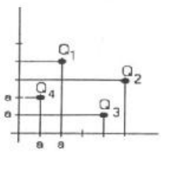

# UTN · FRR: Física “II”, 1º parcial — curso 2º año/07, tema A

## Problema 1

Cuatro cargas puntuales Q₁; Q₂; Q₃ y Q₄ están distribuidas según muestra la
figura. Calcular: la fuerza neta sobre Q₃ debido a la presencia de las otras
cargas.

sabiendo que: $`Q_1=Q_3=2\times10^{-9}\ \mathrm{C}`$;
$`Q_2=-1\times10^{-9}\ \mathrm{C}`$.

$`Q_4=3\times10^{-9}\ \mathrm{C}`$; $`a=0.02\ \mathrm{m}`$.

## Problema 2

Un Disco circular de 40 cm. de diámetro tiene una densidad superficial de carga
uniforme $`\sigma\ (\mathrm{C/m^2})`$.

Encontrar el campo eléctrico E en un punto P ubicado a 20 cm. del centro del
disco y sobre el eje del mismo.

## Problema 3

Aplicando la Ley de Gauss, encuentre la expresión del campo eléctrico E, creado
por una distribución esférica de radio R con densidad de carga
$`\rho\ (\mathrm{C/m^3})`$, para $`r\lt R`$ y $`r\gt R`$

## Problema 4

Un anillo circular de 20 cm. de diámetro tiene una carga total Q distribuida
uniformemente. Encontrar el Potencial Eléctrico V en un punto ubicado a 10 cm.
del centro del anillo y sobre el eje del mismo.

## Procedencia y observaciones de transcripción

- Original:
  `2015/480938-Modelos de parcial FISICA II actualizado 060813(0).pdf`, página
  5, examen inferior desde «UTN · FRR FÍSICA “II” 1º PARCIAL Curso: 2º Año/07
  Tema: A». El recuperatorio tema A superior es otro examen.
- SHA-256: `1555e295ed06e6a3872614be84854c0e0af3e8455048ca7e5bcbc4383490653e`.
- Compilación: Sampallo Guillermo, Rodríguez Ulises y Cleva Mario; versión 1.1,
  04/08/2010 en carátula. Se conserva «Año/07», sin inferir un día o mes.
- Herramientas: OCRmyPDF español sobre copia con `--force-ocr`, PyMuPDF4LLM y
  Poppler; cotejo visual de los cuatro enunciados, datos y diagrama. Figura
  original conservada mediante render PyMuPDF. No se resuelven los ejercicios.
