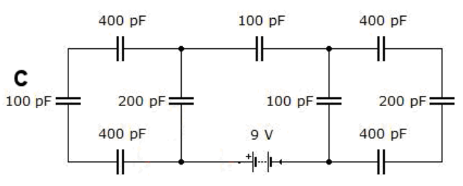
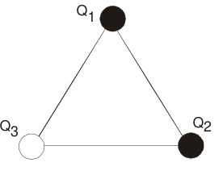

# UTN: primer parcial de Física II, 16/09/08, tema 1

A y N: \_\_\_\_\_\_\_\_\_\_\_\_\_\_\_\_\_\_\_\_

## Problema 1

Calcular la capacidad equivalente del siguiente circuito y hallar la carga que
se almacena en el capacitor C de 100 pF

## Problema 2

Dadas la distribución discreta de la figura, calcular la fuerza neta sobre la
carga Q1 y el potencial en el mismo punto. Datos:
$`Q1=Q2=16*10^{-19}\ \mathrm{coul}`$, $`Q3=-1.6*10^{-19}\ \mathrm{coul}`$.
$`L=1\ \mathrm{cm}`$

## Problema 3

Para un casquete ESFERICO no conductor de radio interno R1 y radio externo R2
con densidad de carga constante, calcular: a) El campo eléctrico para
$`r\lt R1`$, $`R1\lt r\lt R2`$ y $`r\gt R2`$. Calcule la diferencia de potencial
entre dos puntos interno y externo al casquete.

## Problema 4

Un condensador de placas paralelas dispuesto horizontalmente se llena la mitad
derecha con un dieléctrico de permitividad ε mientras que la mitad izquierda se
llena con aire (εo). La separación entre las placas es d = 10 mm y está a una
diferencia de potencial de 100 voltios. Hallar E, D y P en ambas mitades.
Suponer que $`\varepsilon=3.\varepsilon_o`$.

## Procedencia y observaciones de transcripción

- Original:
  `2015/480938-Modelos de parcial FISICA II actualizado 060813(0).pdf`, página
  12, desde el título «UTN - PRIMER PARCIAL DE FISICA II – 16/09/08». Los
  diagramas superiores pertenecen al recuperatorio IEM 2010, tema 2, y están
  conservados en su nota correspondiente.
- SHA-256: `1555e295ed06e6a3872614be84854c0e0af3e8455048ca7e5bcbc4383490653e`.
- Compilación: Sampallo Guillermo, Rodríguez Ulises y Cleva Mario, versión 1.1,
  04/08/2010 en carátula. El examen está fechado 16/09/08; se archiva en 2015
  por la carpeta canónica de procedencia.
- Herramientas: capa textual PyMuPDF y Poppler; diagramas extraídos por render
  PyMuPDF del original. Página, datos y figuras cotejados visualmente.
- Se conserva **16** (sin separador decimal) para Q1 y Q2, frente a **1.6** para
  Q3. No se agrega una medida L al triángulo: el enunciado la da, pero la figura
  no la rotula. Se conserva «Dadas la distribución». Los campos vacíos siguen
  sin completar.
