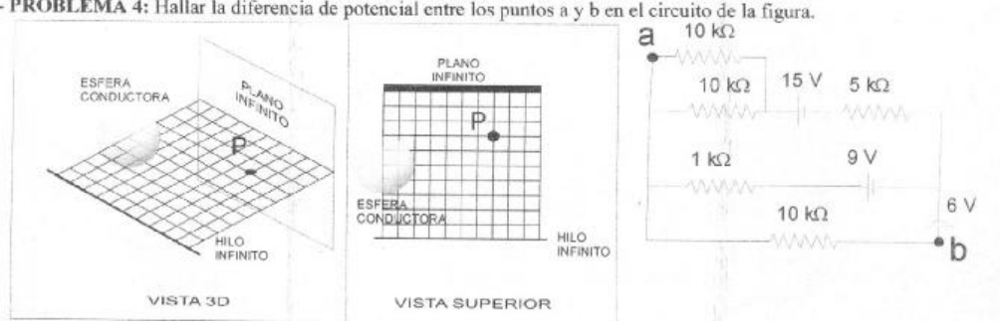

# Física II (2010): primer examen parcial, tema 2 — calor y cargas

APELLIDO Y NOMBRE: \_\_\_\_\_\_\_\_\_\_\_\_\_\_\_\_\_\_\_\_

CARRERA: IQ – ISI – IEM

## Problema 1

Se coloca un calentador en el seno de una masa de hielo de 500 gramos a -20 °C.
Si el calentador disipa una potencia de 200 watts, calcular el tiempo en minutos
que tarda en llegar a una temperatura de 80 °C. Datos: Calor latente de fusión
del hielo: 80 cal/g.K, Calor latente de vaporización del agua = 536 cal/g.K,
calor específico del agua = 1cal/g.K, Calor específico del hielo = 0.48
cal/g.°C.

## Problema 2

Dado el esquema de la figura a) Graficar los campos producidos por cada
distribución de carga y el campo total resultante. Calcular el campo en el punto
P. Datos: - Radio de la esfera conductora: 2 cm. - Tamaño de la cuadrícula: 1cm
x 1cm. - Carga de la esfera conductora: $`8{,}85.10^{-12}\ \mathrm{coul}`$. -
Densidad de carga del hilo: $`1{,}6.10^{-11}\ \mathrm{coul/m}`$. - Densidad de
carga del plano: $`\pi.10^{-10}\ \mathrm{coul/m^2}`$.

## Problema 3

Dada una esfera de radio R=3 cm, con densidad de carga $`\rho(r)=A/r`$ y carga
total $`Q=8{,}85.10^{-12}\ \mathrm{coul}`$, calcular a) El valor de la constante
A y sus unidades b) El campo eléctrico a 2 cm del centro c) El campo eléctrico a
4 cm del centro. d) La diferencia de potencial entre dos puntos ubicados a 2 cm
y a 4 cm del centro.

## Problema 4

Hallar la diferencia de potencial entre los puntos a y b en el circuito de la
figura.

## Procedencia y observaciones de transcripción

- Original:
  `2015/480938-Modelos de parcial FISICA II actualizado 060813(0).pdf`, página
  9, examen superior tema 2.
- SHA-256: `1555e295ed06e6a3872614be84854c0e0af3e8455048ca7e5bcbc4383490653e`.
- Compilación: Sampallo Guillermo, Rodríguez Ulises y Cleva Mario; versión 1.1,
  04/08/2010 en carátula. El examen indica2010 e IQ–ISI–IEM.
- Herramientas: OCRmyPDF español sobre copia con `--force-ocr`, PyMuPDF4LLM,
  Poppler y cotejo visual de todos los enunciados, exponentes y diagramas.
  Figuras originales por render PyMuPDF.
- Se conservan las unidades cal/g.K impresas para los calores latentes y la
  distribución A/r de esta versión. No se resuelven ejercicios ni se completan
  campos.
