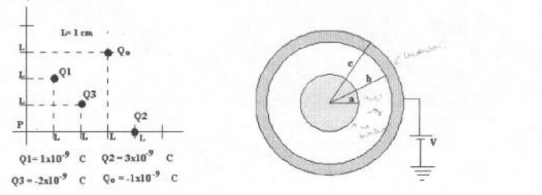

# Física II: 1º parcial F2 — calor, cargas y esfera

NOMBRE Y APELLIDO: \_\_\_\_\_\_\_\_\_\_\_\_\_\_\_\_\_\_\_\_

## Problema Nº 1

Calcular la cantidad de calor que se debe transmitir a un bloque de hielo de 200
gr a -10 °c para llevarlo a la temperatura de ebullición si este se encuentra en
un recipiente de aluminio de 120g - Ch = 0,48 cal/g°k (calor específico del
hielo) CL=80 cal/gr (calor latente de fusión).- CeAl=0,22 cal/g°c (calor
específico del aluminio)

## Problema Nº 2

Hallar la fuerza sobre la carga Qo y el potencial en el centro de coordenadas
debido a la distribución de cargas de la figura.-

## Problema Nº 3

Una esfera de radio a=1,5 cm tiene distribuida uniformemente una carga total
$`Q=2\times10^{-9}\ \mathrm{C}`$ rodeando a ésta se encuentra un casquete
esférico de radio interior b=3 cm y radio exterior c=3,5 cm, dicho casquete se
encuentra conectado a un potencial V=300v. Hallar: 1) La expresión del campo
eléctrico para $`r\lt a`$, para $`a\lt r\lt b`$, para $`b\lt r\lt c`$ y
$`r\gt c`$.- 2) La carga en la superficie interior y exterior del casquete. 3)
El valor del campo eléctrico en la superficie de cada esfera.- 4) La diferencia
de potencial entre ambos casquetes.-

## Procedencia y observaciones de transcripción

- Original:
  `2015/480938-Modelos de parcial FISICA II actualizado 060813(0).pdf`, página
  4, examen inferior F2, con tres problemas.
- SHA-256: `1555e295ed06e6a3872614be84854c0e0af3e8455048ca7e5bcbc4383490653e`.
- Compilación: Sampallo Guillermo, Rodríguez Ulises y Cleva Mario; versión 1.1,
  04/08/2010 en carátula. El examen no muestra fecha propia.
- Herramientas: OCRmyPDF español sobre copia con `--force-ocr`, extracción
  PyMuPDF4LLM y Poppler; cotejo visual de texto, exponentes, datos y diagramas
  del original. Figuras por render PyMuPDF.
- Se conservan «ambos casquetes», unidades y minúsculas del enunciado. El
  diagrama tiene anotaciones manuscritas tenues que se mantienen en la figura
  original, sin convertirlas en nuevos datos. No se resuelven problemas ni se
  completan campos.
