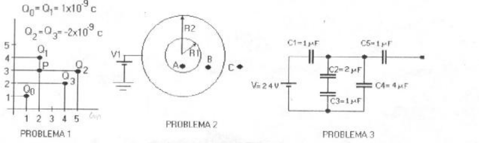

# Física II: 1º parcial, tema 1 — campo, esfera y capacitores

NOMBRE Y APELLIDO: \_\_\_\_\_\_\_\_\_\_\_\_\_\_\_\_\_\_\_\_

## Problema Nº 1

Dada la distribución de cargas de la figura calcular: a) El campo total en el
Punto P.- b) El potencial en el centro de coordenadas-.

## Problema Nº 2

Una esfera conductora de radio R1 está cargada con una carga total Q1, rodeando
a ésta se encuentra un casquete, también metálico de radio R2 conectado a una
batería de potencial V2. a) Calcular el campo en: $`r\lt R1`$, $`R1\lt r\lt R2`$
y $`r\gt R2`$

b) Calcular la diferencia de potencial entre B y C

## Problema Nº 3

hallar la capacidad y la carga en cada condensador.

## Problema Nº 4

En el espacio comprendido entre dos láminas planas y paralelas cargadas con
cargas iguales y opuestas existe un campo eléctrico uniforme. Un electrón es
abandonado en reposo sobre la lámina cargada negativamente y llega a la
superficie de la lámina opuesta, situada a 3 cm de distancia de la primera en un
tiempo de 2 seg. A) Calcular la intensidad del campo eléctrico. B) Obtenga la
velocidad del electrón cuando llega a la segunda lámina. Datos:
$`me=3{,}11\times10^{-31}\ \mathrm{kg}`$
$`Q=1{,}6\times10^{-19}\ \mathrm{coul}`$, (Resolver empleando las unidades
correspondientes)

## Procedencia y observaciones de transcripción

- Original:
  `2015/480938-Modelos de parcial FISICA II actualizado 060813(0).pdf`, página
  4, examen superior tema 1. El examen F2 inferior es otra versión.
- SHA-256: `1555e295ed06e6a3872614be84854c0e0af3e8455048ca7e5bcbc4383490653e`.
- Compilación: Sampallo Guillermo, Rodríguez Ulises y Cleva Mario; versión 1.1,
  04/08/2010 en carátula. No se imprime fecha propia de este examen.
- Herramientas: OCRmyPDF español sobre copia con `--force-ocr`, extracción
  PyMuPDF4LLM y Poppler, cotejo visual del original y figuras por render
  PyMuPDF.
- Se conserva el valor **3,11** impreso para me y el tiempo de **2 seg**, sin
  sustituirlos por datos físicos o tiempos supuestos. El texto nombra V2, pero
  la figura rotula V1; se conserva la discrepancia. El campo de nombre y los
  ejercicios siguen vacíos.
