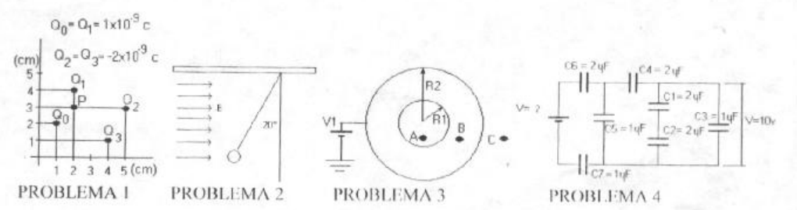

# Física II: 1º parcial, tema 1 — cargas, pelota, esfera y capacitores

NOMBRE Y APELLIDO: \_\_\_\_\_\_\_\_\_\_\_\_\_\_\_\_\_\_\_\_

## Problema Nº 1

Dada la distribución de cargas de la figura calcular: a) La fuerza total sobre
la carga Qo b) El potencial en el punto P.-

## Problema Nº 2

Una pequeña pelota de 0,6 gramos se encuentra suspendida de un hilo en un campo
eléctrico uniforme, como muestra la figura, si la pelota se encuentra en
equilibrio cuando el hilo forma un ángulo de 20° con la vertical . cual es la
carga neta de la pelota si el campo eléctrico es E = 700 N/c

## Problema Nº 3

Se tiene una esfera metálica de radio R1 la cual posee un carga Q a la cual
rodea un casquete metálico de radio R2 que está conectado a una fuente de
potencial V1.- Hallar: a) El campo en los puntos A, B y C.-

## Problema Nº 4

Si la diferencia de potencial que posee el condensador C3 de la figura es de 10
V calcular el valor de la tensión de la fuente de alimentación.-

## Procedencia y observaciones de transcripción

- Original:
  `2015/480938-Modelos de parcial FISICA II actualizado 060813(0).pdf`, página
  3, examen superior, hasta el separador. El recuperatorio IQ tema B inferior es
  otro examen.
- SHA-256: `1555e295ed06e6a3872614be84854c0e0af3e8455048ca7e5bcbc4383490653e`.
- Compilación: Sampallo Guillermo, Rodríguez Ulises y Cleva Mario; versión 1.1,
  04/08/2010 en carátula. Este examen no muestra fecha propia.
- Herramientas: OCRmyPDF español sobre copia con `--force-ocr` (la capa original
  contiene solo espacios), extracción PyMuPDF4LLM y Poppler; cotejo visual del
  original. Los diagramas originales se conservan con sus datos y etiquetas.
- Se conserva «un carga» y la puntuación del original. No se agregan datos para
  los radios ni se resuelven los ejercicios. El campo de nombre queda vacío.
