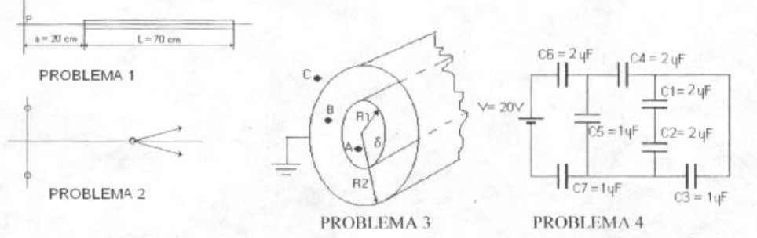

# Física II: 1º parcial, tema 2 — varilla, cargas y cilindro

NOMBRE Y APELLIDO: \_\_\_\_\_\_\_\_\_\_\_\_\_\_\_\_\_\_\_\_

## Problema Nº 1

Una varilla de longitud L cargada con una densidad lineal de carga
$`\lambda=2\times10^{-9}\ \mathrm{coul/m}`$. Calcular el valor del campo
eléctrico en el punto P situado a lo largo del eje de la varilla a una distancia
a de un extremo.-

## Problema Nº 2

Dos cargas iguales de $`+2\times10^{-9}\ \mathrm{C}`$ están separadas por una
distancia d=20 cm. Calcular el trabajo por unidad de carga necesaria para traer
otra carga de $`1\times10^{-9}\ \mathrm{C}`$ desde un punto muy alejado
(infinito) y sobre el plano bisector de la línea que une las dos cargas, hasta
el punto medio que une las dos cargas.-

## Problema Nº 3

Se tiene una densidad volumétrica de carga en un volumen cilíndrico muy largo de
radio R1 a éste rodea otro cilindro hueco metálico de espesor despreciable y de
radio R2 el cual está conectado a tierra.- Hallar: a) El campo en los puntos A,
B y C.- b) El potencial en los puntos A, B y C.-

## Problema Nº 4

Hallar la carga y la diferencia de potencial en cada uno de los condensadores
del circuito de la figura.-

## Procedencia y observaciones de transcripción

- Original:
  `2015/480938-Modelos de parcial FISICA II actualizado 060813(0).pdf`, página
  7, examen superior tema 2. El recuperatorio IEM 2009 inferior es otro examen.
- SHA-256: `1555e295ed06e6a3872614be84854c0e0af3e8455048ca7e5bcbc4383490653e`.
- Compilación: Sampallo Guillermo, Rodríguez Ulises y Cleva Mario; versión 1.1,
  04/08/2010 en carátula. Este examen no muestra fecha propia.
- Herramientas: OCRmyPDF español sobre copia con `--force-ocr`, PyMuPDF4LLM,
  Poppler y cotejo visual de los cuatro enunciados y diagramas. Figuras
  originales conservadas mediante render PyMuPDF.
- Se conserva «trabajo por unidad de carga» junto con la carga adicional dada y
  «punto medio que une las dos cargas», sin reinterpretar el ejercicio. Los
  campos vacíos no se completan.
