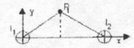

# Física II: recuperatorio 1er parcial, 2008 — tema 1

NOMBRE Y APELLIDO: \_\_\_\_\_\_\_\_\_\_\_\_\_\_\_\_\_\_\_\_

## Problema 1

Una inductancia de 1 Hy, un condensador de 50 μf y una resistencia de 100 ohm se
conectan en serie a una fuente de alimentación cuya tensión eficaz es de 120
Volt y 60 Hz. Calcular: a) Reactancias inductiva y capacitiva; b) Impedancia y
el ángulo de fase; c) Tensión eficaz sobre cada uno de los elementos. Dibuje el
diagrama vectorial de tensiones y corriente. d) la corriente instantánea.

## Problema 2

Una barra conductora de longitud 50 cm, se desplaza con velocidad v=10 m/seg en
una región donde existe campo magnético (saliente) B=0,5 tesla, perpendicular al
plano en el que se desliza la barra.

a) Dibuje un diagrama con las direcciones y sentidos de las fuerzas que actúan
sobre los portadores de carga.

b) Escriba las expresiones de dichas fuerzas.

c) Indique que tipo de carga se acumula en cada extremo de la barra.

d) Calcule la Fem. que se induce entre los extremos de la barra.

## Problema 3

Dos conductores filiformes paralelos separados una distancia d=2 cm conducen
corrientes iguales i=1 A en el mismo sentido. Determine el campo B para el punto
P₁(1,1), medidos en cm.

## Problema 4

Por un conductor cilíndrico macizo, de radio R=15 mm, circula una corriente I=5
A. Determinar: a) El campo magnético B para r mayor que el radio del conductor.
b) el campo magnético B para r menor que el radio R del conductor. c) el valor
de B para r=5 mm y para r=50 mm.

## Procedencia y observaciones de transcripción

- Original:
  `2015/480938-Modelos de parcial FISICA II actualizado 060813(0).pdf`, página
  19, examen inferior, con fecha 2008 y tema 1.
- SHA-256: `1555e295ed06e6a3872614be84854c0e0af3e8455048ca7e5bcbc4383490653e`.
- Compilación: Sampallo Guillermo, Rodríguez Ulises y Cleva Mario; versión 1.1,
  04/08/2010 en carátula.
- Herramientas: OCRmyPDF español sobre copia con `--force-ocr`, PyMuPDF4LLM,
  Poppler y cotejo visual de todos los enunciados, valores y diagramas. Figuras
  originales por render PyMuPDF. No se completan campos ni se resuelven
  ejercicios.
