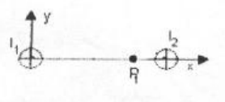

# Física II: recuperatorio 1er parcial, 2008 — tema 2

NOMBRE Y APELLIDO: \_\_\_\_\_\_\_\_\_\_\_\_\_\_\_\_\_\_\_\_

## Problema 1

Un circuito RLC en serie, R=400; L=0,4 Hy; $`C=10^{-5}\ \mathrm{\mu f}`$; se
conecta a una fuente de alimentación cuya tensión eficaz es de 100 Volt y
$`\omega=1000\ \mathrm{Rad/seg}`$.

Calcular: a) Reactancias inductiva y capacitiva; b) Impedancia y el ángulo de
fase. Indicar si el circuito es inductivo o capacitivo; c) Tensión eficaz sobre
cada uno de los elementos. Dibuje el diagrama tensiones y corriente. d) ¿Cuál
debe ser la frecuencia para que el circuito entre en resonancia?.

## Problema 2

Una barra conductora de longitud 30 cm, se desplaza con velocidad v=5 m/seg en
una región donde existe campo magnético (entrante) B=1,5 tesla, perpendicular al
plano en el que se desliza la barra.

a) Dibuje un diagrama con las direcciones y sentidos de las fuerzas que actúan
sobre los portadores de carga.

b) Escriba las expresiones de dichas fuerzas.

c) Indique que tipo de carga se acumula en cada extremo de la barra.

d) Calcule la Fem que se induce entre los extremos de la barra.

## Problema 3

Dos conductores filiformes paralelos separados una distancia d=2 cm conducen
corrientes iguales i=2 A en sentidos contrarios. Determine el campo B para el
punto P₁ (1.5, 0), medidos en cm (ver figura)

## Problema 4

Por un conductor cilíndrico macizo, de radio R=1 mm, circula una corriente I=5
A. Determinar en función de r: a) El campo B para $`r\lt R`$. b) el campo B para
$`r\gt R`$. c) el valor de B para r=0,5 mm y para r=5 mm.

## Procedencia y observaciones de transcripción

- Original:
  `2015/480938-Modelos de parcial FISICA II actualizado 060813(0).pdf`, página
  6, examen superior «FÍSICA II – RECUPERATORIO 1er PARCIAL - 2008 TEMA 2». El
  tema 1 inferior es un examen independiente.
- SHA-256: `1555e295ed06e6a3872614be84854c0e0af3e8455048ca7e5bcbc4383490653e`.
- Compilación: Sampallo Guillermo, Rodríguez Ulises y Cleva Mario; versión 1.1,
  04/08/2010 en carátula. El encabezado del examen indica 2008.
- Herramientas: OCRmyPDF español sobre copia con `--force-ocr`, PyMuPDF4LLM,
  Poppler y cotejo visual del original. Diagrama conservado mediante render
  PyMuPDF.
- Se mantiene la unidad **µf** junto a **10⁻⁵** y la ausencia de unidad tras
  R=400 en el original, sin corregir datos por conjetura. No se agrega una
  figura al problema 2, que pide dibujarla. Campo de nombre y soluciones sin
  completar.
