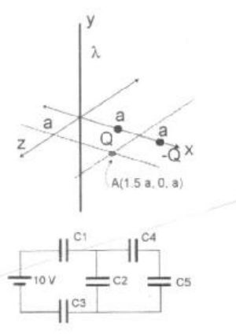

# Física II (2008): recuperatorio 1er parcial, tema 1 — problemas 5–8

APELLIDO Y NOMBRE: \_\_\_\_\_\_\_\_\_\_\_\_\_\_\_\_\_\_\_\_

## Problema 5

Para la siguiente distribución de carga, calcular el campo eléctrico en el punto
A (FIG 1)

Datos: $`\lambda=-2.\pi\ \mathrm{ncoul}`$, $`Q=4.\pi\ \mathrm{ncoul}`$, a=1 m,
A(1.5 a, 0, a)

## Problema 6

Una esfera no conductora de radio R tiene una densidad de carga
$`\rho=\rho_o r`$ con $`0\lt r\lt R`$ y $`\rho_o=\mathrm{constante}`$. Calcular
la diferencia de potencial entre un punto externo y otro interno a la esfera.

## Problema 7

Un condensador de placas paralelas dispuesto horizontalmente se llena la mitad
derecha con un dieléctrico de permitividad ε1 (con ε1=3 εo) mientras que la
mitad izquierda se llena con otro medio de permitividad ε2 (con ε2=4 εo). La
separación entre las placas es d=10 mm y está a una diferencia de potencial de
100 voltios. Hallar E, D y P en ambos mitades.

## Problema 8

Para el circuito de la Fig. 2, calcule: a) la capacidad equivalente. b) la carga
y la diferencia de potencial en el condensador C5.

Datos: C1=C2=C3=1μF, C4=C5=10μF

## Procedencia y observaciones de transcripción

- Original:
  `2015/480938-Modelos de parcial FISICA II actualizado 060813(0).pdf`, página6,
  examen inferior tema1, numerado5–8. Se preserva esa numeración.
- SHA-256: `1555e295ed06e6a3872614be84854c0e0af3e8455048ca7e5bcbc4383490653e`.
- Compilación: Sampallo Guillermo, Rodríguez Ulises y Cleva Mario; versión1.1,
  04/08/2010 en carátula. El examen indica2008.
- Herramientas: OCRmyPDF español sobre copia con `--force-ocr`, PyMuPDF4LLM,
  Poppler y cotejo visual mediante ampliación del texto pequeño. Figuras
  originales por render PyMuPDF.
- El original imprime ncoul para ambos datos del problema5, sin agregar /m para
  λ; se conserva. También «en ambos mitades». No se importan datos o incisos de
  otros recuperatorios ni se resuelven ejercicios.
