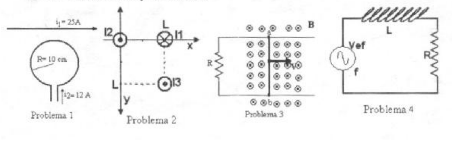

# 2º parcial recuperatorio T2 — espira, conductores y RL

NOMBRE Y APELLIDO: \_\_\_\_\_\_\_\_\_\_\_\_\_\_\_\_\_\_\_\_

## Problema Nº 1

Hallar a que distancia debe ubicarse el alambre recto de longitud infinita para
que el campo neto sobre el centro de la espira sea cero.-

## Problema Nº 2

En la figura se muestran tres conductores muy largos perpendiculares al plano
del papel. Determine la fuerza sobre el conductor que transporta la corriente
I3. L=0.05 m I1=6 A, I2=3 A, I3=2A

## Problema Nº 3

En el dispositivo de la figura 3 la varilla a b se desplaza hacia la derecha con
una velocidad de v=20 m/s, la longitud de la varilla ab es 10 cm, R=2 Ω el campo
B saliente de 5 T determine: a) La Fem Inducida; b) La intensidad de corriente
en sentido y módulo, fundamentando el sentido de circulación

## Problema Nº 4

Para el circuito de la figura determinar a) la impedancia b) la diferencia de
potencial sobre R y sobre L c) dibuje el diagrama de tensiones Vef=18V f=60Hz
L=0.05Hy R=100 ohms

## Procedencia y observaciones de transcripción

- Original:
  `2015/480938-Modelos de parcial FISICA II actualizado 060813(0).pdf`, página
  17, examen inferior T2. El encabezado no muestra identificación de carrera ni
  fecha propia.
- SHA-256: `1555e295ed06e6a3872614be84854c0e0af3e8455048ca7e5bcbc4383490653e`.
- Compilación: Sampallo Guillermo, Rodríguez Ulises y Cleva Mario; versión 1.1,
  04/08/2010 en carátula.
- Herramientas: OCRmyPDF español sobre copia con `--force-ocr`, PyMuPDF4LLM,
  Poppler y cotejo visual de los cuatro enunciados, datos y diagramas. Figuras
  originales por render PyMuPDF. No se completan campos ni se resuelven
  ejercicios.
