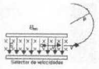
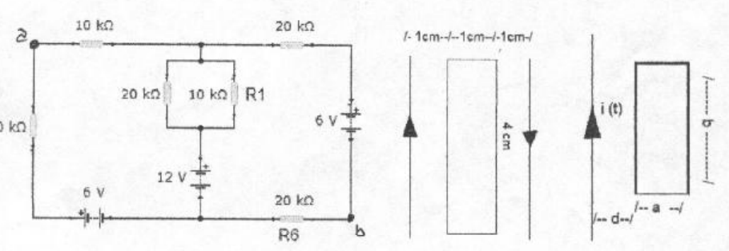

# Física II: recuperatorio 2do examen parcial — tema 1, espectrógrafo

## Problema 1

Dado el circuito de la figura, hallar la corriente que circula por R1 y la
diferencia de potencial entre los puntos a y b (fig 1)

## Problema 2

Calcular el flujo del campo magnético generado por dos hilos que llevan
corrientes iguales y opuestas de 3 amperes a través del área sombreada de la
figura.

## Problema 3

Calcular la fem inducida en el circuito rectangular de la figura cuando por la
línea rectilínea e indefinida circula una corriente alterna cuya intensidad
viene dada por $`I=10.\sin(100.\mathrm{Pi}.t)`$ siendo a=5 cm, b=10 cm y d=5 cm.
Si el circuito tiene una resistencia asociada de 20 ohm, calcular la corriente
eficaz.

## Problema 4

En un espectrógrafo de masas se estudian los isótopos de un elemento simplemente
ionizado. En su selector de velocidades actúa un campo B=0.02 T y un campo E=400
V/cm. En la cámara de deflexión existe un campo magnético uniforme de 1 T; si la
masa de los isótopos es de $`5\times10^{-20}\ \mathrm{kg}`$, calcule el radio de
la trayectoria en la cámara de deflexión y explique cómo determina el sentido
del campo que produce esa trayectoria.

## Figuras originales

## Procedencia y observaciones de transcripción

- Original:
  `2015/480938-Modelos de parcial FISICA II actualizado 060813(0).pdf`, página
  15, examen superior tema 1. Sin fecha propia visible.
- SHA-256: `1555e295ed06e6a3872614be84854c0e0af3e8455048ca7e5bcbc4383490653e`.
- Compilación: Sampallo Guillermo, Rodríguez Ulises y Cleva Mario; versión 1.1,
  04/08/2010 en carátula.
- Herramientas: OCRmyPDF español sobre copia con `--force-ocr`, PyMuPDF4LLM,
  Poppler y cotejo visual de todos los enunciados, datos, ecuaciones y
  diagramas. Figuras originales por render PyMuPDF. No se resuelven ejercicios.
- Se conserva la masa con exponente−20 y la notación Pi de la expresión
  temporal, sin cambiar los datos. Se preservan las topologías y los sentidos de
  corriente de esta versión.
