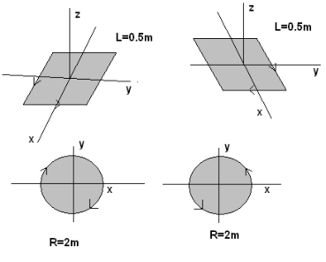

# Guía de problemas: repaso de análisis vectorial

Universidad Tecnologica Nacional, Facultad Regional Resistencia. Física II.

Fuente: `2015/GUIA DE PROBLEMAS PROPUESTOS 1ra parte.pdf`, páginas 3–4 de 24.
SHA-256: `efac01b619f48d06286a725a5a7ccc8de7b6baffb2a931515c9dba28ae7e5e5b`.
Transcripción cotejada con pdftotext y ambas páginas renderizadas; fórmulas
recuperadas visualmente. Esta nota cubre únicamente la sección vectorial.

**1).–** Sean los vectores

```math
\vec A=2\vec i+4\vec j
```

```math
\vec B=\vec i-5\vec j
```

```math
\vec C=-4\vec i+3\vec j
```

Determine en forma gráfica (cuando se pueda) y analítica las siguientes
operaciones

- a) $`\vec A+\vec B`$
- b) $`\vec A-\vec C`$
- c) $`\vec A+\vec B+\vec C`$
- d) $`\vec A\cdot\vec B`$
- e) $`\vec A\wedge\vec B`$
- f) $`\vec B\wedge\vec A`$

**2).–** Sean los vectores

```math
\vec A=2\vec i-\vec k
```

```math
\vec B=\vec i-5\vec j
```

```math
\vec C=-4\vec i+3\vec j+2\vec k
```

Determine en forma gráfica (cuando se pueda) y analítica las siguientes
operaciones

- b) $`\vec A+\vec B`$
- b) $`\vec A-\vec C`$
- c) $`\vec A+\vec B+\vec C`$
- d) $`\vec A\cdot\vec B`$
- e) $`\vec A\wedge\vec B`$
- f) $`\vec B\wedge\vec A`$

**3).–** Obtenga los ángulos que forman los vectores del problema 2 con los ejes
x, y, z

**4).–** Sean los puntos P1(2,4) y P2(4,2)

- a) Represente en forma gráfica y analítica el vector
  $`\vec A=\overrightarrow{P1P2}`$
- b) Obtenga el versor correspondiente

**5)** Repita 2 Si $`\vec A=\overrightarrow{P2P1}`$

**6)** El valor de la componente x de un vector viene dado por

```math
Ex=0.318\frac{x}{x^2+y^2}+0.81*10^{-3}\frac{x-2}{((x-2)^2+(y-3)^2)^{3/2}}
```

Mientras que la componente y viene dado por

```math
Ey=0.318\frac{y}{x^2+y^2}+0.81*10^{-3}\frac{y-3}{((x-2)^2+(y-3)^2)^{3/2}}
```

Donde x e y representan las coordenadas de un punto en el plano xy. Calcular el
módulo y la dirección del vector cuando

- a) x = 1, y = 1
- b) x = 2, y = 3
- c) x = 4, y = 5

Sumar el vector obtenido en el punto a y el vector obtenido en el punto b.
Hallar el producto escalar y vectorial de los vectores.

**7)** El módulo de un vector A viene dado por la expresión:

```math
B=\frac{2}{(x-3)^2+(y-5)^2}
```

Donde x e y son las coordenadas del punto donde se calcula el valor del vector y
la dirección y el sentido del vector viene dado por la línea que va desde el
punto de coordenadas x = 3 e y = 5 al punto de coordenadas x,y. Determinar el
módulo, la dirección y las componentes del vector cuando

- a) x = 3, y = 6
- b) x = 1, y = 7
- c) x = 2, y = 3

**6)** Una superficie puede ser representada por un vector. El modulo del vector
representa el área, la dirección es perpendicular a la superficie que representa
y el sentido se obtiene de recorrer el contorno de la superficie en sentido
antihorario positivo y horario negativo. Dibuje y calcule el vector superficie
para los casos de las figuras cuadradas y circulares



**8)** La definición de flujo de un vector E a través de una superficie S viene
dada por

```math
\varphi=\vec E\cdot\vec S=ES\cos(\theta)
```

Donde θ representa el ángulo entre los vectores. Si

```math
\vec E=\vec i+2\vec j+3\vec k
```

Determine el plano de mayor flujo

## Observaciones de fidelidad

- Se conserva la doble etiqueta b) en el problema 2 y la numeración 6 después
  del 7.
- El problema 5 dice «Repita 2» y el 7 nombra A en el texto pero B en la
  fórmula; no se corrigen.
- Se conservan los denominadores distintos y el asterisco de multiplicación en
  Ex y Ey.
- La figura conserva las cuatro superficies, dimensiones, ejes y sentidos
  originales.
