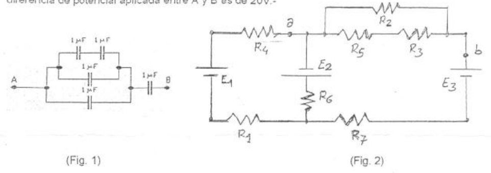
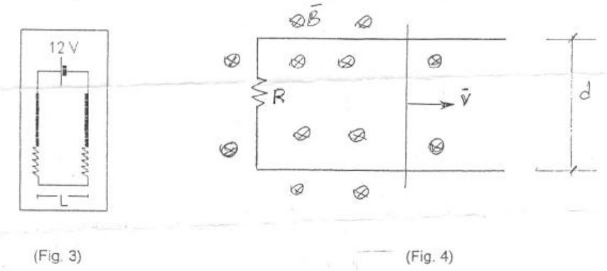

# UTN FRR: Física “II”, 2º parcial — curso 2º año/07, tema B

## Problema 1

Dado el circuito (Fig. 1), hallar: La carga y la diferencia de potencial en cada
condensador, si la diferencia de potencial aplicada entre A y B es de 20V.-

## Problema 2

Calcular las corrientes eléctricas que circulan (Fig. 2) y la diferencia de
potencial entre los puntos a y b.

Datos: R1=R3=R5=1 ohm; R2=R4=R6=R7=2 ohm E1=10 V.; E2=8 V.; E3=6 V.

## Problema 3

Un alambre recto de 20 g y 10 cm. se suspende con dos resortes idénticos de tal
manera que forman el circuito (Fig. 3). La resistencia del mismo es de 12 Ohm.
Los resortes están alargados, debido al peso, en 0.5 cm. ¿Cuál es la magnitud y
sentido del campo magnético que se requiere para eliminar el alargamiento de los
resortes?

## Problema 4

La densidad de corriente en un conductor cilíndrico de radio R=10 cm., es
$`J=3/r`$ donde J se mide en Amp/m2 y r en m. Calcular: a) la corriente total
que circula por el mismo; b) el Campo Magnético (Módulo, dirección y sentido) en
puntos interiores y exteriores a dicho conductor.

$`\mu_o=4.\pi\times10^{-7}\ (\mathrm{Wb./Amp.m})`$

## Problema 5

En el dispositivo (Fig. 4), determine: a) La Fem Inducida; b) La intensidad de
corriente en sentido y módulo, fundamentando el sentido de circulación. Datos:
v=20 m/seg.; d=10 cm.; B=0,5 T.; R=2 ohm

## Procedencia y observaciones de transcripción

- Original:
  `2015/480938-Modelos de parcial FISICA II actualizado 060813(0).pdf`, página
  18 completa.
- SHA-256: `1555e295ed06e6a3872614be84854c0e0af3e8455048ca7e5bcbc4383490653e`.
- Compilación: Sampallo Guillermo, Rodríguez Ulises y Cleva Mario; versión 1.1,
  04/08/2010 en carátula. El último dígito de «Año/07» está repasado a mano en
  el encabezado; se conserva en el original.
- Herramientas: OCRmyPDF español sobre copia con `--force-ocr`, PyMuPDF4LLM,
  Poppler y cotejo visual de los cinco enunciados, datos y cuatro diagramas.
  Figuras originales por render PyMuPDF.
- No se completa el espacio para respuestas. Las marcas manuscritas de las
  figuras quedan conservadas; no se interpretan como nuevas consignas.
