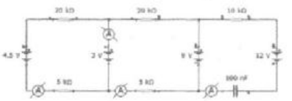
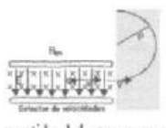
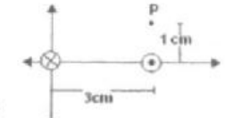

# Segundo parcial de Física II (2008), tema 1 — instrumentos y espectrógrafo

## Problema 1

Para el circuito de la figura hallar: a) las medidas de los instrumentos b) La
carga de capacitor.

## Problema 2

En un espectrógrafo de masas se estudian los isótopos de un elemento simplemente
ionizado. En su selector de velocidades actúa un campo B=0.02 T y un campo E=400
V/cm. En la cámara de deflexión existe un campo magnético uniforme de 1 T; si la
masa de los isótopos es de $`5\times10^{-20}\ \mathrm{kg}`$, calcule el radio de
la trayectoria en la cámara de deflexión y explique cómo determina el sentido
del campo que produce esa trayectoria.

## Problema 3

Dos conductores filiformes paralelos situados una distancia d=3 cm entre ellos,
conducen corrientes iguales a 4 amp, cuyos sentidos se indican en el esquema.
Determine el campo de inducción magnética en el punto P.

## Problema 4

Una espira rectangular fija de lados 5 cm x 10 cm es atravesada por un campo de
inducción magnética variable en el tiempo $`B(t)=5.t\ (\mathrm{Wb/m^2})`$,
formando con el plano de la espira un ángulo de 25 grados. Calcule la fuerza
electromotriz inducida en la espira y explique claramente como determina el
sentido de la corriente inducida.

## Figuras originales

## Procedencia y observaciones de transcripción

- Original:
  `2015/480938-Modelos de parcial FISICA II actualizado 060813(0).pdf`, página
  20, examen superior tema 1.
- SHA-256: `1555e295ed06e6a3872614be84854c0e0af3e8455048ca7e5bcbc4383490653e`.
- Compilación: Sampallo Guillermo, Rodríguez Ulises y Cleva Mario; versión 1.1,
  04/08/2010 en carátula. Se conserva 2008 del encabezado.
- Herramientas: OCRmyPDF español sobre copia con `--force-ocr`, PyMuPDF4LLM,
  Poppler y cotejo visual de enunciados, datos, expresiones y figuras. Diagramas
  originales por render PyMuPDF. No se agregan respuestas ni datos omitidos.
- Se conserva «La carga de capacitor» y la distinción entre ionización
  simple/doble, ángulo de25/65grados y campo variable/área variable. No se
  sustituye el plano de la espira por su normal.
