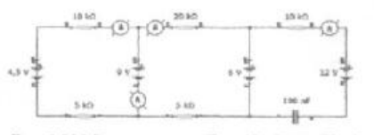
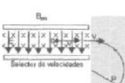
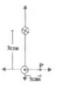

# Segundo parcial de Física II (2008), tema 2 — instrumentos y espectrógrafo

## Problema 1

Para el circuito de la figura hallar: a) las medidas de los instrumentos b) La
carga de capacitor.

## Problema 2

En un espectrógrafo de masas se estudian los isótopos de un elemento doblemente
ionizado. En su selector de velocidades actúa un campo B=0.025 T y un campo
E=450 V/cm. En la cámara de deflexión existe un campo magnético uniforme de 2 T;
si el radio de la trayectoria en la cámara de deflexión es de 10 cm, cuál es la
masa en gramos del isótopo?. Explique cómo determina el sentido del campo que
produce esa trayectoria.

## Problema 3

Dos conductores filiformes paralelos situados una distancia d=3 cm entre ellos,
conducen corrientes iguales a 4 amp, en el sentido indicado en el esquema.
Determine el campo de inducción magnética en el punto P.

## Problema 4

Una espira rectangular tiene uno de sus lados móviles con velocidad v=5 cm/seg
aumentando el área. Un campo de inducción magnética constante B=0.5 T atraviesa
el plano de la espira formando un ángulo de 65 grados. Calcule la fuerza
electromotriz inducida en la espira y explique claramente como determina el
sentido de la corriente inducida.

## Figuras originales

## Procedencia y observaciones de transcripción

- Original:
  `2015/480938-Modelos de parcial FISICA II actualizado 060813(0).pdf`, página
  20, examen inferior tema 2.
- SHA-256: `1555e295ed06e6a3872614be84854c0e0af3e8455048ca7e5bcbc4383490653e`.
- Compilación: Sampallo Guillermo, Rodríguez Ulises y Cleva Mario; versión 1.1,
  04/08/2010 en carátula. Se conserva 2008 del encabezado.
- Herramientas: OCRmyPDF español sobre copia con `--force-ocr`, PyMuPDF4LLM,
  Poppler y cotejo visual de enunciados, datos, expresiones y figuras. Diagramas
  originales por render PyMuPDF. No se agregan respuestas ni datos omitidos.
- Se conserva «La carga de capacitor» y la distinción entre ionización
  simple/doble, ángulo de25/65grados y campo variable/área variable. No se
  sustituye el plano de la espira por su normal.
