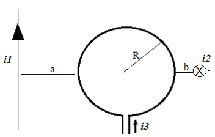

# 2do examen parcial de Física II (2010), tema 1

A y N: \_\_\_\_\_\_\_\_\_\_\_\_\_\_\_\_\_\_\_\_

CARRERA: ISI – IEM (tachar lo que no corresponde)

## Problema 1

Hallar: a) el campo B generado por cada uno de los tres hilos en el punto centro
de la espira b) El campo total. Datos: i1 = 1 amp, i2 = 0.5 amp, i3 = 2 amp, a =
1.5 cm, b = 0.5 cm, R = 1 cm.

## Problema 2

Una espira rectangular de lados 3 cm y 5 cm, se coloca en una región donde
existe un campo magnético B(t) = a.t (donde a es una constante y t el tiempo) y
cuya dirección es perpendicular al plano de la espira. Si la resistencia del
circuito es de 1 kohm y la corriente inducida es de 10 mA circulando en sentido
horario. Calcular: a) la constante “a” y sus unidades y b) el sentido del campo
magnético (entrante o saliente).

## Problema 3

Un circuito serie R-L-C está formado por una bobina de coeficiente de
autoinducción L= 2 H, un condensador de capacidad C= 5μF, y una resistencia de
90 Ω. La frecuencia de la corriente es de 100 Hz. Si el circuito se conecta a un
generador de corriente alterna de 220 V de tensión máxima, calcular: a) La
impedancia del circuito b) la corriente c) el ángulo de defasaje d) la tensión
en cada elemento e) la frecuencia de resonancia

## Problema 4

El campo eléctrico de una onda electromagnética plana es

```math
E_x=0{,}4.\mathop{\mathrm{sen}}\nolimits\left[\frac{2.\pi}{3}(z-c.t)\right],\quad E_y=0{,}4.\mathop{\mathrm{sen}}\nolimits\left[\frac{2.\pi}{3}(z-c.t)\right],\quad E_z=0
```

medido N/C. a) Determinar la amplitud del campo eléctrico y del campo magnético
de la onda electromagnética. b) Dibujar un esquema en el que se especifique la
dirección de vibración del campo eléctrico, del campo magnético y la dirección y
sentido de la propagación de la onda electromagnética. c)Hallar la frecuencia,
longitud de onda e intensidad de la onda electromagnética. d) Calcular el vector
de Poynting

## Figuras originales



## Procedencia y observaciones de transcripción

- Original:
  `2015/480938-Modelos de parcial FISICA II actualizado 060813(0).pdf`, página
  22\.
- SHA-256: `1555e295ed06e6a3872614be84854c0e0af3e8455048ca7e5bcbc4383490653e`.
- Compilación: Sampallo Guillermo, Rodríguez Ulises y Cleva Mario; versión 1.1,
  04/08/2010 en carátula. Se conserva la identificación y fecha del examen.
- Herramientas: extracción textual PyMuPDF y Poppler, cotejo visual de
  enunciados, datos, expresiones y figuras; diagramas originales por render
  PyMuPDF. No se completan campos ni se resuelven ejercicios.
