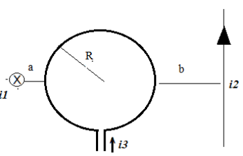

# 2do examen parcial de Física II (2010), tema 2

CARRERA: ISI – IEM (tachar lo que no corresponde)

## Problema 1

Hallar: a) el campo B generado por cada uno de los tres hilos en el centro de la
espira b) El campo total. Datos: i1 = 1 amp, i2 = 0.5 amp, i3 = 2 amp, a = 0.5
cm, b = 1.5 cm, R = 1 cm.

## Problema 2

Un campo magnético B(t) = $`2.10^{-7}.t`$ (con t en segundos y B en teslas)
atraviesa una región circular de 2 cm de radio. Calcular: a) la corriente
inducida en el circuito si su resistencia es de 10 kohm. b) el sentido de
circulación de la misma en función del sentido del campo magnético adoptado.

## Problema 3

Un circuito RLC se alimenta con una tensión V= 25 cos (100.π.t). Si los datos
del circuito son: R= 15 Ω , L = 25 mHy , C = 1000 μF, hallar: a) La impedancia.
b) La corriente c) El defasaje d) La Potencia activa, reactiva y aparente e) La
frecuencia de resonancia.

## Problema 4

El campo eléctrico de una onda electromagnética plana es

```math
E_x=0{,}4.\mathop{\mathrm{sen}}\nolimits\left[\frac{2.\pi}{3}(y-c.t)\right],\quad E_y=0,\quad E_z=0{,}4.\mathop{\mathrm{sen}}\nolimits\left[\frac{2.\pi}{3}(y-c.t)\right]
```

medido N/C. a) Determinar la amplitud del campo eléctrico y del campo magnético
de la onda electromagnética. b) Dibujar un esquema en el que se especifique la
dirección de vibración del campo eléctrico, del campo magnético y la dirección y
sentido de la propagación de la onda electromagnética. c)Hallar la frecuencia,
longitud de onda e intensidad de la onda electromagnética. d) Calcular el vector
de Poynting

## Figuras originales



## Procedencia y observaciones de transcripción

- Original:
  `2015/480938-Modelos de parcial FISICA II actualizado 060813(0).pdf`, página
  23\. El encabezado y la carrera están al final de la página 22; el enunciado
  completo continúa en la 23.
- SHA-256: `1555e295ed06e6a3872614be84854c0e0af3e8455048ca7e5bcbc4383490653e`.
- Compilación: Sampallo Guillermo, Rodríguez Ulises y Cleva Mario; versión 1.1,
  04/08/2010 en carátula. Se conserva la identificación y fecha del examen.
- Herramientas: extracción textual PyMuPDF y Poppler, cotejo visual de
  enunciados, datos, expresiones y figuras; diagramas originales por render
  PyMuPDF. No se completan campos ni se resuelven ejercicios.
