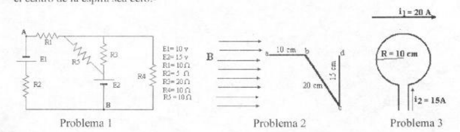

# Física II: 2º parcial, tema 1 — circuito, alambre y espira

APELLIDO Y NOMBRE: \_\_\_\_\_\_\_\_\_\_\_\_\_\_\_\_\_\_\_\_

1. En el circuito de la figura determine la corriente en cada rama y la potencia
   disipada en R5.

1. En el esquema de la figura hallar modulo y sentido de la fuerza en cada tramo
   de alambre por el cual circula una corriente desde a hacia d. siendo B=5 T

1. Hallar a que distancia debe ubicarse el alambre recto de longitud infinita
   para que la fuerza neta sobre el centro de la espira sea cero.-

## Procedencia y observaciones de transcripción

- Original:
  `2015/480938-Modelos de parcial FISICA II actualizado 060813(0).pdf`, página
  16, examen superior tema 1, con tres problemas. El tema A inferior es otra
  versión.
- SHA-256: `1555e295ed06e6a3872614be84854c0e0af3e8455048ca7e5bcbc4383490653e`.
- Compilación: Sampallo Guillermo, Rodríguez Ulises y Cleva Mario; versión 1.1,
  04/08/2010 en carátula. El examen no imprime fecha propia.
- Herramientas: OCRmyPDF español sobre copia con `--force-ocr`, PyMuPDF4LLM,
  Poppler y cotejo visual de los tres enunciados y diagramas; figuras originales
  por render PyMuPDF.
- El problema 2 no da el valor de la corriente: se conserva ese vacío. El
  problema 3 dice «fuerza neta sobre el centro de la espira», sin
  reinterpretarlo. Se conservan los valores de cada circuito en sus figuras; no
  se agregan cálculos ni respuestas.
