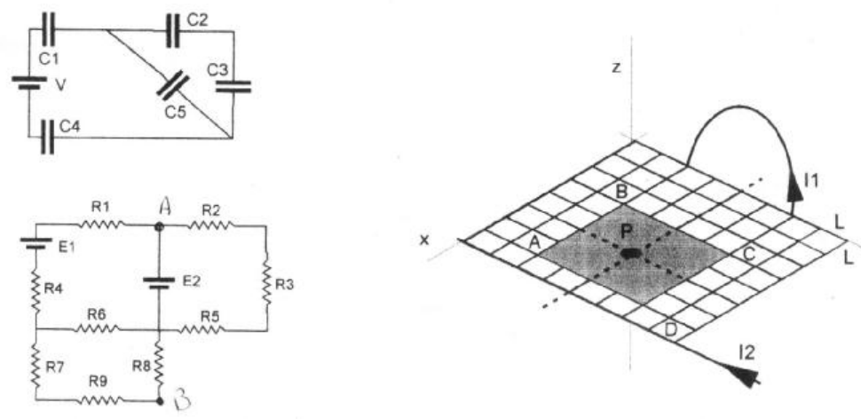

# Física II: 2º parcial, tema B — capacitores, corrientes e inducción

NOMBRE Y APELLIDO: \_\_\_\_\_\_\_\_\_\_\_\_\_\_\_\_\_\_\_\_

## Problema 1

Dado el circuito de la figura calcular: la capacidad equivalente, la carga y la
diferencia de potencial en cada capacitor. Datos Cimpar=1 μF, Cpar=2 μF, V=9
voltios.

## Problema 2

Hallar las corrientes que atraviesan cada resistencia y la diferencia de
potencial A - B. Datos E1=25 V, E2=10 V, Rimpar=15 ohm, Rpar=10 ohm.

## Problema 3

Por un conductor cilíndrico macizo, de radio R=1 mm, circula una densidad de
corriente $`J=C.r\ (\mathrm{A/m^2})`$ con $`0\lt r\lt R`$. Determinar a) el
valor y las unidades de la constante C si la corriente total que transporta el
conductor es 0,3 A. b) el campo de inducción magnética en el interior y el
exterior del conductor.

## Problema 4

Calcular el campo magnético total en el punto P para t=0.25 seg. creado por un
hilo infinito que lleva una corriente variable con el tiempo
$`I2=i(t)=0.5\sin(2.\pi.\mathrm{seg}^{-1}.t)`$ (donde t en segundos, i(t) en
amperios) y el de una espira circular cuyo eje pasa por P y por el cual circula
una corriente de 0.5 amp. Hallar tambien la FEM máxima inducida en la espira
ABCD. L=1cm

## Procedencia y observaciones de transcripción

- Original:
  `2015/480938-Modelos de parcial FISICA II actualizado 060813(0).pdf`, página
  14, examen inferior tema B. Encabezado parcialmente recortado en el original.
- SHA-256: `1555e295ed06e6a3872614be84854c0e0af3e8455048ca7e5bcbc4383490653e`.
- Compilación: Sampallo Guillermo, Rodríguez Ulises y Cleva Mario; versión 1.1,
  04/08/2010 en carátula. Sin fecha propia visible del examen.
- Herramientas: OCRmyPDF español sobre copia con `--force-ocr`, PyMuPDF4LLM,
  Poppler y cotejo visual de todos los enunciados, expresiones y diagramas.
  Figuras originales por render PyMuPDF. No se resuelven los ejercicios.
- Esta versión da J=C.r y una espira circular con corriente constante. Se
  conserva esa diferencia y la topología original de los circuitos frente a
  otros temas parecidos.
