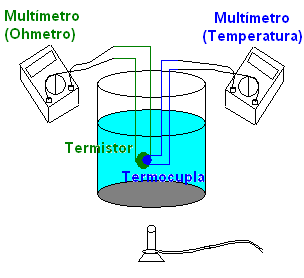

<!-- markdownlint-disable MD060 -->

# Trabajo práctico Nº 16: Termometría

Universidad Tecnologica Nacional. Facultad Regional Resistencia. Cátedra: Física
II.

TEMA: TERMOMETRÍA

## Objeto de la experiencia

- Estudiar la variación de la resistencia eléctrica de un semiconductor
  (termistor) en función de la variación de la temperatura.
- Determinación del modelo matemático que mejor describa el comportamiento del
  valor de la resistencia de un termistor en función de la temperatura.
- Validación del modelo.
- Comprobación del equilibrio térmico. Verificación del principio cero de la
  termodinámica.

## Consideraciones teóricas

Los termistores aprovechan, la dependencia que presenta la resistencia eléctrica
de cualquier material conductor con la temperatura. La sensibilidad a la
temperatura se ha incrementado gracias a la utilización de materiales
semiconductores, específicamente diseñados para que su resistencia dependa
fuertemente de la temperatura del elemento. Existen termistores de coeficiente
positivo (su resistencia aumenta con la temperatura) o negativo, siendo este
último más típico y de bajo costo.

En los termistores se observan relaciones de la resistencia con la temperatura
que no son lineales, sino más bien de carácter exponencial. Para termistores
comerciales comunes, la relación es del tipo

```math
R(T)=R(T=T_o)e^{\chi(1/T-1/T_o)} \tag{1}
```

Donde R(T) es la resistencia (en ohm) en T (en Kelvin), la que depende de un
primer parámetro dado por la resistencia a una temperatura conocida
$`R(T=T_0)`$, típicamente 1000 ohm para $`T_0=298\,K`$, y de un segundo
parámetro de ajuste "χ".

En la experiencia que se propone se sumergirá un termistor conectado a una
termocupla en una mezcla liquida cuya temperatura se hará variar. En forma
simultánea, se medirá con un óhmetro los valores de la resistencia del termistor
y con un multímetro configurado como termómetro conectado a la termocupla la
temperatura de la mezcla liquida (ver figura).

Por lo tanto, se registrarán un par de valores (Resistencia, Temperatura).

A los fines de poder procesar los datos experimentales, reescribimos la ecuación
(1) como:

```math
R(T)=\frac{R(T=T_o)}{e^{\chi(1/T_o)}}e^{\chi(1/T)}
```

Donde el término constante:

```math
\frac{R(T=T_o)}{e^{\chi(1/T_o)}}
```

se determinará a partir del ajuste de la curva.

Para ello se construye una gráfica de la resistencia R(ohm) en función de la
inversa de la temperatura $`1/T\;(K^{-1})`$ y se ajustan los datos a una función
de la forma

```math
R(T)=Ae^{B(1/T)}
```

Donde

```math
A=\frac{R(T=T_o)}{e^{\chi(1/T_o)}}\qquad B=\chi
```

Dado que se mide resistencia, se debe cuidar, en primer lugar, que la
resistencia de los cables de conexión (que también cambia con la temperatura) no
incida sobre la medición y, en segundo lugar, que la corriente que circule por
el elemento para medir su resistencia sea lo suficientemente pequeña como para
calentar sólo mínimamente el propio sensor.



## Elementos empleados

termistor, termocupla, vaso precipitado de 250 ml, multímetro, conectores, hielo
y calentador

## Técnica operatoria

1. Colocar el termistor lo más cerca posible de la termocupla, emplear una cinta
   adhesiva para sujetar.
1. Introducir la termocupla y el termistor en un vaso precipitado que contiene
   una mezcla de hielo y agua, tratando de que estén lo mas apartado de las
   paredes del vaso.
1. Conectar los bornes de la termocupla al multímetro configurado como
   termómetro. Conectar los bornes del termistor a otro multímetro configurado
   como óhmetro en la escala.
1. Registrar la lectura de la temperatura de la termocupla y el valor de la
   resistencia del termistor con el multímetro en forma simultánea.
1. Aumentar la temperatura, agregando agua temperatura ambiente en el vaso
   precipitado y continuar con el registro
1. Colocar el vaso precipitado con su contenido en un baño María para continuar
   con el aumento de temperatura y continuar con el registro.
1. Confeccione la siguiente tabla

| Lectura | Temperatura (ºC) | Resistencia (Ω) | 1 / Temperatura ($`K^{-1}`$) |
| -- | -- | -- | -- |
| 1 |  |  |  |
| 2 |  |  |  |
|  |  |  |  |

<!-- markdownlint-disable MD029 -->

8. Represente gráficamente los datos obtenidos en el eje horizontal la inversa
   de la temperatura y en el vertical los correspondientes valores de
   resistencia.
1. Empleando una planilla de cálculo o la calculadora, obtenga la función que
   ajusta los valores de la tabla.
1. ¿Qué significado le asigna a la función encontrada?
1. A fin de validar el modelo se deberá contrastar el valor de temperatura
   obtenido con el termistor a partir de (1) con un sistema de temperatura
   conocida y discutir.
1. Discutir cómo se podría validar el principio cero de la termodinámica.

<!-- markdownlint-enable MD029 -->

## Trabajo de laboratorio Nº 16: Hoja de datos

TEMA: TERMOMETRÍA

OBJETO DE LA EXPERIENCIA:

- Estudiar la variación de la resistencia eléctrica de un semiconductor
  (termistor) en función de la variación de la temperatura.
- Determinación del modelo matemático que mejor describa el comportamiento del
  valor de la resistencia de un termistor en función de la temperatura.
- Validación del modelo.
- Comprobación del equilibrio térmico. Verificación del principio cero de la
  termodinámica.

<table>
<tr><th rowspan="5">CURSO</th><th rowspan="5">FECHA</th><th>INTEGRANTES</th></tr>
<tr><td>1.-</td></tr>
<tr><td>2.-</td></tr>
<tr><td>3.-</td></tr>
<tr><td>4.-</td></tr>
</table>

Haga un esquema detallado del dispositivo empleado o una imagen

Tabla:

| Lecturas | Temperatura(ºC) | Resistencia (Ω) | 1/Temperatura (1/K) |
| -- | -- | -- | -- |
|  |  |  |  |
|  |  |  |  |
|  |  |  |  |
|  |  |  |  |
|  |  |  |  |
|  |  |  |  |
|  |  |  |  |
|  |  |  |  |
|  |  |  |  |
|  |  |  |  |
|  |  |  |  |
|  |  |  |  |

Haga la representación gráfica de los valores (1/T, R) de la tabla.

Haga un ajuste por cuadrados mínimos para determinar los coeficientes A y B,
empleando una planilla de cálculo o la calculadora.

Función obtenida:

Coeficiente de correlación:

## Procedencia y transcripción

Fuente: `2015/FISICA II - EXPERIENCIAS DE LABORATORIOS.pdf`, páginas 90–93,
cotejadas completas. Se conservan el modelo exponencial y su reescritura, la
figura, doce pasos y dos tablas de datos: tres filas en la técnica (1,2 y una
vacía) y doce vacías en la hoja. Véase
[el inventario de fuentes](../../../resources/2015/fuentes.md).

Se mantienen «termistor conectado a una termocupla», «en la escala», «agua
temperatura ambiente» y las referencias al principio cero. Las temperaturas en
ºC y sus inversas en Kelvin se conservan como se imprimen, sin completar
conversiones, ajuste ni validación del modelo. El subíndice o de las fórmulas y
0 del párrafo se mantienen en sus contextos.
