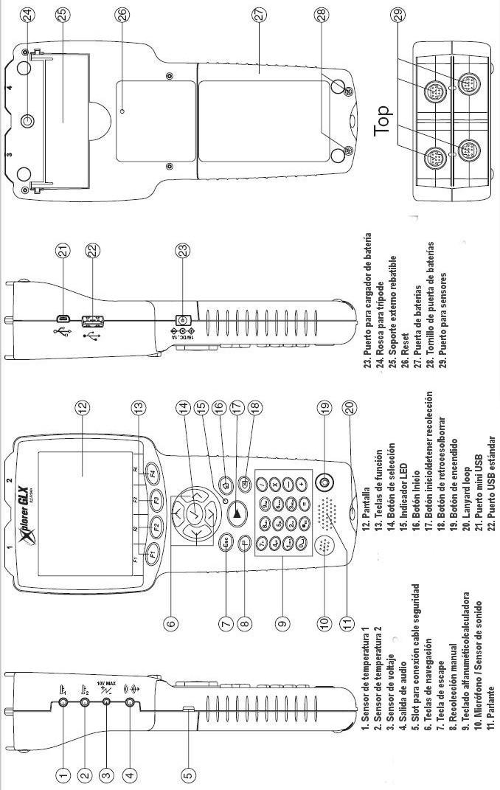

# Anexo: Xplorer GLX

Universidad Tecnologica Nacional. Facultad Regional Resistencia. Cátedra: Física
II.

## Referencias de la figura

1. Sensor de temperatura 1
1. Sensor de temperatura 2
1. Sensor de voltaje
1. Salida de audio
1. Slot para conexión cable seguridad
1. Teclas de navegación
1. Tecla de escape
1. Tecla de menú
1. Teclado alfanumérico/calculadora
1. Micrófono / Sensor de sonido
1. Parlante
1. Pantalla
1. Teclas de función
1. Botón de selección
1. Indicador LED
1. Botón Inicio
1. Botón iniciar/detener recolección
1. Botón de retroceso/borrar
1. Botón de encendido
1. Lanyard loop
1. Puerto mini USB
1. Puerto USB estándar
1. Puerto para cargador de batería
1. Rosca para trípode
1. Soporte externo rebatible
1. Reset
1. Puerta de baterías
1. Tornillo de puerta de baterías
1. Puerto para sensores

## Procedencia y transcripción

Fuente: `2015/FISICA II - EXPERIENCIAS DE LABORATORIOS.pdf`, página 98. El
título de esta nota es editorial: la página original presenta el diagrama sin
título de sección. Se conserva el bitmap JPEG original sin recodificar, en la
orientación impresa. Las veintinueve etiquetas se transcriben para facilitar su
lectura; «Slot», «Lanyard loop» y «Reset» se conservan en inglés. La capa
textual del PDF omite el diagrama y todas sus etiquetas; se cotejaron
visualmente. Véase
[el inventario de fuentes](../../../resources/2015/fuentes.md).
