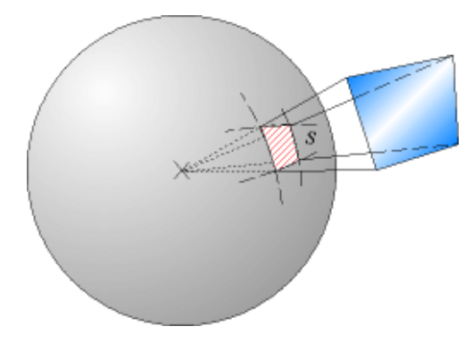

# Ángulo sólido

El **ángulo sólido** es el ángulo espacial que abarca un objeto visto desde un
punto dado, que se corresponde con la zona del espacio limitada por una
superficie cónica. Mide el tamaño aparente de ese objeto.



La unidad del ángulo sólido en el SI es el estereorradián, cuyo símbolo es
**sr**. Es el área del casquete esférico, en una esfera de radio unidad,
abarcado por un cono cuyo vértice está en el centro de la esfera. Es una
magnitud adimensional que se representa con la letra griega Ω.

Para calcular el ángulo sólido bajo el cual se ve un objeto desde un punto, se
proyecta el objeto sobre una esfera de radio R conocido, centrada en el punto de
vista. Si la superficie de la proyección del objeto sobre la esfera es S, el
ángulo sólido bajo el cual se ve el objeto es, por definición:

```math
\Omega=\frac{S}{R^2}
```

Si la superficie es la de una esfera, el ángulo sólido obtenido desde el centro
es:

```math
\Omega=\frac{S}{R^2}=\frac{4\pi R^2}{R^2}=4\pi
```

## Procedencia y observaciones de transcripción

- Original: `2015/UNIDAD 1 Fuerza electrica y campo electrico-1.pdf`,
  páginas24–25 de41. No constan autor ni fecha propios en estas páginas.
- SHA-256: `1130cc5160c8a6f87578f071f70595c679fb1535a8899aa02e13c9b0d093da07`.
- Herramientas: PyMuPDF y Poppler; cotejo visual de las dos diapositivas,
  ecuaciones y figura, conservada por render PyMuPDF.
- La página24 muestra un rótulo R aislado junto al borde superior derecho; queda
  registrado aquí sin atribuirlo por conjetura a un elemento del dibujo. No se
  agregan desarrollos a la definición original.
