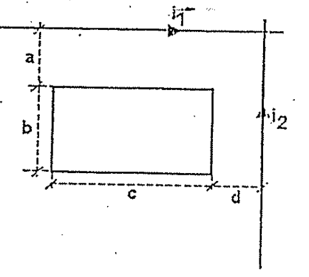
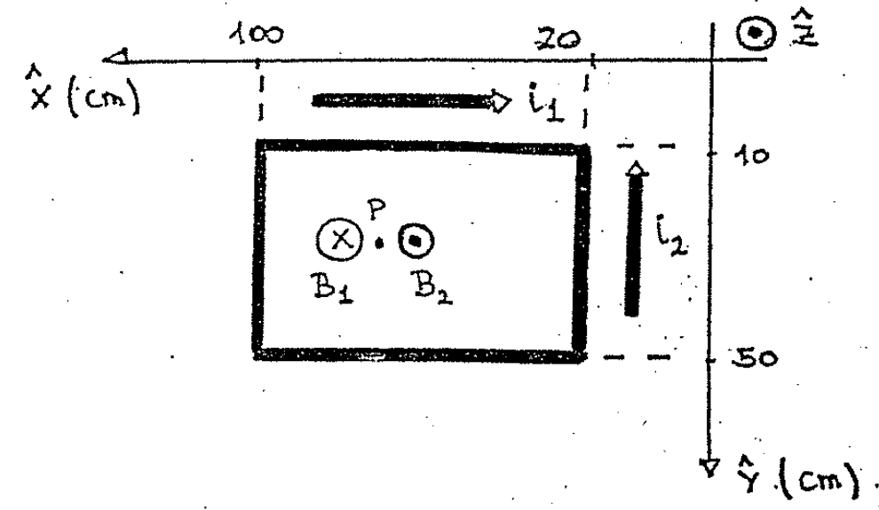
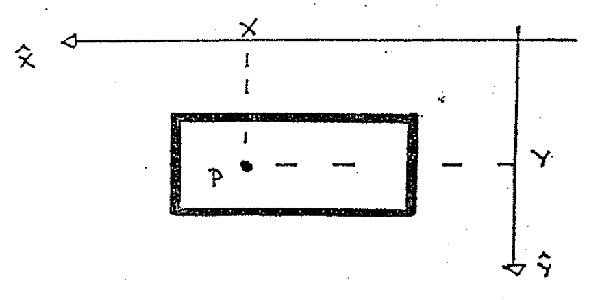

# Biot–Savart — Anibal Kasero: bobina cercana a dos conductores

## Enunciado

Una bobina de 50 espiras se encuentra cercana a dos conductores coplanares con
ella por los los circulan corrientes i₁ e i₂. Calcular:

a) El flujo de inducción magnética que la atraviesa.

b) Si i₁ conserva su valor, ¿Cuánto debería valer i₂ para que dicho flujo fuera
nulo?

Datos: i₁ = 50 A; i₂ = 200 A; a = 10 cm; b = 40 cm; c = 80 cm; d = 20 cm.

Rta.:

```math
\phi_T=-1{,}29\cdot10^{-5}\;\mathrm{Wb}\qquad;\qquad
\phi_{B_1}=\phi_{B_2}\qquad i_2=160\;\mathrm A
```



## a) Flujo

El ejercicio es similar al anterior, se busca el flujo del campo magnético a
través de una superficie. La superficie está compuesta por una bobina
rectangular formada por 50 espiras. En realidad NO influye para nada la cantidad
de espiras, para hallar el flujo solo nos importa la superficie formada por esta
bobina.

Tenemos que comenzar hallando los campos generados por los conductores uno (i₁)
y dos (i₂) en un punto P en el interior del rectángulo. El origen del sistema de
referencias lo elegimos en el punto donde se intersectan los conductores con
corriente.



Ya conocemos la dirección de los campos, el campo $`\vec B_1`$ es entrante
$`(-\hat z)`$ mientras que $`\vec B_2`$ es saliente. Vamos a suponer que el
punto P tiene coordenadas cualesquiera (x,y) dentro del rectángulo.



En los ejercicios anteriores vimos como son las expresiones de los campos
generados por conductores rectilíneos a una cierta distancia r de ellos mismos:

```math
B=\frac{\mu_0i}{2\pi r}
```

El punto P dista y del cable1 y x del cable2, entonces la magnitud y dirección
de los campos son:

```math
\vec B_1=\frac{\mu_0i_1}{2\pi y}(-\hat z)
```

```math
\vec B_2=\frac{\mu_0i_2}{2\pi x}(\hat z)
```

Para encontrar el flujo vamos a tener que hacer la cuenta:

```math
\phi=\int_S\vec B\cdot\hat n\,ds
```

para cada campo por separado. La normal a la superficie es única (es la misma) y
la podemos elegir como $`\hat n=\hat z`$ (saliente del plano).

Calculemos el flujo1: φ₁. Nuevamente el diferencial ds es dxdy y la integral es
doble, pero como vimos esto no es una dificultad.

```math
\phi_1=\iint_S\vec B_1\cdot\hat n\,dx\,dy
=\iint_S\frac{\mu_0i_1}{2\pi y}(-\hat z)\cdot\hat z\,dx\,dy
```

```math
\phi_1=\frac{\mu_0i_1}{2\pi}(-1)\iint_S\frac1y\,dx\,dy
```

El −1 proviene del producto escalar de los versores.

Los límites de integración los vemos fácilmente de la figura.

```math
20\le x\le100\qquad10\le y\le50
```

Hacemos una integración en cada variable:

```math
\phi_1=-\frac{\mu_0i_1}{2\pi}\cdot\int_{20}^{100}dx\cdot\int_{10}^{50}\frac{dy}y
```

```math
\phi_1=-\frac{\mu_0i_1}{2\pi}\cdot(100\mathrm{cm}-20\mathrm{cm})\cdot
\ln\left(\frac{50\mathrm{cm}}{10\mathrm{cm}}\right)
```

```math
\phi_1=-\frac{4\pi\cdot10^{-7}}{2\pi}\;\frac{\mathrm{Wb}}{\mathrm{A}\,\mathrm m}
\cdot50\;\mathrm A\cdot0{,}8\;\mathrm m\cdot\ln(5)
=-1{,}29\cdot10^{-5}\;\mathrm{Wb}
```

```math
\phi_1=-1{,}29\cdot10^{-5}\;\mathrm{Wb}
```

Ahora buscamos el flujo2: φ₂.

```math
\phi_2=\iint_S\vec B_2\cdot\hat n\,dx\,dy
=\iint_S\frac{\mu_0i_2}{2\pi x}(\hat z)\cdot\hat z\,dx\,dy
```

```math
\phi_2=\frac{\mu_0i_2}{2\pi}\iint_S\frac1x\,dx\,dy
```

```math
\phi_2=\frac{\mu_0i_2}{2\pi}\cdot\int_{20}^{100}\frac{dx}x\cdot\int_{10}^{50}dy
```

```math
\phi_2=\frac{\mu_0i_2}{2\pi}\cdot\ln\left(\frac{100}{20}\right)\cdot(50\mathrm{cm}-10\mathrm{cm})
```

```math
\phi_2=4\pi\cdot10^{-7}\;\frac{\mathrm{Wb}}{\mathrm{A}\,\mathrm m}
\cdot200\;\mathrm A\cdot\ln(5)\cdot0{,}4\;\mathrm m
=2{,}58\cdot10^{-5}\;\mathrm{Wb}
```

```math
\phi_2=2{,}58\cdot10^{-5}\;\mathrm{Wb}
```

El flujo total lo hallamos con la suma de los flujos

```math
\phi=\phi_1+\phi_2=-1{,}29\cdot10^{-5}\;\mathrm{Wb}+2{,}58\cdot10^{-5}\;\mathrm{Wb}
```

```math
\phi=1{,}29\cdot10^{-5}\;\mathrm{Wb}
```

## b) Flujo nulo

Ahora el problema nos dice que el flujo total debe anularse, ya sabemos nosotros
que como los campos $`\vec B_1`$ y $`\vec B_2`$ tienen direcciones opuestas, los
flujos tienen SIGNOS opuestos. Entonces tienen que ser iguales para que el neto
sea cero:

```math
\phi_1=\phi_2
```

Vamos a usar las expresiones que hemos hallado para los flujos y dejamos como
incógnita i₂:

```math
\phi_1=\frac{\mu_0i_1}{2\pi}\cdot80\;\mathrm{cm}\cdot\ln(5)
```

(Sin tener en cuenta el signo.)

```math
\phi_2=\frac{\mu_0i_2}{2\pi}\cdot40\;\mathrm{cm}\cdot\ln(5)
```

Igualamos las expresiones,

```math
\frac{\mu_0i_1}{2\pi}\,80\;\mathrm{cm}\,\ln(5)
=\frac{\mu_0i_2}{2\pi}\,40\;\mathrm{cm}\,\ln(5)
```

Simplificando queda:

```math
i_1\cdot2=i_2
```

Nos queda

```math
i_2=100\;\mathrm A
```

## Procedencia y discrepancias conservadas

- Original: `2015/Resueltos Fisica II Anibal Kaseros Ley de Biot-Sabat.pdf`,
  página44 desde el segundo enunciado, páginas45–48 y página49 hasta el
  separador. SHA-256:
  `b4aeb8cc9f1fa04835d4817a067976cc3d3c07d57e18ca5dabd898b67e09d41e`.
- OCR español auxiliar y cotejo visual completo. Tres figuras originales.
  Respuesta impresa ampliada para comprobar «160 A»; no se copia el resultado de
  la solución.
- La respuesta impresa tiene flujo negativo e i₂ =160A; el desarrollo manuscrito
  da flujo positivo e i₂ =100A. Ambos se preservan, sin elegir una versión.
- En la sustitución numérica manuscrita de φ₂ falta el divisor2π que aparece en
  los pasos anteriores. Se conserva esa omisión y su resultado literal.
- Se mantiene la afirmación del autor sobre las50espiras, sin agregar un factor
  N ni corregir su interpretación. «Por los los circulan» pertenece al
  enunciado.
